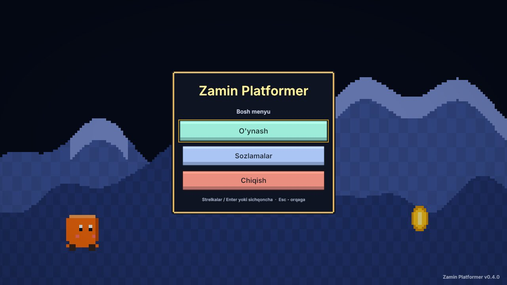

# Zamin Engine: the runtime player and export

This guide is about **Zamin Player** (`ZaminPlayer`), which runs a game outside the editor: how to
start it, the command line, where the settings come from, the log and crash reports, the version information, the cursor
and display APIs, the game menu sample, the exported game folder, and testing the player automatically
(the performance test and the export test). The project settings themselves (window, splash, quality, language ...) are covered in detail
in [ProjectSettings.md](ProjectSettings.md), the scene flow in [Scenes.md](Scenes.md).

## Contents

1. [What the player is and how it starts](#1-what-the-player-is-and-how-it-starts)
2. [The startup sequence](#2-the-startup-sequence)
3. [Settings and their precedence](#3-settings-and-their-precedence)
4. [The command line](#4-the-command-line)
5. [In-game keys and the window](#5-in-game-keys-and-the-window)
6. [Log files](#6-log-files)
7. [Crash reports](#7-crash-reports)
8. [Version information](#8-version-information)
9. [For scripts: the display and cursor APIs](#9-for-scripts-the-display-and-cursor-apis)
10. [The game menu sample](#10-the-game-menu-sample)
11. [Export](#11-export)
12. [The performance test (headless)](#12-the-performance-test-headless)
13. [The export test (automatic)](#13-the-export-test-automatic)
14. [Environment variables for automation](#14-environment-variables-for-automation)
15. [Problems and solutions](#15-problems-and-solutions)
16. [Tests](#16-tests)
17. [A short API reference](#17-a-short-api-reference)

---

## 1. What the player is and how it starts

`ZaminPlayer` is the game itself: no editor, no ImGui, only the game window. It opens a `.zproject` file, loads the script
module (`lib<Game>.so`) and starts the start scene through the `SceneManager` (additional
scenes, `DontDestroyOnLoad`, background loading, transitions - [Scenes.md](Scenes.md)).

```bash
# During development: a project file or folder
./build/bin/ZaminPlayer Projects/Platformer2D
./build/bin/ZaminPlayer Projects/Platformer2D/Platformer2D.zproject --scene Menu --windowed

# An exported game: the start script (opens the Game/*.zproject next to the player)
./Platformer2D.sh
./Platformer2D.sh --fullscreen --lang en
```

When no project is given, the player looks for the first `.zproject` in the `Game/` folder next to it (then in its own folder) -
this is how an exported game works. When no project is found it exits with a message (exit code 1).

The start scene: `--scene`, otherwise the project's `StartScene`, and when that is not found the first enabled scene of the
build list. When the first scene does not load, the window does not close: an **error screen** shows what is broken (Esc - exit),
and when switching to another scene fails during the game, a red bar stays at the top for a few seconds.

## 2. The startup sequence

1. The **command line** is read (`PlayerCommandLine::Parse`). With `--help` or `--version` the text is printed and the
   player ends without a window.
2. The **project file** is read (for the window settings), and so are the **display settings** the game saved (SaveData) - before the
   window is created, so a game that was closed in fullscreen opens in fullscreen right away.
3. The **log file** is opened (section 6) and the **crash handler** is installed (section 7).
4. The window is created with each value taken from its strongest source (`PlayerLaunchSettings::Resolve`, section 3); the log
   says where each value came from.
5. The project opens: the icon, the quality level, the language, the sound, gamma / brightness, debug drawing, the script module.
6. The **splash screen** (the Zamin logo or the game's picture, ~2 s) - meanwhile the first scene loads in the background. A key
   press skips it (when the scene is ready). `--no-splash` or the project setting turns it off.
7. The game starts; its first frames fade in from the splash color.

The log always starts with:

```
Zamin Engine 0.1.0 (commit 40a7394f2c, build 2026-11-07, Release, GCC 13.3.0) is starting (Zamin Player)
Log file: /home/ali/.local/share/Zamin Studio/Zamin Platformer/logs/player-2026-11-07_14-03-12.log
Window settings: 1600x900 (saved), windowed (project), VSync: yes (project), FPS: unlimited (project), monitor: primary (project), splash: yes (project)
Zamin Platformer 0.4.0 (Zamin Studio)
Script module loaded: libPlatformer2D.so (25 script classes)
```

## 3. Settings and their precedence

Each setting is taken separately from its strongest source:

1. **the command line** (`--resolution`, `--fullscreen`, `--fps`, `--quality`, `--lang`, `--gamma` ... - section 4);
2. **the player's saved choice** - what the game's settings menu saved (SaveData);
3. **the project settings** (Project settings > Player, Graphics, Quality, Localization).

| Setting | The API that saves it | SaveData keys |
|---|---|---|
| Screen size | `Display::SetResolution` + `Display::SaveSettings` | `Zamin.Display.Width`, `.Height` |
| Fullscreen, VSync | `Display::SetFullscreen` / `SetVSync` + `SaveSettings` (F11 saves too) | `Zamin.Display.Fullscreen`, `.VSync` |
| Gamma, brightness | `Display::SetGamma` / `SetBrightness` + `SaveSettings` | `Zamin.Display.Gamma`, `.Brightness` |
| Quality level | `Quality::SetLevel` + `Quality::SaveSettings` | `Zamin.Quality` |
| Sound groups | `Audio::SetGroupVolume` + `Audio::SaveSettings` | `Zamin.Audio` |
| Language | `Localization::SetLanguage` + `Localization::SaveSettings` | `Zamin.Localization` |

The SaveData file: `~/.local/share/<company>/<game>/savedata.json` (`~/.local/share/zamin/<game>/` when the company is
empty; `$XDG_DATA_HOME` is taken into account). Deleting it forgets every choice.
The screen size is saved only when the game chooses it (`SetResolution`): a window the player stretched with the mouse
does not become the size next time. Games without a settings menu work as before - nothing is saved,
the project settings are used.

## 4. The command line

```
ZaminPlayer [Game.zproject | project folder] [options]
```

Options with a value are written as `--fps 60` or `--fps=60`. An option that is not understood, or a wrong value, is written
to the log as a warning, and the rest are used. `ZaminPlayer --help` - all of them.

| Option | Meaning |
|---|---|
| `--windowed`, `--fullscreen`, `--borderless` | The window mode (the last one wins) |
| `--resolution WxH`, `--width W`, `--height H` | The window size (with `--fullscreen` the monitor's video mode too) |
| `--monitor N` | Which monitor it opens on (0 - the primary) |
| `--vsync`, `--no-vsync` | Vertical sync |
| `--fps N` | A frame rate limit (0 - unlimited) |
| `--jobs N` | The job system's worker threads (default: processor threads - 1; 0 - off, all work on the main thread). Independent particle systems and animator poses are computed in parallel |
| `--scene <path / index / name>` | The start scene: `Scenes/Level2.zscene`, `2` (the build index) or `Level2` |
| `--quality <name / index>` | The quality level (`Low`, `High` ...) |
| `--lang <code>`, `--language <code>` | The language (`uz`, `ru`, `en` ...) |
| `--no-splash` | Without the splash screen |
| `--gamma G`, `--brightness B` | The picture's gamma (0.5 ... 2.0) and brightness (0.5 ... 1.5) |
| `--gl 4.1/4.3/4.5/4.6`, `--msaa N`, `--gl-debug`, `--no-gl-debug`, `--srgb`, `--no-srgb` | The OpenGL context |
| `--no-debug-draw`, `--debug-raycasts`, `--debug-contacts`, `--debug-contact-details`, `--debug-joints`, `--debug-velocities`, `--debug-nav`, `--debug-nav-cells` | Debug drawing (not in a Shipping build; `--debug-nav` - navigation and AI) |
| `--log-file <file>`, `--no-log-file` | The log only to this file / without a log file |
| `--log-level <level>` | The log levels: `warn` (both loggers), `engine=warn,app=info,file=error` (section 6) |
| `--no-crash-handler`, `--no-crash-dialog` | Without a crash report (debugger, core dump) / a report but no window |
| `--benchmark N` (+ `--benchmark-warmup`, `--benchmark-out`, `--benchmark-max-avg`, `--benchmark-max-p95`) | The performance test (section 12) |
| `-v`, `--version` | The game and engine versions (section 8) |
| `-h`, `--help` | Help |

## 5. In-game keys and the window

| Key | What it does |
|---|---|
| **F11**, **Alt+Enter** | Fullscreen <-> window (back to the previous size and place; the choice is saved). The `ToggleFullscreen` action of the input map too. It can be turned off in the project (`FullscreenToggle`) |
| **F10** | The FPS and the audio profile to the log |
| **Esc** | On the error screen - exit; in games usually the pause menu |

- **When the window size changes**, the camera, the UI scale (canvas scaler) and the render targets adapt to the new size every
  frame. When the project has a **fixed aspect ratio** on, the game picture keeps that ratio, with bars at its
  edges (the mouse is counted inside the picture).
- **A minimized window** - the game is not updated and not drawn, the CPU is not busy; time does not jump when it comes back.
- When **running in the background is off** (`RunInBackground: false`), the game stops when the window loses the focus (time,
  physics, scripts, sound) and the last frame is shown dimmed with a "Paused" label.
- **The FPS limit** (`TargetFrameRate` / `--fps`) works together with VSync: VSync itself holds a limit that divides the monitor's
  refresh rate, the others use precisely scheduled waiting (sleep + a short spin).

More: [ProjectSettings.md, section 4](ProjectSettings.md#4-player-oyna-nom-versiya-ikonka).

## 6. Log files

Every run writes its own log file:

```
~/.local/share/<company>/<game>/logs/player-<date_time>.log    (the latest 5 are kept)
~/.local/share/<company>/<game>/logs/latest.log                (always the last run)
```

The file starts with the game's name and version, the engine build (commit, date), the start time, the project and the command
line; the messages from before the file was opened are included too. Every line goes to disk at once - the log stays complete
even on a crash. A line looks like `[14:03:12] ERROR APP: ...` (levels: `TRACE`, `INFO`, `WARN`, `ERROR`,
`CRITICAL`; `ZAMIN` - the engine, `APP` - the game scripts). `--log-file <path>` writes only to that file,
`--no-log-file` works without a log file (the terminal only).

### Log levels

There are two loggers - the engine's (`ZAMIN`, `ZM_CORE_INFO` ...) and the game's (`APP`, `ZM_INFO` ...) - each with its
own minimum level: a message below it is not written anywhere (the macro does not even format the text, so a
disabled `ZM_CORE_TRACE` is almost free). The log file has its own level too: for example everything in the terminal,
only warnings and errors in the file. Levels: `trace`, `info`, `warn`, `error`, `critical`, `off`.

Where from (each later one wins over the earlier ones):

1. **Project settings > Player > Log**: the levels of the engine, the game scripts and the file, whether a log file is
   written and how many old files are kept (default: everything, a file, 5). In the `.zproject`
   `"Player": { "Log": { "Engine": "info", "App": "trace", "File": "warn", "WriteFile": true, "Keep": 5 } }`
   (not written when unchanged).
2. The **`ZAMIN_LOG_LEVEL`** environment variable.
3. **`--log-level`**: `warn` - both loggers; `engine=error,app=info,file=warn` - separately (keys: `engine` /
   `zamin` / `core`, `app` / `game`, `file`, `all` / `*`; separated by `,` `;` or a space).

```
ZaminPlayer Game.zproject --log-level warn                    # only warnings and errors
ZaminPlayer Game.zproject --log-level engine=warn,file=error  # a quieter engine, only errors in the file
ZAMIN_LOG_LEVEL=app=trace ZaminPlayer Game.zproject
```

The editor: **Preferences > Log > Log levels / Log file** (the editor's own log file:
`~/.local/share/zamin/editor/logs/editor-<date>.log` and `latest.log`), the levels in the console's ⚙ menu too;
`ZaminEditor <project> --log-level ...` and `ZAMIN_LOG_LEVEL` win over the preferences at startup. In code:
`Log::SetLevel(LogSource::Engine, LogLevel::Warn)`, `Log::SetFileLevel(...)`, `LogLevelSettings`,
`LogLevelOverride::Parse("engine=warn")`.

## 7. Crash reports

When the game crashes (SIGSEGV, SIGABRT, SIGFPE, SIGILL, SIGBUS or an uncaught C++ exception), `crash-<date_time>.txt` is
written to the log folder:

```
=== Zamin crash report ===
Program: Zamin Player
Game: Zamin Platformer 0.4.0
Engine: Zamin Engine 0.1.0 (commit 40a7394f2c, build 2026-11-07, Release, GCC 13.3.0)
Reason: SIGSEGV (segmentation fault) - address 0x8
Backtrace: ...
Last log lines: ...
Loaded modules: ...
```

Then a message window opens in a separate process: `zenity`, `kdialog`, otherwise the player's own window
(`ZaminPlayer --crash-dialog <report>`: the reason, the report path, "Open folder", "Copy path", "Close"),
finally `xmessage`. Ask the player to send this file - it has the commit, so you know exactly which code the error
comes from. The signal handler uses only safe (async-signal-safe) calls; the program ends with the usual signal
exit code. `--no-crash-handler` - for a debugger / core dump, `--no-crash-dialog` - without the window.
In automatic runs (`ZAMIN_MAX_FRAMES`, `--benchmark`) the window is not shown.

**Asserts.** `ZM_ASSERT(condition, "message {}", value)` / `ZM_CORE_ASSERT` are checked in Debug builds (and in a
Release built with `-DZAMIN_ASSERTS=ON`). On a failure a `CRITICAL` line goes to the log (the expression, the message,
`file:line`, the function), then: with a debugger attached it stops at that place, otherwise the program `abort`s and
the reason in the crash report is `Reason: assert failed - <expression> - <message> (File.cpp:123, Function)`.
`ZM_VERIFY(condition, ...)` is checked in every build and returns its result (`if (!ZM_VERIFY(p)) return;`);
it never stops the program. `ZAMIN_ASSERT=auto|break|abort|continue` changes the behavior.
In the editor a `ZM_ASSERT` in a game script is only written to the log (the editor does not close).

## 8. Version information

```
$ ./Platformer2D.sh --version
Zamin Platformer 0.4.0 - Zamin Studio
Zamin Engine 0.1.0
  Commit:  40a7394f2c (2026-11-07)
  Build:   2026-11-07, Release, GCC 13.3.0
```

- **The game version** - Project settings > Player > Version (`1.4.2`, semver), the name - Product name.
- **The engine build** (`BuildInfo`) is written at build time (`cmake/GenerateBuildInfo.cmake`): the git commit (10
  characters), changes on top of the commit (`-dirty`, "[with changes]"), the commit date, the build date (UTC, the day;
  `SOURCE_DATE_EPOCH` when it is set), the build type and the compiler. In a build without git the commit is "unknown". The file is
  rewritten only when something changed - the engine is not recompiled on every build.
- Where it shows up: `--version`, the start of every log file, the crash report, the editor's Help > "About Zamin"
  window (with a "Copy version" button), the corner of the Platformer2D settings menu and the corner of the pause
  menu (`VersionInfo::FormatShort()`: `Zamin Platformer v0.4.0  |  Zamin Engine 0.1.0 (40a7394)`).

From a script:

```cpp
VersionInfo v = VersionInfo::ForActiveProject();
SetText(VersionLabel, v.FormatShort());                    // one line for the menu corner
ZM_INFO("{}", BuildInfo::Get().Describe());                // "Zamin Engine 0.1.0 (commit ..., build ...)"
Application::GetVersion(); Application::GetProductName();  // the game's version and name
```

## 9. For scripts: the display and cursor APIs

### The display (`Display`)

The player binds its window to `Display`; the game's settings menu changes the window through it. In the editor's
Play mode no window is bound: the values are only saved (the editor window does not change), while gamma / brightness
work in the game view. Every Play starts like the player (`Display::ResetOptions`: the project's window mode and
VSync, no chosen size, gamma 1; then the saved ones are loaded) and returns to that state on Stop - something changed in one
run does not carry over to the next. The size list in Play is the editor monitor's (no size larger than the screen
is offered). When the player window opens and the saved / requested window size is larger than the monitor,
it is fitted to the monitor keeping its ratio.

```cpp
// Screen size: the monitor's video modes (without a window - the editor monitor or 1280x720 ... 2560x1440), the current
// size is always in the list.
std::vector<ScreenResolution> sizes = Display::GetResolutions();
Display::SetResolution(1920, 1080);     // the window size in windowed mode, the video mode in exclusive fullscreen
ScreenResolution r = Display::GetResolution();

Display::SetFullscreen(true);           // the project's fullscreen kind (exclusive or borderless)
Display::SetVSync(false);
Display::SetGamma(1.2f);                // 0.5 ... 2.0
Display::SetBrightness(0.9f);           // 0.5 ... 1.5
Display::SaveSettings();                // the next run opens with these
// The "Defaults" button: the way the next run would open (the project's window mode, VSync), the saved ones are deleted.
Display::ResetOptions(Project::GetPlayerSettings());
Display::ClearSavedSettings();
```

### The cursor (`Cursor`)

```cpp
Cursor::SetLockMode(CursorLockMode::Locked);    // hidden, in place: mouse look with Input::GetMouseDelta()
Cursor::SetLockMode(CursorLockMode::Confined);  // stays inside the window
Cursor::SetVisible(false);
Cursor::SetImage("Textures/crosshair.png", { 16, 16 });   // your own picture (hotspot); Cursor::ClearImage()
Cursor::SetShape(CursorShape::Hand);                      // the system shapes
Cursor::SetReleaseWhenPaused(true);                       // free and visible during a pause (the default)
Cursor::Reset();
```

The requests are applied to the window every frame; when the window loses the focus, when the game is paused (`Time::SetPaused`) or
when Play stops, the system cursor comes back. In the editor it works while the game view has the focus, and **Esc** gives the cursor
back to the editor.

## 10. The game menu sample

Platformer2D has a reusable menu: **`Prefabs/GameMenu.zprefab`** and its script
**`GameMenu`** (`Projects/Platformer2D/Source/GameMenu.cpp`). `Menu.zscene` (the main menu) is an instance of this prefab.



*`ZaminPlayer Projects/Platformer2D --scene Scenes/Menu.zscene`: the main menu of the `GameMenu` prefab — Play,
Settings, Quit; the game version in the bottom corner.*

- **The main panel**: the game's name, "Play" (fades over to `PlayScene`), "Settings", "Quit"; the game version in the
  screen's corner.
- **The settings panel**: the screen size, fullscreen, VSync, graphics quality, gamma, sound (master, music,
  effects), language; "Back" (saves), "Defaults" (deletes the saved ones). In the panel's corner are the game and engine
  versions.
- **Controls**: the arrows / D-pad - select, Enter / A - press, Esc / B - back. Pressing the size, quality and language
  buttons moves to the next one; when one is selected, left / right picks the previous / next.
- **Saving**: "Back", or closing the menu, calls `Display` / `Audio` / `Quality::SaveSettings`, and choosing a language
  `Localization::SaveSettings` - the player opens with these settings next time (section 3).

**Adding it to your own game**: drag the prefab from the Content panel into the scene (or from a script
`Instantiate("Prefabs/GameMenu.zprefab", glm::vec3(0.0f))`) and set up the `GameMenu` fields in the inspector:

| Field | Meaning |
|---|---|
| `PauseMenu` | Off: the main menu (always visible). On: the pause menu - Esc / Start pauses the game and opens it, with "Resume" in place of "Play" |
| `PlayScene` | The scene "Play" opens (a path or a build scene name) |
| `FadeOut`, `FadeIn` | The fade out / in of the transition (seconds) |
| Panels, buttons, sliders | The entities inside the prefab (they can stay as they are) |

The menu texts use localization keys (`menu.play`, `menu.main_title`, `menu.nav_hint`, `pause.*`,
`settings.*` - including `settings.resolution` = `"Resolution: {0}"`, `settings.quality` =
`"Graphics quality: {0}"`); when moving it to another game, add these keys to your language files
(copy them from `Projects/Platformer2D/Assets/Localization/*.json`). The pause menu of levels 1-3
(`PauseMenu`, M12) is kept too - it shows the sound, display, gamma and language settings and the version in the corner.

## 11. Export

In the editor **File > Build game...** exports the game to a folder:

```
<folder>/
  Platformer2D.sh              the start script (changes to its own folder, ZaminPlayer Game/Platformer2D.zproject)
  ZaminPlayer, libZamin.so     the player and the engine (stripped)
  Resources/                   the engine resources (fonts)
  Game/Platformer2D.zproject   the project file
  Game/Assets/                 only the assets in use (+ .zmeta, the binary cache of the scenes .zsceneb)
  Game/AssetRegistry.zreg      the asset registry (only the exported ones)
  Game/Binaries/libPlatformer2D.so  the script module (Release, -O2, strip)
  Platformer2D.desktop         a relocatable menu entry (it runs the script next to it)
  Platformer2D.png, icons/hicolor/<size>/apps/zamin-platformer2d.png   the icon (16 ... 256 px)
  install-desktop-entry.sh     installs the game into the applications menu (--uninstall - removes it)
  export-report.json, export-report.txt   the export report
  excluded-assets.txt          the excluded assets (when there are any)
```

- **Unused assets are left out**: the build scenes and everything needed through them
  (prefabs, materials, models, clips), the files named in the project file and in the `"..."` strings of the C++ code,
  `Resources/`, the language files and the "Always include" list. More: [ProjectSettings.md, section 12](ProjectSettings.md#12-build-sahnalar).
- **The script module in Release** is recompiled in a separate build folder (`<project>/Build/ExportRelease`);
  the binaries are `strip`ped (~218 MB -> ~37 MB). Both can be turned off.
- **The export checks itself** (`ExportFiles::CheckExportFolder`): the start script (with execute permission),
  the player, the engine, `Resources/`, the project file, its start and build scenes, the asset registry, the script module,
  the `.desktop` and the install script must be in place - the missing ones go into the report as errors. When the script module
  is not found (not compiled) the game is exported without scripts - this is not an error but a warning.
- **The report window** opens when the export finishes: the total size, the size by type, the largest files, the
  excluded assets, the warnings and errors (File > "Export report" - reopens it).
- The exported folder can be moved anywhere or archived: the script and the `.desktop` work from where they are.
  A `.desktop` can only point to the icon with a full path (the standard does not accept a relative one): when the game first
  starts from a new place, the launcher (`<Game>.sh`) fixes the `Icon=` line of the `.desktop` next to it to point to this folder.
  To add it to the applications menu, run `./install-desktop-entry.sh` in the new place.

## 12. The performance test (headless)

`--benchmark N` - instead of the game, **measuring N frames** of its start scene (or `--scene`): the splash, the FPS
limit and VSync are turned off (unless `--vsync` / `--fps` are given on the command line), and it runs in the background too; first
`--benchmark-warmup` (default 60) frames warm up (shaders, caches, the scene's first frames), then the time of each frame
is recorded. The result is in the log and in the `--benchmark-out` JSON file, and the exit code is **0** - passed, **3** - over a limit
(`--benchmark-max-avg MS`, `--benchmark-max-p95 MS`), **2** - it did not run (the scene did not load, the player closed before N frames
were measured - the window was closed, the game called `QuitGame`, `ZAMIN_MAX_FRAMES` - or the `--benchmark-out` file was not
written). Even when the test does not get to the end, the result (with the frames measured, "not passed") is written to the log and the file.

```bash
xvfb-run -a ./build/bin/ZaminPlayer Projects/Showcase3D --benchmark 300 --benchmark-out bench.json --resolution 1280x720
```

```
Benchmark: Zamin Showcase 3D 1.2.0 - Scenes/Showcase.zscene (1280x720, llvmpipe (LLVM 20.1.2, 256 bits))
  300 frames (after 60 warm-up frames), 21.70 s; loading 0.10 s
  Frame:     average 72.35 ms (13.8 FPS), median 70.45, p95 87.21, p99 92.70, min 67.13, max 92.83 ms
  Update:    average 65.82 ms (15.2 FPS), ... (game update and draw calls, without swap)
```

- **Frame** - from the start of one frame to the start of the next (update, draw, swap); **Update** - the player's own
  update and draw calls (without the swap). The percentiles use the "nearest rank" method: p95 is the smallest time that 95% of
  the frames were not slower than (`FrameTimeStats`).
- JSON: `Game`, `GameVersion`, `Scene`, `Engine` (the build), `Renderer` (the GPU), `Width`, `Height`, `Warmup`, `Seconds`,
  `LoadSeconds`, `Frame` / `Update` (`Count`, `Average`, `Median`, `P95`, `P99`, `Min`, `Max`, `StdDev`,
  `AverageFPS`, `Low1PercentFPS`), `Limits`, `Passed`, `Failures`, `Frames` (every frame, ms).
- **A script for the sample games**: `Tests/player_bench.sh` (or `cmake --build build --target player_bench`) measures the three
  samples without a display (xvfb) and prints a table; the reports are in `build/PlayerBench/`:

```
Project          avg ms   med.ms   p95 ms   p99 ms      FPS  result
Platformer2D      8.962    8.925    9.383    9.492  111.582  passed
Showcase3D       79.034   77.437    89.79  104.076   12.653  passed
Adventure3D     107.708  107.109  112.551   123.94    9.284  passed
```

  Options: `--frames N`, `--warmup N`, `--project <folder>` (several times), `--scene`, `--resolution`,
  `--max-avg MS`, `--max-p95 MS`, `--out <folder>`; the rest go to the player (`--quality Low` ...). Every run uses a clean
  HOME (the saved settings have no effect). There is no GPU under Xvfb (llvmpipe - drawing on the processor): use the numbers
  to compare changes on one machine, not against the FPS on a real GPU.

## 13. The export test (automatic)

`Tests/export_test.sh` (or `cmake --build build --target export_test`) checks the export from start to finish:

1. the editor exports Platformer2D to a temporary folder (`ZAMIN_EDITOR_EXPORT`, xvfb) - exit code 0,
   `"Succeeded": true` in `export-report.json`, the export's own check without errors;
2. `<Game>.sh --version` gives the game name and the engine version;
3. the exported game runs its start scene with `--benchmark` through its start script -
   exit code 0, no `ERROR` / `CRITICAL` in its log, the script module loaded, the result file present;
4. it still starts after the folder was moved elsewhere.

```
Export test: Platformer2D (Zamin Platformer) -> /tmp/zamin-export-test.XXXX/export
  [OK]   the editor finished the export (exit code 0)
  [OK]   export-report.json: success (a report of 34 lines)
  [OK]   --version: Zamin Platformer 0.4.0 - Zamin Studio Zamin Engine 0.1.0
  [OK]   the exported game ran 120 frames (exit code 0)
  [OK]   no errors in the game log (30 lines)
  [OK]   Script module loaded: libPlatformer2D.so (25 script classes)
  [OK]   starts after being moved to another folder too
Export test: all passed
```

Options: `--project Projects/Adventure3D`, `--frames N`, `--keep` (the temporary folder stays), `--work <folder>`.
The exit code: 0 - all passed, 1 - there is an error (the folder is kept), 2 - the editor / player was not found. The project
itself does not change (the Release module is in `<project>/Build/ExportRelease`, as the editor does it).

## 14. Environment variables for automation

| Variable | Who | Meaning |
|---|---|---|
| `ZAMIN_MAX_FRAMES=N` | all | Closes after N frames; the FPS is not limited, no splash and no crash window |
| `ZAMIN_SCREENSHOT=file.png` | all | A picture of the last frame |
| `ZAMIN_PLAYER_INPUT="<frame>:<action>;..."` | player | Keys (`Down`, `Enter` ... - pressed for one frame), `hold=W` / `release=W` (the key is held until it is released), `mouse=x,y`, `click`, `down` / `up`, `scroll=dy`; a simulated gamepad (gamepad 0, connected by its first action): `pad=A` (one frame), `padhold=A` / `padrelease=A`, `stick=LeftX,0.8` (the axis stays at that value; triggers 0..1) |
| `ZAMIN_UI_AUDIT=top,120,300` | player | The UI audit ([UI.md](UI.md#4-ui-canvas-ekranga-moslashish)): `top` — 12 frames after the active scene or the open gameplay UI panel changed, numbers — in those frames, a `UI_AUDIT scene=… frame=… {json}` line (rule violations in `Issues`); `ZAMIN_UI_AUDIT_SIZES=800x600,1920x1080` — at those sizes (without drawing), otherwise in the game view; `ZAMIN_UI_AUDIT_ELEMENTS=1` — every element too |
| `ZAMIN_SOAK_STATS=N` | player | Every N frames a `SOAK frame=… scene=… rss=<MiB> entities=… engine=<MiB>` line: the process RAM, the active scene's entities, the memory the engine counts (`Tests/slice_bench.py --soak`, memory growth in a long game) |
| `ZAMIN_SCREENSHOT_ON="<text>\|<frames>\|<file.png>[\|quit]"` | player | A picture `<frames>` (0..600) frames after the first log line with `<text>`; with `\|quit` the player closes afterwards (for example the victory screen: `SLICE_VICTORY\|120\|victory.png\|quit`) |
| `ZAMIN_DEMO=1`, `ZAMIN_DEMO_RECORDS=1`, `ZAMIN_START_LEVEL=N` | sample games | A bot plays; the bot's result becomes a record too (tests); from that level ([Samples.md](Samples.md#demo-mode)) |
| `ZAMIN_CAPTURE_FPS=N` | all | A fixed game time: every frame exactly 1/N s (`Time::SetCaptureFrameRate`) - N frames are the same game time on every computer (tests, frame-by-frame recording) |
| `ZAMIN_PLAYER_STATS=1` | player | On exit: render statistics, the last frame's scene (entities, the most common components), frame times, the profiler, audio, scene load times |
| `ZAMIN_PLAYER_SPLASH=1` | player | The splash in automatic runs too |
| `ZAMIN_FOCUS_LOSS_TEST=<frame>[:<count>]` | all | Simulates losing the focus (the background pause) |
| `ZAMIN_JOBS=N` | all | The job system's worker threads (wins over `--jobs`; 0 or `off` - off) |
| `ZAMIN_LOG_LEVEL=<level>` | all | Log levels (like `--log-level`; wins over the project / editor settings, below `--log-level`) |
| `ZAMIN_ASSERT=auto/break/abort/continue` | all | What a failed assert does (section 7) |
| `ZAMIN_EDITOR_CONSOLE=...;options` | editor | The console's settings menu (with the log levels) is open |
| `ZAMIN_EDITOR_STATS=memory` / `jobs` | editor | The Memory / Job system sections of the Statistics panel are open; memory and jobs to the log on exit |
| `ZAMIN_PLAYER_CRASH_TEST=<frame>:<segv / abort / fpe / exception / assert>` | player | A deliberate crash (`assert` - a failed `ZM_ASSERT`) |
| `ZAMIN_CRASH_DIALOG=1` | player | The crash window in automatic runs too |
| `ZAMIN_PLAYER_NO_CULLING=1`, `ZAMIN_PLAYER_NO_INSTANCING=1` | player | Frustum culling / instancing off (for a comparison) |
| `ZAMIN_EDITOR_EXPORT=<folder>` | editor | Exports the game in frame 5 and waits for it to finish |
| `ZAMIN_EDITOR_EXPORT_REPORT=<folder>` | editor | Opens an earlier export report in its window |
| `ZAMIN_EDITOR_ABOUT=1` | editor | The "About Zamin" window (version, commit, build) |

## 15. Problems and solutions

| Problem | Solution |
|---|---|
| The game opens in a very small / large window | A saved size: choose one in the settings menu, give `--resolution`, or delete `Zamin.Display.*` in `savedata.json` |
| A black screen or "Scene failed to load" | The error screen and the log say what is broken; try another scene with `--scene` |
| The scripts do not work | Is "Script module loaded" in the log? When the module is not in the export, the export check gives an error; check the project's `ScriptModulePath` |
| The game crashes | `crash-*.txt` (in the log folder): the reason, the backtrace, the commit; `--no-crash-handler` for a debugger |
| Uneven frames | `--benchmark` or `ZAMIN_PLAYER_STATS=1`; VSync and `--fps` together (section 5) |
| No icon in the applications menu / it points to the old place | After moving the folder, `./install-desktop-entry.sh` (the game's first run fixes the icon of the `.desktop` in the folder by itself) |
| Which version is running? | `./Game.sh --version`, the start of the log file or the corner of the settings menu |

## 16. Tests

`./build/bin/ZaminTests` (headless) for M18:

| Test | What |
|---|---|
| `PlayerCommandLineParser`, `PlayerLaunchSettingsPrecedence` | The command line, `--help`, the precedence |
| `PlayerSettingsFullscreenToggleAndSplash`, `SplashTimelineAndLogo`, `FramePacingPlanAndPacer` | F11, the splash, the FPS limit |
| `PlayerLogFileRotation`, `CrashHandlerReports`, `CursorApiForScripts`, `PlayerViewportFixedAspect` | The log, crashes, the cursor, the aspect ratio |
| `ExportExcludesUnusedAssets`, `ExportReleaseModuleAndStrip`, `ExportDesktopEntryRelocatableAndIcons`, `ExportReportSizesAndFiles` | Export |
| `PauseInBackgroundAudioOutput`, `DisplayGammaAndBrightness` | The background pause, gamma / brightness |
| `PlayerBenchmarkStatsAndLimits` | Percentiles, the warm-up, the limits, JSON, the `--benchmark` options |
| `ExportFolderSelfCheck` | The export folder's own check |
| `BuildInfoAndVersionText` | The `BuildInfo`, `VersionInfo` texts, `--version` |
| `DisplayResolutionSettings` | The size list, saving, the precedence (command line > saved > project) |
| `GameMenuSampleScene` | The Platformer2D main menu and prefab: navigation, size / quality / gamma / sound / language, saving, "Play", the pause mode |

The ones that need a display (not in ctest): `Tests/render_tests.sh` (the rendering regression),
`Tests/player_bench.sh` (the performance test), `Tests/export_test.sh` (the export test).

## 17. A short API reference

```cpp
// Version
BuildInfo::Get();                       // EngineVersion, Commit, Dirty, CommitDate, BuildDate, BuildType, Compiler, Shipping
BuildInfo::Get().Describe();            // "Zamin Engine 0.1.0 (commit ..., build ..., Release, GCC ...)"
VersionInfo::ForActiveProject().Format();       // the --version text
VersionInfo::ForActiveProject().FormatShort();  // one line for the menu corner
Application::GetVersion(); Application::GetProductName(); Application::GetCompanyName(); Application::GetEngineVersion();

// Display
Display::GetResolutions(); Display::SetResolution(w, h); Display::GetResolution();
Display::SetFullscreen(bool); Display::SetVSync(bool); Display::SetGamma(f); Display::SetBrightness(f);
Display::SaveSettings(); Display::LoadSettings(); Display::GetSavedSettings(); Display::ClearSavedSettings();

// Cursor
Cursor::SetVisible(bool); Cursor::SetLockMode(CursorLockMode); Cursor::SetImage(path, hotspot); Cursor::ClearImage();
Cursor::SetShape(CursorShape); Cursor::SetReleaseWhenPaused(bool); Cursor::Reset();

// The player (the engine side)
PlayerCommandLine::Parse(argc, argv); PlayerCommandLine::GetHelpText();
PlayerLaunchSettings::Resolve(config, Display::GetSavedSettings(), commandLine);
PlayerBenchmark bench(settings); bench.AddFrame(frameMs, updateMs); PlayerBenchmark::WriteJson(bench.GetResult(), path);
FrameTimeStats::Compute(ms); FrameTimeStats::Percentile(sorted, 95.0);
Application::Get().SetExitCode(code);

// Log and crashes
LogFile::OpenRotating(...); LogFile::GetPath(); CrashHandler::Install(settings);

// Export
ExportFiles::CheckExportFolder(folder, "Game"); ExportReport::Read(folder, report); ExportAssets::PlanForActiveProject();
```
