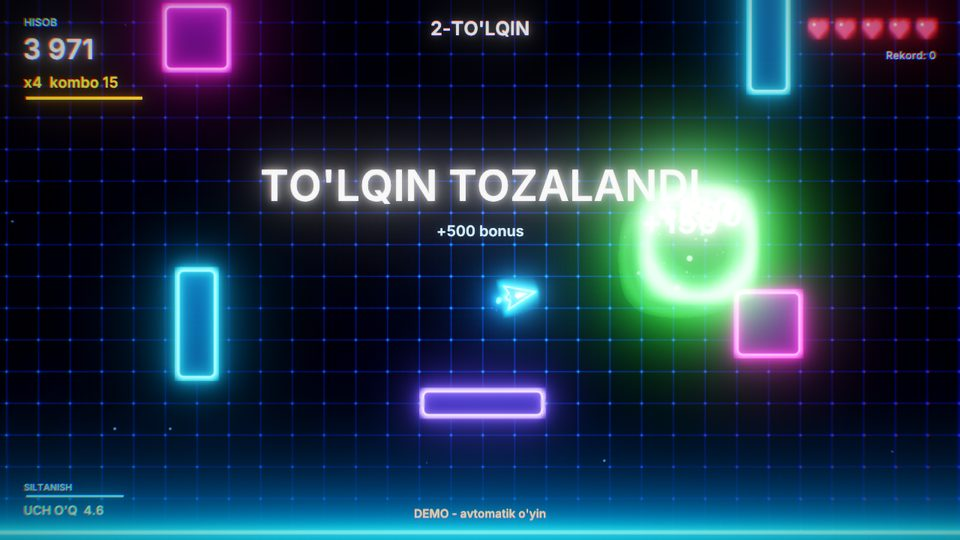
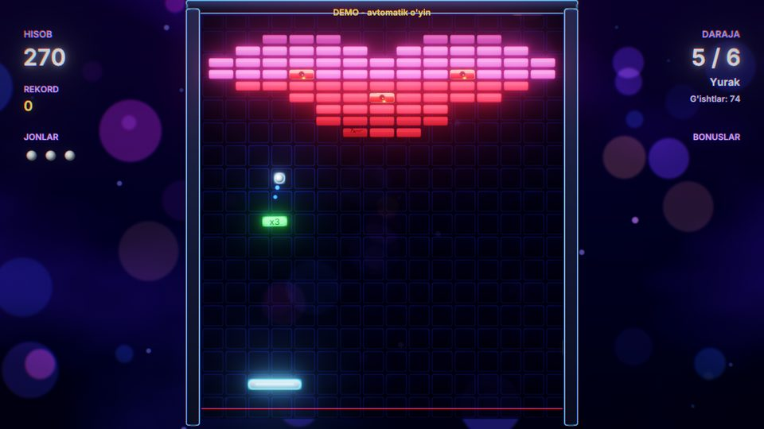
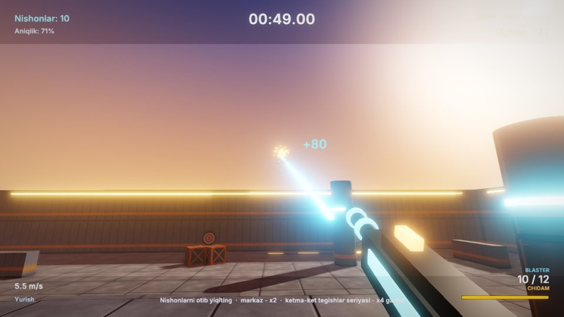
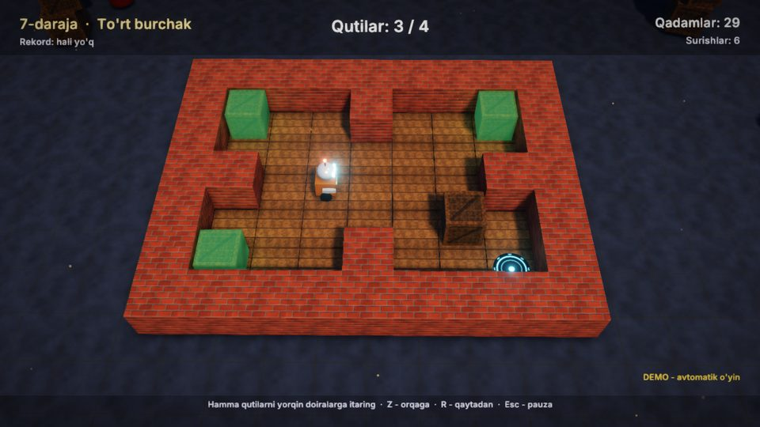
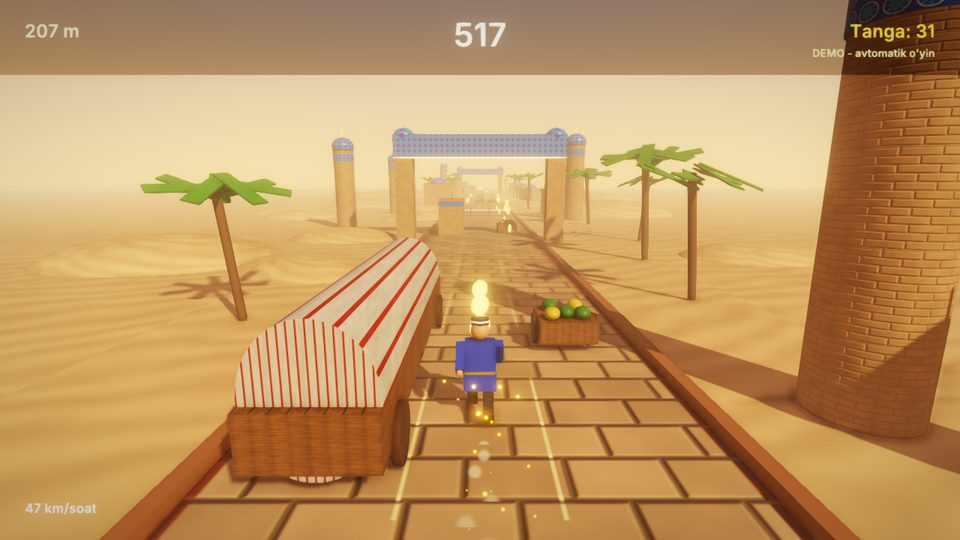
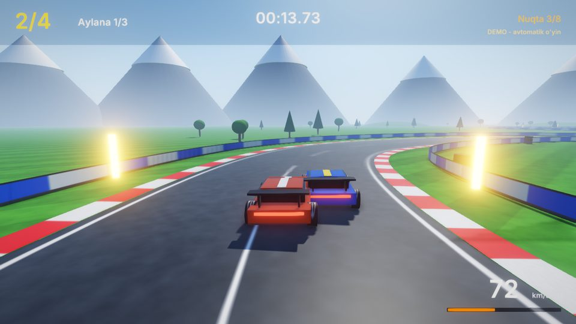
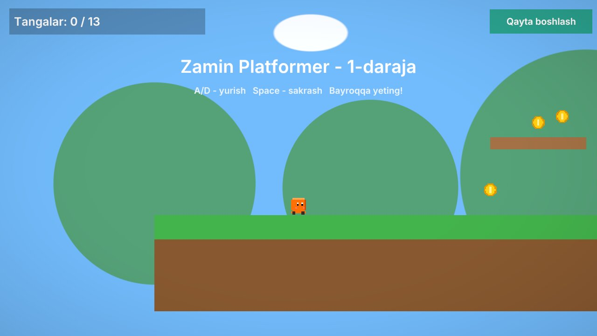
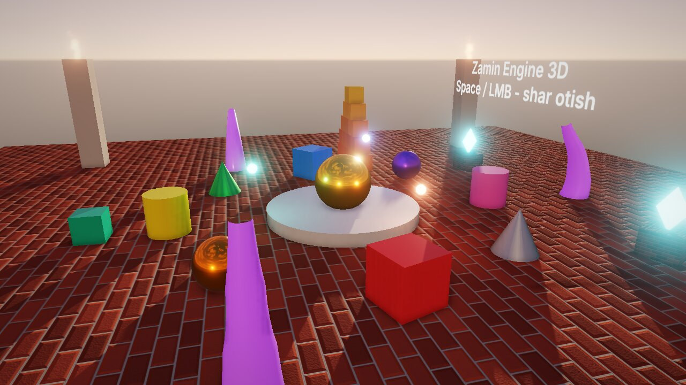
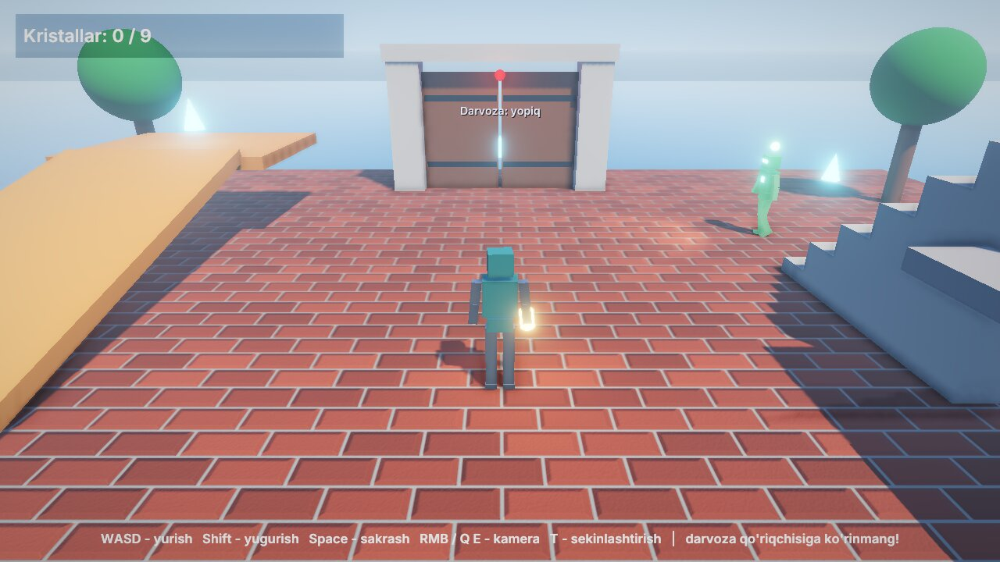

# Namuna o'yinlar galereyasi

Zamin Engine bilan namuna o'yinlar va Blueprint workshop loyihalari keladi (`Projects/`). Oltitasi M24 bosqichida yozilgan kichik, lekin to'liq
o'yinlar: bosh menyu, pauza, natijalar oynasi, rekordlar, klaviatura va gamepad, o'zbek va ingliz tili, demo bot.
Bu olti o'yinning gameplay kodi C++ skriptlarda (`Projects/<O'yin>/Source/`), rasm, model va ovozlar esa koddan yaratilgan
(`Tools/samples/gen_<o'yin>.py`, [Tools/samples/README.md](../Tools/samples/README.md)). Pastdagi rasmlar haqiqiy
o'yindan, `ZaminPlayer` da headless olingan (bot o'ynayapti).

- [Olti yangi o'yin](#olti-yangi-oyin) · [Eski namunalar](#eski-namunalar)
- [Hammasiga umumiy](#hammasiga-umumiy): [menyular](#menyular), [rekordlar (SaveData)](#rekordlar-savedata),
  [boshqaruv: input action'lar va gamepad](#boshqaruv-input-actionlar-va-gamepad), [demo rejim](#demo-rejim)
- [Testlar](#testlar) · [Eksport qilib tekshirish](#eksport-qilib-tekshirish) · [Ishlash tezligi](#ishlash-tezligi)
- [Rasmlarni yangilash](#rasmlarni-yangilash)

Ishga tushirish: editor launcher'ida **Namuna o'yinlar** kartasini bosing yoki player bilan:

```bash
./build/bin/ZaminPlayer Projects/Breakout              # o'yin: bosh menyudan
ZAMIN_DEMO=1 ./build/bin/ZaminPlayer Projects/Racing   # demo: bot o'ynaydi
```

## Compiler-free combat va interaction

[RulesWorkshop](../Projects/RulesWorkshop/README.md): 2D/3D health/shield, death/respawn, melee,
key/medkit/locked door/coin kurslari. Native game module kerak emas. WASD / Space / Ctrl / E.
[Gameplay rules qo‘llanmasi](GameplayRules.md).

## Compiler-free gameplay workshop

[GameplayWorkshop](../Projects/GameplayWorkshop/README.md): o‘ynaladigan 2D/3D motor, kamera,
velocity→Animator, sakrash, checkpoint, marra va diskdan qayta tiklash. C++ game module kerak emas.
WASD / Space / Shift / E. [Gameplay qo‘llanmasi](Gameplay.md).

## Olti yangi o'yin

| | |
|---|---|
|  |  |
| **[Neon Maydon](../Projects/TopDownShooter/README.md)** — 2D twin-stick shooter | **[Zamin Breakout](../Projects/Breakout/README.md)** — 2D g'isht sindirish |
|  |  |
| **[FPS Arena](../Projects/FPSArena/README.md)** — 3D birinchi shaxs, parkur va nishon otish | **[Omborchi](../Projects/Sokoban/README.md)** — 3D Sokoban, 10 daraja |
|  |  |
| **[Ipak Yo'li](../Projects/EndlessRunner/README.md)** — 3D cheksiz yugurish | **[Vodiy Poygasi](../Projects/Racing/README.md)** — 3D poyga |

### Neon Maydon (`Projects/TopDownShooter`)

Neon maydonda kema: chap stik / WASD bilan yurasiz, o'ng stik / sichqoncha bilan nishonga olasiz. Dushmanlar
to'lqin-to'lqin bo'lib portallardan chiqadi (besh xil: quvuvchi, to'da, otuvchi, hujumchi, har 5-to'lqinda tank),
ketma-ket o'ldirishlar kombo ko'paytuvchisini oshiradi, bonuslar — jon, tez otish, uchtalik o'q.
**Ko'rsatadi:** 2D yorug'lik va neon pol (Lit sprite'lar), bloom, zarralar va chaqnash yorug'liklari, kamera
silkinishi, `Instantiate` bilan shablonlardan dushman va o'qlar, 2D fizika qatlamlari, UI tween'lar.
**Rekord:** eng katta hisob va eng uzoq to'lqin.

### Zamin Breakout (`Projects/Breakout`)

Raketka bilan to'pni qaytarib g'ishtlarni sindirasiz: besh xil g'isht (oddiy, qattiq, po'lat, oltin, bomba), olti
bonus (keng raketka, uchta to'p, sekin to'p, olov to'pi, lazer, +1 jon), olti daraja. **Ko'rsatadi:** Box2D (tez
to'p — `Bullet`, to'qnashuv callback'lari, lazer uchun `Raycast2D`), darajani matndan qurish, zarralar, bloom.
**Rekord:** eng katta hisob va eng uzoq daraja.

### FPS Arena (`Projects/FPSArena`)

Quyosh botayotgan arenada birinchi shaxs: sichqoncha / o'ng stik bilan qarash, yugurish (chidamlilik bilan), sakrash
(coyote time), cho'kkalash, sakratgichlar. Ikki rejim: parkur (oltita nuqta, aylana vaqti) va 60 soniyalik nishon
otish (raycast qurol, to'rt xil nishon, seriya ko'paytuvchisi). **Ko'rsatadi:** Character Controller 3D, kursor
qulfi, `Raycast` bilan otish, soyalar, SSAO, tuman, normal xaritali PBR materiallar. **Rekord:** eng yaxshi aylana
vaqti va nishon otish ochkosi.

### Omborchi (`Projects/Sokoban`)

Kichik robot qutilarni yorqin doiralarga itaradi: 10 ta daraja, orqaga qaytarish (undo), darajani qaytadan boshlash,
darajalar menyusi. Demo bot har darajani BFS yechuvchi bilan yechadi. **Ko'rsatadi:** o'yin qoidalari dvigateldan
alohida (`Board.cpp`) — headless test qilinadi, katakma-katak silliq harakat (tween), konfetti zarralari, 3D yorug'lik
va soyalar. **Rekord:** har daraja uchun eng kam qadam.

### Ipak Yo'li (`Projects/EndlessRunner`)

Ipak yo'li bo'ylab savdogar yuguradi: uch yo'lak, sakrash, sirpanish, besh xil to'siq naqshi, tangalar, magnit va
qalqon. Tezlik masofa bilan oshadi, dunyo oldinda protsedurali quriladi. **Ko'rsatadi:** cheksiz yo'l (UV
siljishi), obyektlarni qayta ishlatish, kichik qadamli simulyatsiya (sekin kadrda ham to'siqdan o'tib ketmaydi),
tuman va kun yorug'ligi. **Rekord:** eng katta ochko va eng uzoq masofa.

### Vodiy Poygasi (`Projects/Racing`)

Tog' vodiysidagi 750 metrlik aylanma trassada uchta bot raqib bilan uch aylana: start svetofori, 8 ta nazorat
nuqtasi, aylana vaqti, o'rinlar. Arkada mashina fizikasi: tezlanish, tezlikka bog'liq rul, yon ilashish, qo'l
tormozida drift, o'tda sekinlashish. **Ko'rsatadi:** generator yasagan `.obj` trassa (Catmull-Rom spline), mashinalar
to'qnashuvi, g'ildirak tutuni, dvigatel va sirpanish ovozi (balandligi tezlikka qarab). **Rekord:** eng yaxshi
aylana vaqti.

## Eski namunalar

| Platformer2D | Showcase3D | Adventure3D |
|---|---|---|
|  |  |  |
| [2D platformer](../Projects/Platformer2D/README.md): tilemap, parallaks, 2D yorug'lik, menyu va yuklanish ekrani | [3D ko'rgazma](../Projects/Showcase3D/README.md): PBR, soyalar, post-processing, fizika, zarralar | [3D sarguzasht](../Projects/Adventure3D/README.md): orol, uchinchi shaxs qahramon, NPC'lar, animatsiya |

## Hammasiga umumiy

### Menyular

Har o'yinda bosh menyu (orqasida bot o'ynaydi), pauza menyusi (Esc / Start) va natijalar oynasi bor; hammasi UI
komponentlaridan ([UI.md](UI.md)), klaviatura, sichqoncha va gamepad bilan boshqariladi (UI navigatsiyasi). Menyular
ochilganda jurnalga `Menyu: ...` yoziladi — testlar shu qatorlarni tekshiradi.

### Rekordlar (SaveData)

Har o'yin o'z rekordini [`SaveData::SubmitRecord`](Scripting.md#18-saqlash-lokalizatsiya-log) bilan saqlaydi:
natija avvalgisidan yaxshi bo'lsa yoziladi (vaqt va qadamlar uchun `RecordOrder::Lower`). Rekord o'yin tugaganda,
pauzadan bosh menyuga chiqilganda, qaytadan boshlanganda va o'yin yopilganda hisoblanadi; bosh menyu orqasidagi bot
rekord qo'ymaydi. Ishga tushganda o'yin `Rekordlar: ...`, yangi rekordda `Yangi rekord: ...` deb yozadi; bosh menyu va
HUD rekordni ko'rsatadi, natijalar oynasi esa "YANGI REKORD!" deydi.

| O'yin | SaveData kalitlari | Qaysi biri yaxshi |
|---|---|---|
| Neon Maydon | `Neon.BestScore`, `Neon.BestWave` | katta |
| Zamin Breakout | `Breakout.BestScore`, `Breakout.BestLevel` | katta |
| FPS Arena | `FPSArena.BestLap` / `FPSArena.BestRange` (+ `FPSArena.Sensitivity` sozlamasi) | kichik vaqt / katta ochko |
| Omborchi | `Sokoban.Best.<daraja>` (+ `Sokoban.Level` — keyingi daraja) | kam qadam |
| Ipak Yo'li | `EndlessRunner.Best`, `EndlessRunner.BestDistance` | katta |
| Vodiy Poygasi | `Racing.BestLap` (har aylana tugaganda) | kichik vaqt |

Fayl: `~/.local/share/Zamin Studio/<Mahsulot>/savedata.json`. `ZAMIN_DEMO_RECORDS=1` bilan demo botning natijasi ham
rekord bo'ladi — testlar rekord yozilib, keyingi ishga tushirishda o'qilishini shunday tekshiradi.

### Boshqaruv: input action'lar va gamepad

O'yinlar tugmalarni to'g'ridan-to'g'ri o'qimaydi: hamma narsa loyihaning input xaritasidagi harakat, o'q va
vektorlardan (`Input::IsActionPressed("Fire")`, `Input::GetVector("Move")`; Loyiha sozlamalari → Input). Har harakatning
klaviatura / sichqoncha va gamepad bog'lanishi bor; tugmani qayta bog'lash uchun kodni o'zgartirish shart emas.
Bosh menyudagi boshqaruv yozuvi ham xaritadan olinadi (matn komponentining **Boshqaruv ishoralari**, `InputHints`):
klaviatura bilan "WASD - yurish", gamepad qo'lga olinishi bilan "chap stik / D-pad - yurish" ko'rinadi
([UI.md](UI.md#6-matn)).

| O'yin | Harakatlar (klaviatura · gamepad) | O'qlar / vektorlar |
|---|---|---|
| Neon Maydon | `Fire` LKM, J · RT, RB; `Dash` Space, Shift · A, LB; `Pause` Esc, P · Start | `Move` WASD · chap stik, D-pad; `Aim` strelkalar · o'ng stik |
| Zamin Breakout | `Action` Space, LKM, Up, W · A, RT; `Pause` Esc, P · Start | `MoveX` A/D, strelkalar · chap stik, D-pad |
| FPS Arena | `Jump` Space · A; `Sprint` Shift · L3; `Crouch` C, Ctrl · B; `Fire` LKM · RT, RB; `Reload` R · X; `Pause` Esc, P · Start | `Move` WASD, strelkalar · chap stik; `Look` sichqoncha · o'ng stik |
| Omborchi | `Undo` Z, Backspace · X; `Restart` R · Y; `Pause` Esc, P · Start | `Move` WASD, strelkalar · chap stik, D-pad |
| Ipak Yo'li | `Left` / `Right` A/D, strelkalar · D-pad, LB/RB; `Jump` Space, W, Up · A; `Slide` S, Down · B; `Pause` Esc, P · Start | `Steer` · chap stik |
| Vodiy Poygasi | `Handbrake` Space · X, A; `Reset` R · Y; `Pause` Esc, P · Start | `Steer` A/D, strelkalar · chap stik; `Throttle` W, Up · RT; `Brake` S, Down · LT |

`Tests/samples_assets.py` (ctest `SampleAssets`) xaritani tekshiradi: har harakatda ikkala qurilma bor, skriptlar
o'qiydigan har nom xaritada bor va xaritadagi har nom o'qiladi, skriptlar klaviatura yoki gamepad'ni to'g'ridan-to'g'ri
so'ramaydi (faqat sichqoncha — nishon / qarash uchun), menyudagi ishora faqat xaritadagi nomlarni ishlatadi.

### Demo rejim

`ZAMIN_DEMO=1` (yoki o'yin skriptining `AutoDemo` maydoni) — bot o'ynaydi va jurnalga `Demo: ...` qatorlarini yozadi.
FPS Arena'da `ZAMIN_DEMO=range` — nishon otish raundi; Breakout va Omborchi'da `ZAMIN_START_LEVEL=<n>` — shu
darajadan. Kadr vaqti qat'iy bo'lsa (`ZAMIN_CAPTURE_FPS=20`), bot har kompyuterda bir xil o'ynaydi.

## Testlar

`Tests/samples_test.py` (ctest `Sample<O'yin>`, label `samples`) har o'yinni player'da headless ishga tushiradi
([Testing.md](Testing.md)):

| Holat | Nima tekshiriladi |
|---|---|
| `demo` | bot o'ynaydi: ochko, to'lqin / daraja / aylana / masofa o'sadi (`Demo: ...` qatorlari) |
| rekord (`demo` dan keyin) | demo natijasi `Yangi rekord: ...` bo'lib SaveData fayliga yoziladi; o'sha HOME bilan ikkinchi ishga tushirish `Rekordlar: ...` da xuddi shu qiymatni o'qiydi va bosh menyuni ko'rsatadi |
| `menus` | klaviatura: bosh menyu → o'yin → pauza → davom → pauza → bosh menyu (ba'zilarida natijalar oynasi ham) |
| `gamepad` | faqat gamepad (simulyatsiya: `ZAMIN_PLAYER_INPUT` `pad=A`, `stick=LeftX,0.8`): A bilan o'yin, o'yinning o'z boshqaruvi (stik, tugmalar, triggerlar), Start bilan pauza, D-pad + A bilan bosh menyu; ishoralar gamepad'ga o'tadi (`Kiritish qurilmasi: gamepad`) va o'yinda natija bor (o'q otildi, g'isht sindi, daraja yechildi, masofa) |
| `smoke` | eski namunalar ishga tushadi, rasm chiqaradi |

```bash
python3 Tests/samples_test.py --game Racing                # bitta o'yinning hamma holatlari
python3 Tests/samples_test.py --kind gamepad               # olti o'yin gamepad bilan
ctest --test-dir build -L samples                          # hammasi (sekin: ~25 daqiqa, llvmpipe)
```

## Eksport qilib tekshirish

`Tests/samples_export.py` (ctest `SampleExports`, label `samples;slow`) to'qqiz namunaning har birini editor bilan
eksport qiladi va eksport qilingan o'yinni o'yinchi qanday olsa shunday tekshiradi: `Tests/export_test.sh`
(Release skript moduli, eksport papkasi tekshiruvi, `<O'yin>.sh --version`, vaqtli ishga tushirish, skrinshot,
boshqa papkaga ko'chirish), keyin eksportdagi `<O'yin>.sh` bilan `samples_test.py --exported` holatlari — olti yangi
o'yinning bot demosi (rekord bilan) va eski namunalarning smoke'i.

```bash
python3 Tests/samples_export.py                       # hammasi (~40 daqiqa); natija: build/SampleExports/exports.md
python3 Tests/samples_export.py --game Racing         # bitta o'yin
python3 Tests/samples_test.py --exported build/SampleExports --kind gamepad   # boshqa holatlar eksportdagi o'yinda
```

### Natija (2026-11-08, Debug engine, eksport qilingan Release skript modullari)

| Namuna | Eksport | Hajmi | Fayllar | Kadr (o'rtacha) | Eksportdagi o'yin |
|---|---|---:|---:|---:|---|
| Neon Maydon | OK | 44.2 MiB | 66 | 54.7 ms | demo + rekord OK |
| Zamin Breakout | OK | 43.9 MiB | 66 | 56.0 ms | demo + rekord OK |
| FPS Arena | OK | 44.3 MiB | 92 | 243.7 ms | demo + rekord OK |
| Omborchi | OK | 44.1 MiB | 68 | 264.3 ms | demo + rekord OK |
| Ipak Yo'li | OK | 43.9 MiB | 72 | 267.9 ms | demo + rekord OK |
| Vodiy Poygasi | OK | 44.7 MiB | 70 | 221.6 ms | demo + rekord OK |
| Platformer2D | OK | 45.1 MiB | 125 | 28.2 ms | smoke OK |
| Showcase3D | OK | 49.5 MiB | 202 | 188.0 ms | smoke OK |
| Adventure3D | OK | 43.1 MiB | 50 | 158.8 ms | smoke OK |

Hajmning ~40 MiB i — player va dvigatel (Debug build'dan eksport: strip qilingan bo'lsa ham kattaroq); o'yinning o'zi
1–5 MiB. Kadr vaqti — `export_test.sh` ning 60 kadrlik o'lchovi (Debug dvigatel, bosh menyu, 1280x720, llvmpipe).

**Eksport topgan xato.** Birinchi eksportda Neon Maydon va Zamin Breakout eksportdagi o'yinda ovoz chiqarmasdi:
ular ovozni qisqa nomi bilan chaqiradi (`Sfx("hit")` → `"Audio/hit.wav"` ish vaqtida yasaladi), eksport esa C++
satrlarida to'liq yo'l ko'rmagani uchun WAV fayllarni "ishlatilmagan" deb tashlab ketardi (`excluded-assets.txt`).
Ikkala loyihaga `"Export": { "AlwaysInclude": [ "Audio/*.wav" ] }` qo'shildi
([ProjectSettings.md](ProjectSettings.md#eksport-ishlatilmagan-assetlar)), `Tests/samples_assets.py` esa endi qisqa
nom bilan chaqiriladigan har ovoz eksportga kirishini tekshiradi.

## Ishlash tezligi

`Tests/samples_bench.py` har namunani `ZaminPlayer --benchmark` bilan headless o'lchaydi: yangi o'yinlarda bot o'ynaydi
(`ZAMIN_DEMO=1`, qat'iy o'yin soati `ZAMIN_CAPTURE_FPS=30` — har ishga tushirishda o'yinning bir xil lahzalari), 90 ta
isitish kadridan keyin 300 kadr o'lchanadi. `ZAMIN_PLAYER_STATS` bilan player chiqishda oxirgi kadrning sahnasini
(obyektlar, eng ko'p komponentlar), chizilganlarni va profiler daraxtini yozadi; `--benchmark` esa eng sekin kadrning
profilini ham ("Ishlash testi: eng sekin kadr ...").

```bash
cmake -S . -B build-release -G Ninja -DCMAKE_BUILD_TYPE=Release -DZAMIN_BUILD_EDITOR=OFF -DZAMIN_BUILD_TESTS=OFF \
      -DZAMIN_GAME_MODULE_OUTPUT_DIR=$PWD/build-release/GameModules     # o'yin modullari o'z papkasiga
cmake --build build-release
ZAMIN_BUILD_DIR=build-release python3 Tests/samples_bench.py --check   # jadval: build-release/SampleBench/samples-bench.md
```

### Natija (2026-11-08)

Muhit: 4 vCPU Intel Xeon @ 2.10 GHz, GPU yo'q — Mesa 25.2.8 llvmpipe (dasturiy rasterizator), xvfb, oyna 1280x720,
GCC 13.3, **Release** build. "O'yin kodi" — kadrdagi skriptlar, fizika, particle'lar, animatsiya va audio (CPU);
"Eng qimmat qismlar" — oxirgi kadrning profiler daraxtidan; byudjet — shu kompyuterdagi kadr vaqti + ~15% (regressiya
chegarasi), yana har o'yinda eng sekin kadr ≤ 1000 ms va o'yin kodi ≤ 3 ms (`--check`).

| Namuna | Tur | Obyekt (faol) | Draw call | Uchburchak / quad | Kadr o'rtacha | p95 | Eng sekin | FPS | O'yin kodi (CPU) | Byudjet | Eng qimmat qismlar (ms) |
|---|---|---:|---:|---|---:|---:|---:|---:|---:|---|---|
| TopDownShooter | 2D | 124 (69) | 30 | 0 / 219 | 53.3 ms | 62.9 ms | 784 ms | 19 | 0.20 ms | 65 ms: OK | Post-processing 31.3, Bloom 27.7, Sahnalar (chizish) 1.1, Skriptlar 0.1 |
| Breakout | 2D | 223 (164) | 31 | 0 / 267 | 44.9 ms | 50.6 ms | 141 ms | 22 | 0.23 ms | 55 ms: OK | Post-processing 25.1, Bloom 21.6, Sahnalar (chizish) 1.3, Skriptlar 0.1 |
| FPSArena | 3D | 251 (213) | 67 | 11816 / 207 | 123.5 ms | 152.1 ms | 197 ms | 8 | 0.55 ms | 145 ms: OK | Post-processing 103.7, SSAO 77.0, Sahnalar (chizish) 23.4, Bloom 13.2 |
| Sokoban | 3D | 219 (172) | 53 | 6782 / 208 | 127.6 ms | 141.0 ms | 468 ms | 8 | 0.08 ms | 150 ms: OK | Post-processing 97.4, SSAO 72.4, Sahnalar (chizish) 15.2, Bloom 12.1 |
| EndlessRunner | 3D | 502 (403) | 74 | 155284 / 50 | 155.5 ms | 183.9 ms | 213 ms | 6 | 0.15 ms | 180 ms: OK | Post-processing 85.5, SSAO 60.7, Sahnalar (chizish) 57.8, Bloom 12.0 |
| Racing | 3D | 552 (525) | 69 | 21672 / 64 | 112.9 ms | 132.8 ms | 209 ms | 9 | 0.11 ms | 135 ms: OK | Post-processing 71.0, SSAO 41.7, Sahnalar (chizish) 23.2, Bloom 16.8 |
| Platformer2D | 2D | 108 (60) | 8 | 0 / 115 | 11.1 ms | 12.5 ms | 16 ms | 90 | 0.03 ms | 15 ms: OK | Post-processing 4.0, Sahnalar (chizish) 0.3, Fizika 0.0, Skriptlar 0.0 |
| Showcase3D | 3D | 48 (48) | 84 | 20010 / 39 | 99.3 ms | 110.3 ms | 140 ms | 10 | 0.41 ms | 125 ms: OK | Post-processing 70.5, SSAO 55.5, Sahnalar (chizish) 16.7, Bloom 11.5 |
| Adventure3D | 3D | 73 (72) | 62 | 10658 / 151 | 148.7 ms | 169.7 ms | 198 ms | 7 | 0.45 ms | 185 ms: OK | Post-processing 113.6, SSAO 98.8, Sahnalar (chizish) 19.5, Bloom 11.2 |

Qanday o'qish kerak:

- **Kadrni rasterizatsiya oladi, o'yin kodi emas.** Har o'yinda skriptlar, fizika, particle'lar va animatsiya birga
  kadrda 0.03–0.55 ms. Qolgani — piksellarni CPU'da bo'yash (llvmpipe): 3D sahnaning PBR yoritilishi va soyalari,
  SSAO, bloom, 2D yorug'liklar (Neon Maydon va Breakout'da har piksel uchun 20+ ta 2D chiroq). Haqiqiy GPU'da hamma
  namuna 60 FPS dan ancha tez ishlaydi.
- **Vaqt qayerda ko'rinishi.** llvmpipe chizishni kechiktiradi va rasm birinchi o'qilganda bajaradi: 3D sahnaning
  bo'yalishi "SSAO" ichida (u chuqurlikni birinchi o'qiydi), 2D sahnaniki "Bloom" ichida ko'rinadi. Profiler'da endi
  post-processing o'tishlari alohida (`SSAO`, `Bloom`, `FXAA`).
- **Obyektlar soni kichik** (48–552): ECS yangilanishi va sahna bo'ylab yurish kadrda sezilmaydi; eng ko'pi Vodiy
  Poygasi (552 — trassa bo'laklari, daraxtlar, to'siqlar) va Ipak Yo'li (502 — oldinda qurilgan dunyo, uchburchaklar
  eng ko'p: 155K).

### Topilgan va tuzatilgan muammolar

| Muammo | Sabab | Tuzatish | Natija (o'rtacha / eng sekin kadr) |
|---|---|---|---|
| O'yin o'rtasida 0.5–3 soniyalik qotishlar (banner, ochko yozuvi chiqqanda) | Har yangi shrift o'lchami (task 232) — yangi atlas tekstura; u 2D batch'ning 16 ta slotli shaderiga kirganda drayver shaderni shu teksturalar to'plami uchun qaytadan kompilyatsiya qiladi (llvmpipe'da har "variant" ~1-2 s) | Matn o'z batch'ida, bitta sampler'li shader bilan chiziladi (`Renderer2D`: `TEXT_ATLAS` dasturi) — uning varianti bitta, sprite'lar shaderi esa endi shrift atlaslarini ko'rmaydi | Breakout 66.0 / 2993 → **44.9 / 141 ms**; Neon Maydon 63.1 / 2317 → **53.3 / 784 ms**; FPS Arena 129.9 / 1614 → **123.5 / 197 ms** |
| Bir xil o'lchamdagi shrift atlasini qayta-qayta yasash | Atlaslar 8 ta bilan cheklangan edi, o'yin UI'si esa ~12 o'lcham ishlatadi: 2 s ishlatilmagan atlas o'chib, banner yana chiqqanda qayta yasalardi (har biri 4-20 ms) | `Font::MaxSizedAtlases` 16 | qayta yasash yo'q |
| SSAO har namunada (piksel boshiga 16 ta matritsa teskarisi) | Ko'rinish nuqtasi har namunada `inverse(projection)` × vec4 bilan tiklanardi | Perspektiv proyeksiya hadlaridan bir necha amal bilan (natija o'sha) | ~3% (llvmpipe'da asosiy vaqt sahnaning o'zida) |

Qolgan bir martalik qotishlar (Neon Maydon ~0.8 s, Omborchi ~0.45 s — yangi sprite / material birinchi chizilganda
shader varianti) faqat llvmpipe'da sezilarli; o'yin davomida takrorlanmaydi. Oldingi o'lchovlar bilan solishtirish
uchun jadvalni shu kompyuterda qayta oling ([Benchmarks.md](Benchmarks.md)).


### M25 tekshiruvi (2026-11-09)

Xuddi shu muhit va buyruq, M25 optimallashtirishlaridan keyin. llvmpipe og'ir 3D'da 60 FPS ga yetmaydi — shuning
uchun 60 FPS talabi **CPU vaqti** bo'yicha tekshirildi: namunalar 284x160 oynada (piksellar 1280x720 ning 5 %)
o'lchandi, 3D'lar `--quality Low` bilan ham (SSAO yo'q, kichik soya xaritalari). Qolgan vaqt — dvigatelning CPU ishi
(o'yin kodi, sahna, culling, batching, chizish buyruqlari) va llvmpipe'ning vertex ishi birga, ya'ni dvigatel CPU
vaqtining yuqori chegarasi. Rasterizatsiya (GPU ishi) — chapdagi 1280x720 ustunlar bilan farqi.

| Namuna | 1280x720: kadr o'rtacha / p95 | FPS | O'yin kodi (CPU) | Kichik oyna: kadr o'rtacha / p95 | CPU ≤ 16.6 ms |
|---|---:|---:|---:|---:|---|
| TopDownShooter (2D) | 62.4 / 73.8 ms | 16 | 0.23 ms | 9.3 / 8.0 ms* | ha |
| Breakout (2D) | 48.9 / 58.1 ms | 20 | 0.18 ms | 7.5 / 9.2 ms | ha |
| Platformer2D (2D) | 12.5 / 15.8 ms | 80 | 0.04 ms | 1.9 / 2.3 ms | ha |
| FPSArena | 131.6 / 175.2 ms | 8 | 0.40 ms | 8.5 / 11.5 ms (Low) | ha |
| Sokoban | 131.5 / 157.2 ms | 8 | 0.08 ms | 9.7 / 9.3 ms* (Low) | ha |
| Racing | 109.4 / 124.0 ms | 9 | 0.16 ms | 12.7 / 21.2 ms (Low) | o'rtacha ha, p95 yo'q |
| Showcase3D | 108.4 / 132.5 ms | 9 | 0.39 ms | 10.3 / 11.6 ms (Low) | ha |
| Adventure3D | 152.9 / 176.1 ms | 7 | 0.50 ms | 10.5 / 12.7 ms (Low) | ha |
| EndlessRunner | 145.2 / 169.1 ms | 7 | 0.11 ms | 26.6 / 32.0 ms (Low) -> **15.1-15.5 / 18.7-20.3 ms** primitivlar LOD'i bilan | o'rtacha ha, p95 yo'q |

\* o'rtacha bitta uzun kadr tufayli p95 dan katta: birinchi o'yinda katta matnning shrift atlasi rasterlanadi
(TopDownShooter ~0.8 s, keyingi ishga tushirishlarda diskdagi keshdan — eng sekin kadr 866 -> 148 ms).

Xulosa: o'yin kodi hamma joyda ≤ 0.55 ms; 2D namunalar va beshta 3D namuna CPU bo'yicha 60 FPS byudjetiga sig'adi.
Ipak Yo'li (EndlessRunner) sig'magan edi — 155K uchburchagining vertex ishi llvmpipe'da CPU'da bajariladi. Endi
uzoqdagi shar / silindr / konuslar soddaroq nusxasini chizadi (primitivlar LOD'i, [Rendering.md](Rendering.md#15-samaradorlik-va-sifat-darajalari)):
kadr uchburchaklari 155K -> 67K. Release build, 284x160, Low, navbatma-navbat 3 juft o'lchov (`ZAMIN_PRIMITIVE_LOD=0` -
LOD'siz): LOD'siz o'rtacha 22.7-24.1 ms (p95 28.9-31.4), LOD bilan **15.1-15.5 ms** (p95 18.7-20.3) - o'rtacha 60 FPS
byudjetiga sig'adi, eng sekin 5 % kadrlar hali 19-20 ms (Racing kabi). 1280x720 dagi kadrning qolgani — piksellarni bo'yash (SSAO, bloom), u haqiqiy GPU'da videokartada bo'ladi.
Batafsil tahlil: [Performance.md](Performance.md).

## Rasmlarni yangilash

- `python3 Tools/samples/make_gallery.py` — shu sahifadagi o'yin rasmlari (`docs/images/sample-*.jpg`, 960x540);
- `python3 Tools/samples/make_thumbnails.py` — launcher kartalaridagi rasmlar (`Projects/*/Thumbnail.jpg`);
- `python3 Tools/samples/gen_<o'yin>.py` — o'yinning assetlari, sahnasi va loyiha fayli (generator o'zgarsa;
  `Tests/samples_assets.py --regen` natija bir xil ekanini tekshiradi).
