# The sample games gallery

Zamin Engine comes with sample games and Blueprint workshop projects (`Projects/`). Six of them, written in the M24 stage, are small but complete
games: a main menu, a pause, a results window, records, keyboard and gamepad, Uzbek and English, a demo bot.
The sample games start in English by default (`"DefaultLanguage": "en"`); Uzbek is chosen with the language button in the game
menu and is kept in the player's settings.
The gameplay code of these six games is in C++ scripts (`Projects/<Game>/Source/`), while the pictures, models and sounds are generated
from code (`Tools/samples/gen_<game>.py`, [Tools/samples/README.md](../Tools/samples/README.md)). The pictures below come from the real
game, taken headless in `ZaminPlayer` (a bot is playing).

- [Two vertical slices](#two-vertical-slices-lantern-keeper-and-beacon-pass) · [Six new games](#six-new-games) · [The older samples](#the-older-samples)
- [Common to all of them](#common-to-all-of-them): [menus](#menus), [records (SaveData)](#records-savedata),
  [controls: input actions and gamepad](#controls-input-actions-and-gamepad), [demo mode](#demo-mode)
- [Tests](#tests) · [Checking by exporting](#checking-by-exporting) · [Performance](#performance)
- [Updating the pictures](#updating-the-pictures)

To run them: click a card under **Sample games** in the editor launcher, or with the player:

```bash
./build/bin/ZaminPlayer Projects/Breakout              # the game: from the main menu
ZAMIN_DEMO=1 ./build/bin/ZaminPlayer Projects/Racing   # demo: a bot plays
```

## Two vertical slices: Lantern Keeper and Beacon Pass

Two finished games assembled without a compiler from the engine's gameplay packages (motor, camera, combat, AI, quest, loadout, UI,
save) — a menu, levels, a boss, victory and defeat screens, save/continue, a demo pilot.
More: [VerticalSlices.md](VerticalSlices.md).

| | |
|---|---|
| 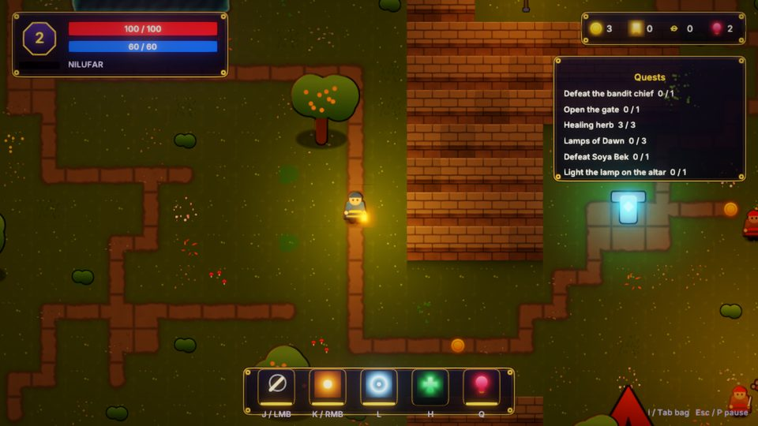 | 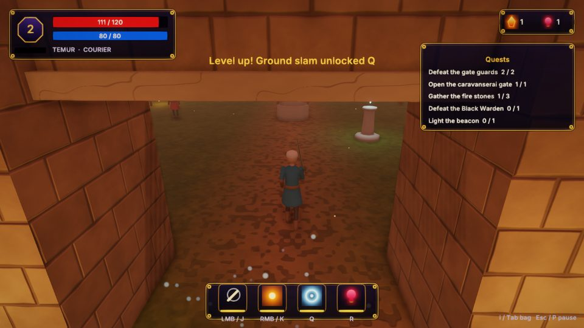 |
| **Lantern Keeper** (`Projects/LanternKeeper`, 2D): the Orchards and the Crypt, a transfer between the two levels, Soya Bek | **Beacon Pass** (`Projects/BeaconPass`, 3D): a character controller, Animator locomotion, the Black Warden, a torch |

```bash
ZAMIN_DEMO=1 ./build/bin/ZaminPlayer Projects/LanternKeeper   # the pilot plays from the menu to the victory
./build/bin/ZaminPlayer Projects/BeaconPass                    # yourself: WASD, mouse, Space, J/K, Q, E
```

Their checks: a headless oracle, a defeat plan, determinism and a cut/corrupt save matrix (`ZaminTests
--filter LanternKeeper*` / `BeaconPass*`), the Player/Editor workflow with continuing in a fresh process, gamepad, export and a
real relocation (`Tests/slice_workflow_test.py --exports`), the UI gate (`Tests/slice_ui_test.py`), the Blueprint
authoring test (`Tests/slice_editor_test.py`) and performance (`Tests/slice_bench.py`,
[VerticalSlices.md](VerticalSlices.md#resume-export-and-profiling)).

## Compiler-free quest/progression

[QuestWorkshop](../Projects/QuestWorkshop/README.md): real collect/kill/interact/trigger, a quest chain,
reward/XP, continuing from a fresh process and rejecting a duplicate claim. [The quest guide](GameplayQuest.md).

## Compiler-free gameplay UI

[UIWorkshop](../Projects/UIWorkshop/README.md): a live health/coin/bag HUD, a paged inventory,
modal focus, pause/control windows and save/load from the menu. Keyboard/gamepad. [The UI guide](GameplayUI.md).

## Compiler-free save/resume

[SaveWorkshop](../Projects/SaveWorkshop/README.md): restoring health, the inventory, used interactions,
AI and prefab slots from a fresh process. WASD / E / Ctrl / Space. [The save guide](GameplaySave.md).

## Compiler-free AI workshop

[AIWorkshop](../Projects/AIWorkshop/README.md): 2D/3D patrol, chase, attack, investigate, return,
LOS shutters and spawning an independent NPC prefab. WASD / E / Ctrl. [The AI guide](GameplayAI.md).

## Compiler-free combat and interaction

[RulesWorkshop](../Projects/RulesWorkshop/README.md): 2D/3D health/shield, death/respawn, melee,
key/medkit/locked door/coin courses. No native game module needed. WASD / Space / Ctrl / E.
[The gameplay rules guide](GameplayRules.md).

## Compiler-free gameplay workshop

[GameplayWorkshop](../Projects/GameplayWorkshop/README.md): a playable 2D/3D motor, camera,
velocity→Animator, jumping, a checkpoint, a finish line and restoring from disk. No C++ game module needed.
WASD / Space / Shift / E. [The gameplay guide](Gameplay.md).

## Six new games

| | |
|---|---|
| 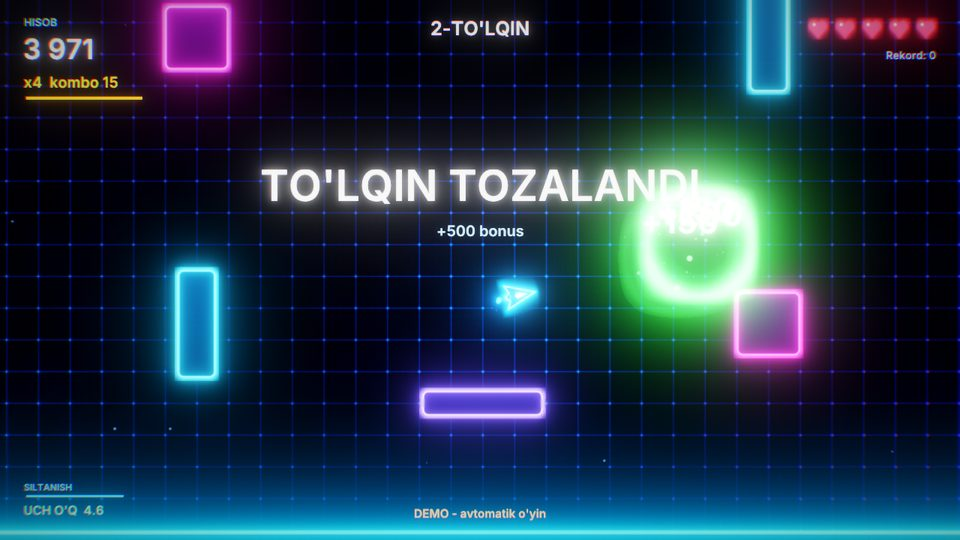 | 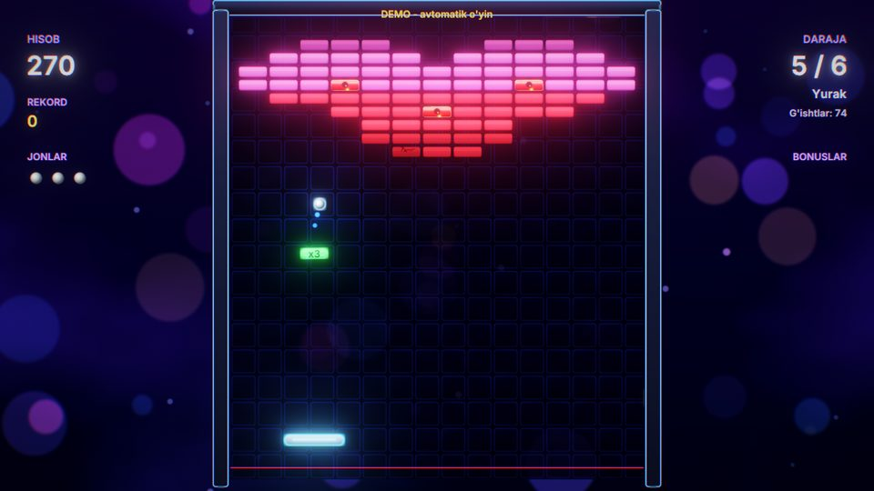 |
| **[Neon Arena](../Projects/TopDownShooter/README.md)** — a 2D twin-stick shooter | **[Zamin Breakout](../Projects/Breakout/README.md)** — 2D brick breaking |
| 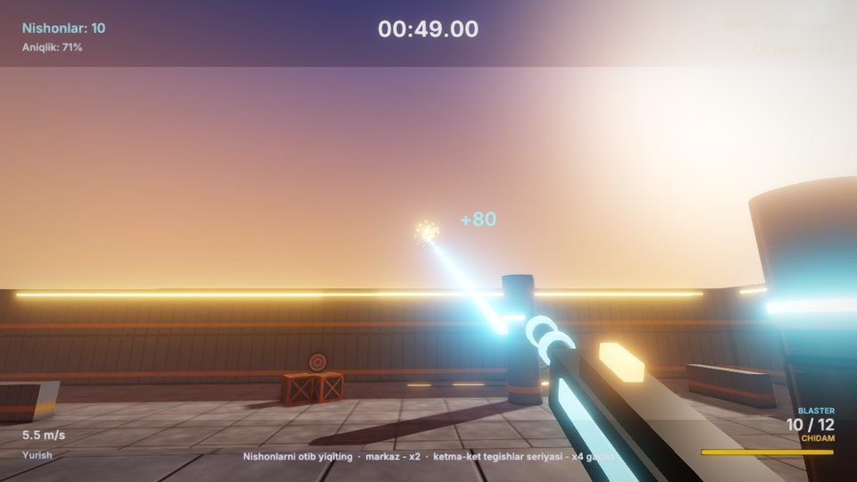 | 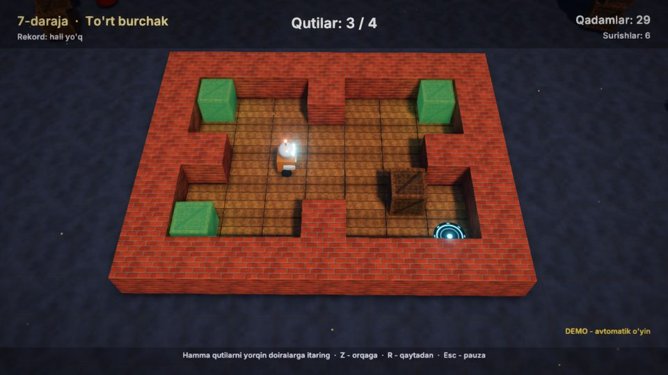 |
| **[FPS Arena](../Projects/FPSArena/README.md)** — 3D first person, parkour and target shooting | **[Warehouse Keeper](../Projects/Sokoban/README.md)** — 3D Sokoban, 10 levels |
| 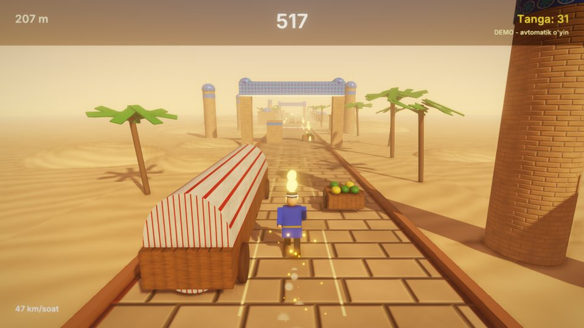 | 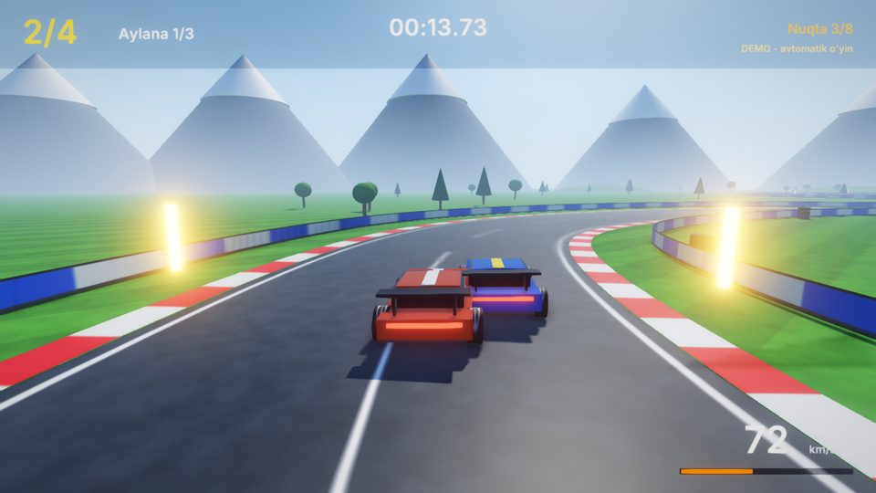 |
| **[Silk Road](../Projects/EndlessRunner/README.md)** — a 3D endless runner | **[Valley Race](../Projects/Racing/README.md)** — a 3D race |

### Neon Arena (`Projects/TopDownShooter`)

A ship on a neon field: you move with the left stick / WASD and aim with the right stick / mouse. The enemies
come out of portals in waves (five kinds: a chaser, a swarm, a shooter, a charger, and a tank every 5th wave),
kills in a row raise the combo multiplier, and the bonuses are health, rapid fire and a triple shot.
**Shows:** 2D lights and a neon floor (Lit sprites), bloom, particles and flash lights, camera
shake, enemies and bullets from templates with `Instantiate`, 2D physics layers, UI tweens.
**Record:** the highest score and the longest wave.

### Zamin Breakout (`Projects/Breakout`)

You bounce the ball back with the paddle and break the bricks: five kinds of bricks (plain, hard, steel, gold, bomb), six
bonuses (a wide paddle, three balls, a slow ball, a fireball, a laser, +1 life), six levels. **Shows:** Box2D (a fast
ball — `Bullet`, collision callbacks, `Raycast2D` for the laser), building a level from text, particles, bloom.
**Record:** the highest score and the furthest level.

### FPS Arena (`Projects/FPSArena`)

First person in an arena at sunset: looking with the mouse / right stick, running (with stamina), jumping
(coyote time), crouching, jump pads. Two modes: parkour (six points, a lap time) and a 60-second target
range (a raycast gun, four kinds of targets, a streak multiplier). **Shows:** Character Controller 3D, the cursor
lock, shooting with `Raycast`, shadows, SSAO, fog, PBR materials with normal maps. **Record:** the best lap
time and the target range score.

### Warehouse Keeper (`Projects/Sokoban`)

A small robot pushes crates onto glowing circles: 10 levels, undo, restarting a level,
a level menu. The demo bot solves every level with a BFS solver. **Shows:** the game rules are separate from the
engine (`Board.cpp`) — they are tested headless, smooth cell-by-cell movement (tweens), confetti particles, 3D lights
and shadows. **Record:** the fewest moves for each level.

### Silk Road (`Projects/EndlessRunner`)

A merchant runs along the Silk Road: three lanes, jumping, sliding, five obstacle patterns, coins, a magnet and a
shield. The speed rises with the distance, and the world ahead is built procedurally. **Shows:** an endless road (UV
scrolling), reusing entities, a small-step simulation (it does not pass through an obstacle even in a slow frame),
fog and daylight. **Record:** the highest score and the longest distance.

### Valley Race (`Projects/Racing`)

Three laps against three bot rivals on a 750-metre circuit in a mountain valley: a start light, 8
checkpoints, lap times, positions. Arcade car physics: acceleration, speed-dependent steering, side grip, a
handbrake drift, slowing down on grass. **Shows:** a `.obj` track made by the generator (a Catmull-Rom spline), car
collisions, wheel smoke, an engine and skid sound (its pitch follows the speed). **Record:** the best
lap time.

## The older samples

| Platformer2D | Showcase3D | Adventure3D |
|---|---|---|
| 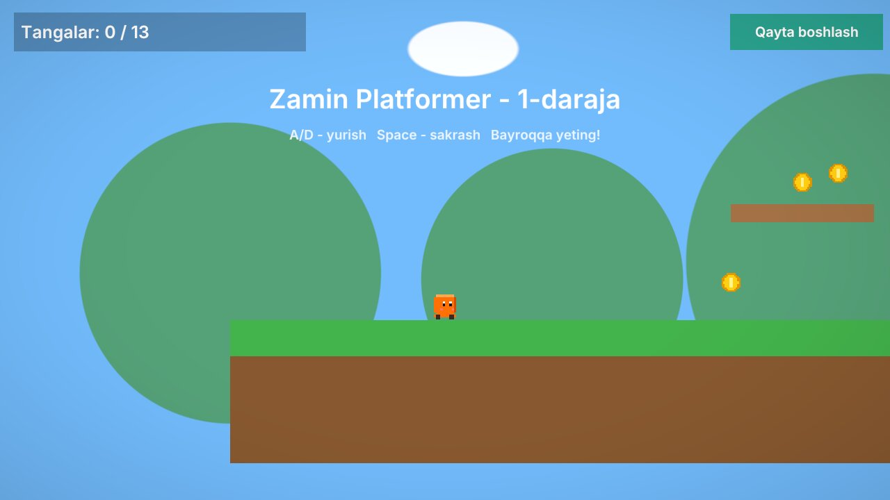 | 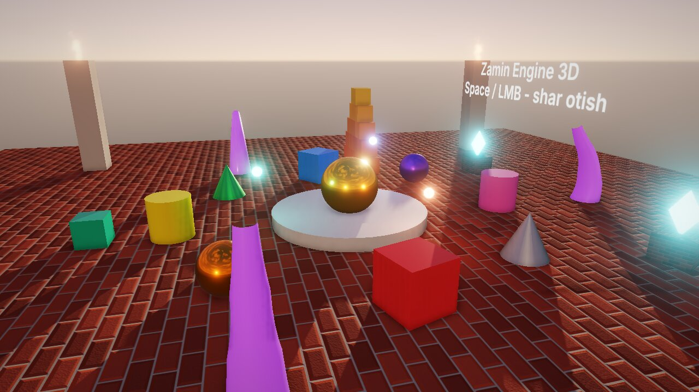 | 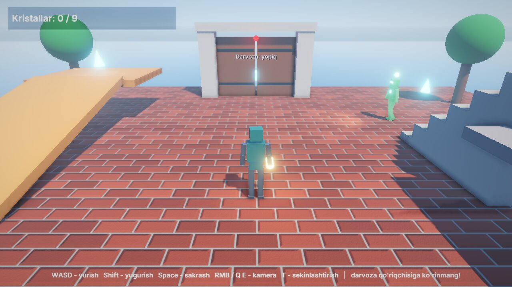 |
| [A 2D platformer](../Projects/Platformer2D/README.md): a tilemap, parallax, 2D lights, a menu and a loading screen | [A 3D showcase](../Projects/Showcase3D/README.md): PBR, shadows, post-processing, physics, particles | [A 3D adventure](../Projects/Adventure3D/README.md): an island, a third-person hero, NPCs, animation |

## Common to all of them

### Menus

Every game has a main menu (with a bot playing behind it), a pause menu (Esc / Start) and a results window; all of them are made
of UI components ([UI.md](UI.md)) and are controlled with the keyboard, the mouse and a gamepad (UI navigation). When a menu
opens, `Menu: ...` is written to the log — the tests check these lines.

### Records (SaveData)

Every game saves its record with [`SaveData::SubmitRecord`](Scripting.md#18-saving-localization-logging):
the result is written when it is better than the previous one (`RecordOrder::Lower` for times and moves). The record is counted
when the game ends, when leaving from the pause to the main menu, when restarting and when the game is closed; the bot behind the
main menu does not set records. On start the game writes `Records: ...`, and `New record: ...` on a new record; the main menu and the
HUD show the record, and the results window says "NEW RECORD!".

| Game | SaveData keys | Which is better |
|---|---|---|
| Neon Arena | `Neon.BestScore`, `Neon.BestWave` | larger |
| Zamin Breakout | `Breakout.BestScore`, `Breakout.BestLevel` | larger |
| FPS Arena | `FPSArena.BestLap` / `FPSArena.BestRange` (+ the `FPSArena.Sensitivity` setting) | a smaller time / a larger score |
| Warehouse Keeper | `Sokoban.Best.<level>` (+ `Sokoban.Level` — the next level) | fewer moves |
| Silk Road | `EndlessRunner.Best`, `EndlessRunner.BestDistance` | larger |
| Valley Race | `Racing.BestLap` (when each lap ends) | a smaller time |

The file: `~/.local/share/Zamin Studio/<Product>/savedata.json`. With `ZAMIN_DEMO_RECORDS=1` the demo bot's result becomes a
record too — this is how the tests check that the record is written and read on the next run.

### Controls: input actions and gamepad

The games do not read keys directly: everything comes from the actions, axes and vectors of the project's input map
(`Input::IsActionPressed("Fire")`, `Input::GetVector("Move")`; Project settings → Input). Every action has a
keyboard / mouse and a gamepad binding; rebinding a key needs no code change.
The controls caption in the main menu also comes from the map (the text component's **Control hints**, `InputHints`):
with the keyboard it shows "WASD - move", and as soon as a gamepad is picked up, "left stick / D-pad - move"
([UI.md](UI.md#6-text)).

| Game | Actions (keyboard · gamepad) | Axes / vectors |
|---|---|---|
| Neon Arena | `Fire` LMB, J · RT, RB; `Dash` Space, Shift · A, LB; `Pause` Esc, P · Start | `Move` WASD · left stick, D-pad; `Aim` arrows · right stick |
| Zamin Breakout | `Action` Space, LMB, Up, W · A, RT; `Pause` Esc, P · Start | `MoveX` A/D, arrows · left stick, D-pad |
| FPS Arena | `Jump` Space · A; `Sprint` Shift · L3; `Crouch` C, Ctrl · B; `Fire` LMB · RT, RB; `Reload` R · X; `Pause` Esc, P · Start | `Move` WASD, arrows · left stick; `Look` mouse · right stick |
| Warehouse Keeper | `Undo` Z, Backspace · X; `Restart` R · Y; `Pause` Esc, P · Start | `Move` WASD, arrows · left stick, D-pad |
| Silk Road | `Left` / `Right` A/D, arrows · D-pad, LB/RB; `Jump` Space, W, Up · A; `Slide` S, Down · B; `Pause` Esc, P · Start | `Steer` · left stick |
| Valley Race | `Handbrake` Space · X, A; `Reset` R · Y; `Pause` Esc, P · Start | `Steer` A/D, arrows · left stick; `Throttle` W, Up · RT; `Brake` S, Down · LT |

`Tests/samples_assets.py` (ctest `SampleAssets`) checks the map: every action has both devices, every name the scripts
read is in the map and every name in the map is read, the scripts do not ask for the keyboard or the gamepad directly
(only the mouse — for aiming / looking), and the menu hint uses only names from the map.

### Demo mode

`ZAMIN_DEMO=1` (or the game script's `AutoDemo` field) — a bot plays and writes `Demo: ...` lines to the log.
In FPS Arena `ZAMIN_DEMO=range` — the target range round; in Breakout and Warehouse Keeper `ZAMIN_START_LEVEL=<n>` — from that
level. With a fixed frame time (`ZAMIN_CAPTURE_FPS=20`) the bot plays the same on every computer.

## Tests

`Tests/samples_test.py` (ctest `Sample<Game>`, label `samples`) runs every game headless in the player
([Testing.md](Testing.md)):

| Case | What is checked |
|---|---|
| `demo` | a bot plays: the score, the wave / level / lap / distance grow (`Demo: ...` lines) |
| record (after `demo`) | the demo result is written to the SaveData file as `New record: ...`; a second run with the same HOME reads the same value in `Records: ...` and shows the main menu |
| `menus` | keyboard: main menu → game → pause → resume → pause → main menu (in some, the results window too) |
| `gamepad` | the gamepad only (simulated: `ZAMIN_PLAYER_INPUT` `pad=A`, `stick=LeftX,0.8`): the game with A, the game's own controls (stick, buttons, triggers), the pause with Start, the main menu with D-pad + A; the hints switch to the gamepad (`Input device: gamepad`) and the game has a result (a shot was fired, a brick broke, a level was solved, a distance) |
| `smoke` | the older samples start and render a picture |

```bash
python3 Tests/samples_test.py --game Racing                # all the cases of one game
python3 Tests/samples_test.py --kind gamepad               # the six games with a gamepad
ctest --test-dir build -L samples                          # all of them (slow: ~25 minutes, llvmpipe)
```

## Checking by exporting

`Tests/samples_export.py` (ctest `SampleExports`, label `samples;slow`) exports each of the nine samples with the editor
and checks the exported game the way a player would get it: `Tests/export_test.sh`
(the Release script module, a check of the export folder, `<Game>.sh --version`, a timed run, a screenshot,
moving it to another folder), then the `samples_test.py --exported` cases with the exported `<Game>.sh` — the bot demo
(with a record) of the six new games and the smoke of the older samples.

```bash
python3 Tests/samples_export.py                       # all of them (~40 minutes); the result: build/SampleExports/exports.md
python3 Tests/samples_export.py --game Racing         # one game
python3 Tests/samples_test.py --exported build/SampleExports --kind gamepad   # other cases on the exported game
```

### Result (2026-11-08, Debug engine, exported Release script modules)

| Sample | Export | Size | Files | Frame (mean) | The exported game |
|---|---|---:|---:|---:|---|
| Neon Arena | OK | 44.2 MiB | 66 | 54.7 ms | demo + record OK |
| Zamin Breakout | OK | 43.9 MiB | 66 | 56.0 ms | demo + record OK |
| FPS Arena | OK | 44.3 MiB | 92 | 243.7 ms | demo + record OK |
| Warehouse Keeper | OK | 44.1 MiB | 68 | 264.3 ms | demo + record OK |
| Silk Road | OK | 43.9 MiB | 72 | 267.9 ms | demo + record OK |
| Valley Race | OK | 44.7 MiB | 70 | 221.6 ms | demo + record OK |
| Platformer2D | OK | 45.1 MiB | 125 | 28.2 ms | smoke OK |
| Showcase3D | OK | 49.5 MiB | 202 | 188.0 ms | smoke OK |
| Adventure3D | OK | 43.1 MiB | 50 | 158.8 ms | smoke OK |

~40 MiB of the size is the player and the engine (an export from a Debug build: larger even when stripped); the game itself is
1–5 MiB. The frame time is the 60-frame measurement of `export_test.sh` (Debug engine, main menu, 1280x720, llvmpipe).

**A bug the export found.** On the first export Neon Arena and Zamin Breakout had no sound in the exported game:
they call sounds by a short name (`Sfx("hit")` → `"Audio/hit.wav"` is built at runtime), and the export, seeing no full path
in the C++ strings, left the WAV files out as "unused" (`excluded-assets.txt`).
`"Export": { "AlwaysInclude": [ "Audio/*.wav" ] }` was added to both projects
([ProjectSettings.md](ProjectSettings.md#eksport-ishlatilmagan-assetlar)), and `Tests/samples_assets.py` now checks that every
sound called by a short name gets into the export.

## Performance

`Tests/samples_bench.py` measures each sample headless with `ZaminPlayer --benchmark`: in the new games a bot plays
(`ZAMIN_DEMO=1`, a fixed game clock `ZAMIN_CAPTURE_FPS=30` — the same moments of the game on every run), and 300 frames are
measured after 90 warm-up frames. With `ZAMIN_PLAYER_STATS` the player writes the last frame's scene
(entities, the most common components), what was drawn and the profiler tree when it exits; `--benchmark` adds the profile of the
slowest frame ("Benchmark: slowest frame ...").

```bash
cmake -S . -B build-release -G Ninja -DCMAKE_BUILD_TYPE=Release -DZAMIN_BUILD_EDITOR=OFF -DZAMIN_BUILD_TESTS=OFF \
      -DZAMIN_GAME_MODULE_OUTPUT_DIR=$PWD/build-release/GameModules     # the game modules into their own folder
cmake --build build-release
ZAMIN_BUILD_DIR=build-release python3 Tests/samples_bench.py --check   # the table: build-release/SampleBench/samples-bench.md
```

### Result (2026-11-08)

Environment: 4 vCPU Intel Xeon @ 2.10 GHz, no GPU — Mesa 25.2.8 llvmpipe (a software rasterizer), xvfb, a 1280x720 window,
GCC 13.3, a **Release** build. "Game code" is the frame's scripts, physics, particles, animation and audio (CPU);
"The most expensive parts" come from the last frame's profiler tree; the budget is the frame time on this computer + ~15% (the regression
limit), plus a slowest frame ≤ 1000 ms and game code ≤ 3 ms in every game (`--check`).

| Sample | Kind | Entities (active) | Draw calls | Triangles / quads | Frame mean | p95 | Slowest | FPS | Game code (CPU) | Budget | The most expensive parts (ms) |
|---|---|---:|---:|---|---:|---:|---:|---:|---:|---|---|
| TopDownShooter | 2D | 124 (69) | 30 | 0 / 219 | 53.3 ms | 62.9 ms | 784 ms | 19 | 0.20 ms | 65 ms: OK | Post-processing 31.3, Bloom 27.7, Scenes (render) 1.1, Scripts 0.1 |
| Breakout | 2D | 223 (164) | 31 | 0 / 267 | 44.9 ms | 50.6 ms | 141 ms | 22 | 0.23 ms | 55 ms: OK | Post-processing 25.1, Bloom 21.6, Scenes (render) 1.3, Scripts 0.1 |
| FPSArena | 3D | 251 (213) | 67 | 11816 / 207 | 123.5 ms | 152.1 ms | 197 ms | 8 | 0.55 ms | 145 ms: OK | Post-processing 103.7, SSAO 77.0, Scenes (render) 23.4, Bloom 13.2 |
| Sokoban | 3D | 219 (172) | 53 | 6782 / 208 | 127.6 ms | 141.0 ms | 468 ms | 8 | 0.08 ms | 150 ms: OK | Post-processing 97.4, SSAO 72.4, Scenes (render) 15.2, Bloom 12.1 |
| EndlessRunner | 3D | 502 (403) | 74 | 155284 / 50 | 155.5 ms | 183.9 ms | 213 ms | 6 | 0.15 ms | 180 ms: OK | Post-processing 85.5, SSAO 60.7, Scenes (render) 57.8, Bloom 12.0 |
| Racing | 3D | 552 (525) | 69 | 21672 / 64 | 112.9 ms | 132.8 ms | 209 ms | 9 | 0.11 ms | 135 ms: OK | Post-processing 71.0, SSAO 41.7, Scenes (render) 23.2, Bloom 16.8 |
| Platformer2D | 2D | 108 (60) | 8 | 0 / 115 | 11.1 ms | 12.5 ms | 16 ms | 90 | 0.03 ms | 15 ms: OK | Post-processing 4.0, Scenes (render) 0.3, Physics 0.0, Scripts 0.0 |
| Showcase3D | 3D | 48 (48) | 84 | 20010 / 39 | 99.3 ms | 110.3 ms | 140 ms | 10 | 0.41 ms | 125 ms: OK | Post-processing 70.5, SSAO 55.5, Scenes (render) 16.7, Bloom 11.5 |
| Adventure3D | 3D | 73 (72) | 62 | 10658 / 151 | 148.7 ms | 169.7 ms | 198 ms | 7 | 0.45 ms | 185 ms: OK | Post-processing 113.6, SSAO 98.8, Scenes (render) 19.5, Bloom 11.2 |

How to read it:

- **Rasterization takes the frame, not the game code.** In every game the scripts, physics, particles and animation together take
  0.03–0.55 ms of the frame. The rest is shading pixels on the CPU (llvmpipe): the PBR lighting and shadows of a 3D scene,
  SSAO, bloom, 2D lights (in Neon Arena and Breakout 20+ 2D lights per pixel). On a real GPU every
  sample runs well above 60 FPS.
- **Where the time shows up.** llvmpipe defers drawing and does it when the image is first read: the shading of a 3D scene
  shows up inside "SSAO" (it reads the depth first), that of a 2D scene inside "Bloom". The profiler now has the
  post-processing passes separately (`SSAO`, `Bloom`, `FXAA`).
- **The entity counts are small** (48–552): the ECS update and walking the scene do not show up in the frame; the most are in Valley
  Race (552 — track pieces, trees, obstacles) and Silk Road (502 — the world built ahead, with the most triangles:
  155K).

### Problems found and fixed

| Problem | Cause | Fix | Result (mean / slowest frame) |
|---|---|---|---|
| 0.5–3 second freezes in the middle of a game (when a banner or a score label appears) | Every new font size (task 232) is a new atlas texture; when it enters the 16-slot shader of the 2D batch, the driver recompiles the shader for that set of textures (on llvmpipe each "variant" takes ~1-2 s) | Text is drawn in its own batch with a single-sampler shader (`Renderer2D`: the `TEXT_ATLAS` program) — it has one variant, and the sprite shader no longer sees the font atlases | Breakout 66.0 / 2993 → **44.9 / 141 ms**; Neon Arena 63.1 / 2317 → **53.3 / 784 ms**; FPS Arena 129.9 / 1614 → **123.5 / 197 ms** |
| Building a font atlas of the same size again and again | The atlases were limited to 8, while the game UI uses ~12 sizes: an atlas unused for 2 s was deleted and built again when the banner appeared again (4-20 ms each) | `Font::MaxSizedAtlases` 16 | no rebuilding |
| SSAO per sample (16 matrix inverses per pixel) | The view-space point was reconstructed per sample with `inverse(projection)` × vec4 | With a few operations from the perspective projection terms (the same result) | ~3% (on llvmpipe the main time is in the scene itself) |

The remaining one-off freezes (Neon Arena ~0.8 s, Warehouse Keeper ~0.45 s — a shader variant when a new sprite / material is first
drawn) are noticeable only on llvmpipe; they do not repeat during the game. To compare with earlier measurements,
take the table again on this computer ([Benchmarks.md](Benchmarks.md)).


### The M25 check (2026-11-09)

The same environment and command, after the M25 optimizations. llvmpipe does not reach 60 FPS in heavy 3D — that is
why the 60 FPS requirement was checked by **CPU time**: the samples were measured in a 284x160 window (5 % of the pixels of
1280x720), the 3D ones with `--quality Low` too (no SSAO, small shadow maps). The remaining time is the engine's CPU work
(game code, the scene, culling, batching, draw commands) and llvmpipe's vertex work together, i.e. an upper bound on the engine's
CPU time. Rasterization (the GPU work) is the difference from the 1280x720 columns on the left.

| Sample | 1280x720: frame mean / p95 | FPS | Game code (CPU) | Small window: frame mean / p95 | CPU ≤ 16.6 ms |
|---|---:|---:|---:|---:|---|
| TopDownShooter (2D) | 62.4 / 73.8 ms | 16 | 0.23 ms | 9.3 / 8.0 ms* | yes |
| Breakout (2D) | 48.9 / 58.1 ms | 20 | 0.18 ms | 7.5 / 9.2 ms | yes |
| Platformer2D (2D) | 12.5 / 15.8 ms | 80 | 0.04 ms | 1.9 / 2.3 ms | yes |
| FPSArena | 131.6 / 175.2 ms | 8 | 0.40 ms | 8.5 / 11.5 ms (Low) | yes |
| Sokoban | 131.5 / 157.2 ms | 8 | 0.08 ms | 9.7 / 9.3 ms* (Low) | yes |
| Racing | 109.4 / 124.0 ms | 9 | 0.16 ms | 12.7 / 21.2 ms (Low) | mean yes, p95 no |
| Showcase3D | 108.4 / 132.5 ms | 9 | 0.39 ms | 10.3 / 11.6 ms (Low) | yes |
| Adventure3D | 152.9 / 176.1 ms | 7 | 0.50 ms | 10.5 / 12.7 ms (Low) | yes |
| EndlessRunner | 145.2 / 169.1 ms | 7 | 0.11 ms | 26.6 / 32.0 ms (Low) -> **15.1-15.5 / 18.7-20.3 ms** with the primitive LODs | mean yes, p95 no |

\* the mean is above the p95 because of one long frame: on the first run the font atlas of a large text is rasterized
(TopDownShooter ~0.8 s; on later runs it comes from the cache on disk — the slowest frame 866 -> 148 ms).

Conclusion: the game code is ≤ 0.55 ms everywhere; the 2D samples and five 3D samples fit the 60 FPS budget by CPU.
Silk Road (EndlessRunner) did not fit — the vertex work of its 155K triangles runs on the CPU on llvmpipe. Now
distant spheres / cylinders / cones draw a simpler copy (the primitive LODs, [Rendering.md](Rendering.md#15-performance-and-quality-levels)):
the frame's triangles 155K -> 67K. A Release build, 284x160, Low, 3 alternating pairs of measurements (`ZAMIN_PRIMITIVE_LOD=0` -
without LODs): without LODs a mean of 22.7-24.1 ms (p95 28.9-31.4), with LODs **15.1-15.5 ms** (p95 18.7-20.3) - the mean fits the 60 FPS
budget, the slowest 5 % of frames are still 19-20 ms (like Racing). The rest of the frame at 1280x720 is shading pixels (SSAO, bloom), which on a real GPU happens on the graphics card.
A detailed analysis: [Performance.md](Performance.md).

## Updating the pictures

- `python3 Tools/samples/make_gallery.py` — the game pictures on this page (`docs/images/sample-*.jpg`, 960x540);
- `python3 Tools/samples/make_thumbnails.py` — the pictures on the launcher cards (`Projects/*/Thumbnail.jpg`);
- `python3 Tools/samples/gen_<game>.py` — the game's assets, scene and project file (when the generator changes;
  `Tests/samples_assets.py --regen` checks that the result is the same).

## LoadoutWorkshop

[2D/3D equipment and ability course](../Projects/LoadoutWorkshop/README.md): transactional equipment,
combat modifiers, energy, damage/heal/shield abilities, consumables, quest rewards and v3 fresh-process
saves. Canonical-state HUD and real relocated export acceptance. [API and bounds](GameplayLoadout.md).

## CombatWorkshop

[2D/3D combat slice](../Projects/CombatWorkshop/README.md): projectile abilities (Bolt with Burn, a piercing
Lance with Shock), a Nova area with line of sight, an enemy Sentry casting Poison projectiles, stacking and
expiring status effects, effect/hit-marker HUD and a combat feed, keyboard and gamepad, and v4 saves that resume
a projectile in flight and its effects in a fresh process. Real Player/Editor/relocated-export acceptance
(`Tests/combat_workflow_test.py`) and a headless oracle. [API, limits and profiling](GameplayCombat.md).
