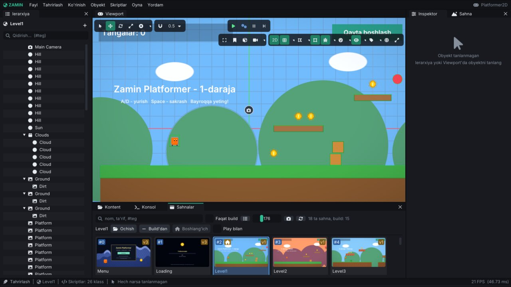

# Zamin Engine: scene management

This document explains how a game's scenes are managed: loading and switching scenes, several scenes at once
(additive), objects that survive a scene switch (DontDestroyOnLoad), background loading and the loading screen, fade
transitions, the build scene list, scene events, fast lookups, load errors, the scene file format (stable order,
version and migration, metadata), global game state, sub-scenes, measuring load time and saving / loading large scenes
fast. Every section has C++ script examples (`#include <Zamin/Zamin.h>`, `using namespace Zamin;`).

Contents:

1. [Core concepts](#1-core-concepts)
2. [Loading a scene](#2-loading-a-scene)
3. [Several scenes (additive)](#3-several-scenes-additive)
4. [DontDestroyOnLoad: objects that survive](#4-dontdestroyonload-objects-that-survive)
5. [Background loading and the loading screen](#5-background-loading-and-the-loading-screen)
6. [Scene transitions (fades)](#6-scene-transitions-fades)
7. [The build scene list and indices](#7-the-build-scene-list-and-indices)
8. [Scene events](#8-scene-events)
9. [Searching inside a scene](#9-searching-inside-a-scene)
10. [Load errors](#10-load-errors)
11. [The scene file: order, version, metadata](#11-the-scene-file-order-version-metadata)
12. [Global game state: services and GameState](#12-global-game-state-services-and-gamestate)
13. [Sub-scenes](#13-sub-scenes)
14. [Load time in the profiler](#14-load-time-in-the-profiler)
15. [Large scenes: fast save and load, the binary cache](#15-large-scenes-fast-save-and-load-the-binary-cache)
16. [Scenes in the editor](#16-scenes-in-the-editor)
17. [Sample: the Platformer2D scene flow](#17-sample-the-platformer2d-scene-flow)
18. [Tests and benchmarks](#18-tests-and-benchmarks)
19. [Limitations](#19-limitations)
20. [Short API reference](#20-short-api-reference)

---

## 1. Core concepts

A game's scenes are managed by the **`SceneManager`**. The program that runs the game creates it: the editor's Play
mode and `ZaminPlayer`. Scripts reach it through `GetSceneManager()` or directly through the helpers (`LoadScene`,
`DontDestroyOnLoad` ...).

| Concept | Meaning |
|---|---|
| **Active scene** | New objects belong to this scene; its camera draws the game and its settings (sky, post-processing) are the picture's |
| **Loaded scenes** | The active scene and the ones loaded next to it (Additive), in load order |
| **The DontDestroyOnLoad scene** | A separate, permanent scene for objects that survive a scene switch |
| **Sub-scene** | A piece from another scene file placed at an object's position in this scene (section 13) |
| **Request** | `LoadScene`, `UnloadScene`, `DontDestroyOnLoad` are carried out not at once but **at the end of the frame** |

Every loaded scene has its own objects, scripts and physics worlds; all of them are updated in one frame and drawn
together through **one camera**. All scenes share one event bus and one game clock (time scale, pause).

The frame order:

1. Scenes loading in the background get their share of the main thread (`UpdateAsyncLoads`, ~4 ms).
2. The fade transition moves forward.
3. Every scene is updated: first the DontDestroyOnLoad scene, then the loaded ones in order.
4. Everything is drawn.
5. At the end of the frame (`ProcessRequests`) what was requested during the frame is carried out: moves, unloads,
   loads, the entry of scenes finished in the background, events.

That is why a script keeps running in the old scene until the end of the current frame even after calling
`LoadScene`.

---

## 2. Loading a scene

Paths are relative to the `Assets` folder. Instead of a path a scene's **name** in the build list (`"Level2"`) or its
**index** (`2`) can be given.

```cpp
class LevelExit : public ScriptableEntity
{
public:
    void OnTriggerBegin(Entity other) override
    {
        if (!other.HasTag("Player"))
            return;
        LoadScene("Scenes/Level2.zscene");                           // Single: every scene is replaced
        // LoadScene("Level2");                                      // its name in the build list
        // LoadScene(3);                                             // the build index
        // LoadScene("Scenes/Level2.zscene", SceneTransition::Fade(0.5f)); // fading to black
    }
};
ZM_REGISTER_SCRIPT(LevelExit)
```

Modes (`LoadSceneMode`):

- **`Single`** (default) — every loaded scene is closed and the new one becomes active. The objects in the
  DontDestroyOnLoad scene stay. The game clock goes back to 1.
- **`Additive`** — the new scene is added next to the existing ones, the active scene does not change.

Other helpers: `UnloadScene("HUD")` (by name or path), `LoadNextScene()`, `ReloadScene()` (the level restarts). When
the file cannot be read the game stays where it is and the error goes into the report (section 10).

Old code (`Scene::RequestLoadScene`) keeps working: the `SceneManager` also carries it out at the end of the frame.

---

## 3. Several scenes (additive)

```cpp
// When a level starts, the HUD scene is loaded next to it.
void OnStart() override
{
    LoadScene("Scenes/HUD.zscene", LoadSceneMode::Additive);
}
```

Additional scenes:

- run with their own objects, scripts and 2D/3D physics worlds;
- are drawn through the active scene's primary camera (without a sky, added on top); when the active scene has no
  camera, the first loaded scene with a camera draws;
- join the game clock (in a slowed-down game an additional scene runs slowly too).

Lookups across scenes (`FindEntity`, `FindEntityWithTag`, `FindObjectsOfType`, `Resolve(EntityRef)`) search the
script's own scene first, then the active scene, then the rest, and finally the DontDestroyOnLoad scene.

```cpp
SceneManager* scenes = GetSceneManager();
scenes->SetActiveScene(scenes->GetSceneByName("Level2"));     // switch the active scene at once
for (const Ref<Scene>& scene : scenes->GetLoadedScenes())
    ZM_INFO("{} ({})", scene->GetName(), scenes->GetScenePath(scene.get()));
scenes->UnloadScene("HUD");                                   // at the end of the frame
```

The last loaded scene cannot be closed (load another one with `Single` instead). When the active scene is closed, the
next loaded scene becomes active.

---

## 4. DontDestroyOnLoad: objects that survive

`DontDestroyOnLoad()` moves the object (with its children) to the permanent **DontDestroyOnLoad** scene at the end of
the frame. It survives every `Single` load. The move keeps the object's UUID, its components and its **running script
instance**: member values, timers and subscriptions stay, `OnDestroy` / `OnCreate` are not called again, playing sounds
are not cut off, and the physics body is rebuilt in the new scene's world.

```cpp
// A manager that lives for the whole game (music, score).
class GameManager : public ScriptableEntity
{
public:
    void OnCreate() override
    {
        // No second copy when returning to the menu.
        if (SceneManager* scenes = GetSceneManager())
            if (const Ref<Scene>& persistent = scenes->GetDontDestroyOnLoadScene();
                persistent && persistent->FindEntityByName(GetName()))
            {
                Destroy();
                return;
            }
        DontDestroyOnLoad();
        Audio::PlayMusic("Audio/theme.wav");
    }
};
ZM_REGISTER_SCRIPT(GameManager)
```

An object loaded a second time from the same file has the same UUID as the first one; when the permanent scene already
has an object with that UUID the move is refused (with a warning) and the object stays in its own scene. That is why
the check above is needed.

In the editor's Play mode the hierarchy shows every loaded scene as a separate section: the active one with a star, the
others (DontDestroyOnLoad too) in collapsed sections; the eye button opens that scene for inspection.

---

## 5. Background loading and the loading screen

`LoadSceneAsync` loads a scene without stopping the game and returns an `AsyncOperation`:

| Stage (`GetStage()`) | Where | `GetProgress()` |
|---|---|---|
| `Reading` — the file is read and the JSON parsed | background thread | 0 → 0.25 |
| `Decoding` — the images the scene names are decoded ahead | background thread | 0.25 → 0.5 |
| `Building` — the objects are created | main thread, a share each frame | 0.5 → 0.7 |
| `Resolving` — textures, meshes and fonts are uploaded to the GPU | main thread, a share each frame | 0.7 → 0.9 |
| `Ready` — ready, waiting for permission to enter | — | 0.9 |
| `Done` / `Failed` | — | 1 |

With `SetAllowSceneActivation(false)` a ready scene waits until it is allowed in (for example to finish a loading
screen animation). The main thread share is set with `SceneManager::SetAsyncBudget(ms)` (4 ms by default).

```cpp
class LoadingScreen : public ScriptableEntity
{
public:
    std::string Target = "Scenes/Level1.zscene";
    EntityRef Bar;   // UI Progress Bar

    void OnStart() override
    {
        m_Load = LoadSceneAsync(Target, LoadSceneMode::Single, SceneTransition::Fade(0.4f));
        if (m_Load)
            m_Load->SetAllowSceneActivation(false); // the screen decides itself
    }

    void OnUpdate(Timestep) override
    {
        if (!m_Load || m_Load->HasFailed())
            return; // m_Load->GetError() / GetReport() - what happened
        if (Entity bar = Resolve(Bar))
            bar.GetComponent<UIProgressBarComponent>().Value = m_Load->GetProgress() / 0.9f;
        if (m_Load->IsReady())
            m_Load->SetAllowSceneActivation(true); // the fade starts, the switch happens behind it
    }

private:
    Ref<AsyncOperation> m_Load;
};
ZM_REGISTER_SCRIPT(LoadingScreen, ZM_FIELD(LoadingScreen, Target), ZM_FIELD(LoadingScreen, Bar))
```

Only safe work runs on the background thread: reading the file, parsing the JSON, migration and decoding images.
Creating objects and uploading to the GPU happen on the main thread, spread over frames.

---

## 6. Scene transitions (fades)

```cpp
LoadScene("Scenes/Level2.zscene", SceneTransition::Fade(0.5f));                  // 0.5 s to black, 0.5 s fading in
LoadScene("Scenes/Level2.zscene", SceneTransition::Fade(0.3f, 0.8f, { 1, 1, 1, 1 })); // to white, a slow fade in
```

The screen fills with the color in `FadeOut` seconds (the game goes on underneath), the switch happens **when the
screen is fully covered**, then the curtain goes away in `FadeIn` seconds. The transition runs on real time (also in a
paused game). A `LoadScene` with a transition loads the scene in the background; a loading screen can start its own
transition while the previous one is still fading in. The curtain is drawn after post-processing, over everything.

---

## 7. The build scene list and indices

The **Project settings → Build scenes** page lists the scenes that go into the game, in order: drag to reorder,
enable / disable, a build index column, a star for the start scene, adding the open scene or all scenes, dropping a
`.zscene` from the content browser. The list is stored in the `.zproject` file with the path, the enabled state and
the UUID (a renamed file is still found by its UUID).

- **Build index** — the position among the enabled scenes, from 0.
- `LoadScene(int)`, `LoadSceneAsync(int)`, `LoadNextScene()`, `ReloadScene()`.
- `GetSceneBuildIndex()`, `GetActiveSceneBuildIndex()`, `GetBuildSceneCount()`.
- Export: when the list is not empty, only the scenes in it, the start scene and the **sub-scenes** they use go into
  the game.
- `ZaminPlayer --scene 2` (index), `--scene Level2` (name) or `--scene Scenes/Level2.zscene` (path).

```cpp
// Back to the menu after the last level.
if (!LoadNextScene(SceneTransition::Fade(0.5f)))
    LoadScene(0);
```

---

## 8. Scene events

Every running script in every loaded scene and in the DontDestroyOnLoad scene hears them:

```cpp
void OnSceneLoaded(const SceneEventInfo& scene) override;
void OnSceneUnloaded(const SceneEventInfo& scene) override;
void OnActiveSceneChanged(const SceneEventInfo& previous, const SceneEventInfo& current) override;
```

`SceneEventInfo`: `SceneRef` (a closed scene still exists during the call and is freed afterwards — do not keep the
pointer), `Name`, `Path`, `BuildIndex`, `Mode`. The events also go out on the bus: `"SceneLoaded"`,
`"SceneUnloaded"` (payload `SceneEventInfo`) and `"ActiveSceneChanged"` (payload `ActiveSceneChange`).

| What happened | Order of events |
|---|---|
| A `Single` load | `OnSceneUnloaded` for every closed scene → `OnActiveSceneChanged` → `OnSceneLoaded` |
| An `Additive` load | `OnSceneLoaded` |
| Closing a scene | `OnSceneUnloaded` (+ `OnActiveSceneChanged` when it was active) |
| The game starts | `OnActiveSceneChanged` (from no scene) → `OnSceneLoaded` |
| Sub-scenes | after the owner's `OnSceneLoaded`, `OnSceneLoaded` (Additive) for each of them |
| Stop | no events |

The new scene's own scripts get `OnSceneLoaded` too: after `OnCreate`, before `OnStart`.

```cpp
void OnSceneLoaded(const SceneEventInfo& scene) override
{
    if (scene.BuildIndex == 3)
        Audio::CrossfadeTo("Audio/boss.wav");
}
```

---

## 9. Searching inside a scene

Lookups are indexed, and calling them every frame is cheap:

| Call | Complexity |
|---|---|
| `FindEntity(name)`, `FindEntities(name)` | O(1) hash |
| `FindEntitiesWithTag(tag)`, `FindEntityWithTag(tag)` | O(k), k — the tagged objects |
| `Scene::CountEntitiesWithTag(tag)` | O(1) |
| `FindObjectsOfType<T>()`, `FindObjectOfType<T>()` | O(k), a component or a script class (with its subclasses) |
| `Scene::FindEntitiesWith<T>()`, `CountEntitiesWith<T>()` | O(k) |

The indexes are built on the first lookup and then updated one by one by creating and deleting objects, `SetName`,
`AddTag` and `RemoveTag`. Changing a component directly is checked once at the start of the next frame (or at once:
`InvalidateNameCache` / `InvalidateTagIndex`).

```cpp
for (auto* enemy : FindObjectsOfType<EnemyAI>())
    enemy->Alert();
if (auto* hud = FindObjectOfType<Hud>())
    hud->SetScore(m_Score);
```

With 10 000 objects (Debug, `ZaminBench --queries`): `FindEntityByName` x1000 — 0.64 ms (a full scan 1429 ms),
`CountEntitiesWithTag` x1000 — 0.13 ms (336 ms).

---

## 10. Load errors

The problems found while a scene loads are gathered in a `SceneLoadReport` (the serializer, background loading,
`AsyncOperation`, `SceneManager::GetLoadReports()`):

| Kind | Result |
|---|---|
| File not found / not readable, a JSON error (with the line, column and that line), not a scene file | **Fatal**: nothing is loaded, the game stays where it is |
| An entry that is not an object | skipped |
| A component that could not be read | the object loads with its other components |
| An unknown component | skipped (lost on save) |
| A missing asset file | a warning with the object and the component |
| A duplicate UUID | the second one gets a new ID |
| A missing parent or a cycle | the object becomes a root |
| A newer format version | read as far as it is understood, with a warning |

Valid objects are always kept. In the editor: a dismissible banner over the viewport and the **"Scene load problems"**
window (a table, a marker under the error column, selecting the object, copying). The Player does not shut down when
the first scene fails to load: it shows an error screen (Esc — quit); a failed switch during the game is shown with a
red bar for 6 seconds.

---

## 11. The scene file: order, version, metadata

**Stable order.** In a `.zscene` file the objects are sorted by UUID and the keys alphabetically, and the hierarchy is
written separately: `"RootOrder"` (the order of the root objects) and `"ChildOrder"` (when the children are not in UUID
order). So the same scene always gives the same text and a diff shows only what changed.

**Version and migration.** The file is written with `"Version": 5` (`SceneMigration::CurrentVersion`). When an older
file is loaded, a chain of migrations runs before anything is read (`SceneMigration`):

- **v0 → v1** (a file without a version): IDs written as text become numbers, `"Name"` → `"Tag"`.
- **v1 → v2**: Text `"Centered"` → `AlignH` / `AlignV`, UI `"Anchor"` → `AnchorMin` / `AnchorMax` / `Pivot`,
  `"Metadata"` is added.
- **v2 → v3**: the sub-scene file in `SubScene`: `"Scene"` / `"SceneUUID"` → `"Path"` / `"PathUUID"` (`"Scene"` was
  a name key, so the reference was not updated when the file was moved or renamed).
- **v3 → v4**: `"Gravity"` / `"Gravity3D"` in `"Settings"` are written only when the scene has its own gravity; the
  engine's default value ((0, -9.8) / (0, -9.81, 0)) is removed - such a scene follows the project's gravity (Project
  settings > Physics). The physics step (`"PhysicsStep"`) works the same way: when missing, the project's (Project
  settings > Time).
- **v4 → v5**: prefab instance links (`PrefabEntity`, `Overrides` ... in `"Editor"`) were added; `\` → `/` in the
  `Editor.Prefab` path. Details: [Prefabs.md](Prefabs.md#13-version-and-migration).

Prefabs (`.zprefab`) and the clipboard go through the same chain (`"Version"`, `"Kind"`; without a version — v0). A
migration is logged once per file version (not when nothing changed). A saved file moves to the current format; the
editor does not overwrite a prefab with a newer version.

**Metadata and thumbnail.** `SceneMetadata`: description, author, tags (`Scene::GetMetadata()`). When the editor saves
a scene it renders an image from its primary camera and writes it to a hidden file next to it
(`.Level1.zscene.png`, 320×180) — together with its sub-scenes. `SceneSerializer::ReadSceneInfo(file, info)` reads a
scene's name, version, metadata, object count, image and the sub-scenes it uses without loading it (handy for a level
select menu).

---

## 12. Global game state: services and GameState

Both survive every scene load; the editor clears them when Play starts and stops.

**`Services`** — one C++ object of each type:

```cpp
struct Inventory { std::vector<std::string> Items; };

auto& inventory = GetOrCreateService<Inventory>();    // Services::GetOrCreate<Inventory>()
inventory.Items.push_back("Key");
if (Inventory* inv = GetService<Inventory>()) { /* ... */ }
Services::Register<AudioDirector>(/* constructor arguments */);
Services::Unregister<AudioDirector>();
```

**`GameState`** — a key–value store (int, float, bool, text):

```cpp
GameState::Increment("Coins");
GameState::SetString("Player.Name", "Ali");
GameState::SetPersistent("BestScore");     // written to SaveData with Save(), back with Load()
GameState::SetInt("BestScore", 120);
GameState::Save();
// Watching a change: the watch ends when the script is destroyed.
WatchGameState("Coins", [this](std::string_view) { RefreshHud(); });
```

During Play the editor's **Scenes** window shows the values (editable) and the list of services.

---

## 13. Sub-scenes

A **sub-scene** (`SubSceneComponent`) stores a piece of a scene in a separate file: a level's rooms, a shared lighting
set, a piece used in several levels. Add a **Sub-scene** component to an object and give it a `.zscene` file (drop it
from the content browser).

| Field | Meaning |
|---|---|
| `ScenePath` (**Scene**) | the scene file to place |
| `LoadOnStart` (**Load with the scene**) | loads together with the scene; when off — when a script asks |
| `ApplyTransform` (**Apply transform**) | the root objects are moved to this object's world transform |
| `ShowInEditor` (**Draw in editor**) | drawn in place in the editor's scene view |

**In the game:** when a scene loads (Start, `Single`, `Additive`, background loading) its active sub-scene objects (the
object and its parents enabled — as the editor shows it) are loaded in that same frame as **additional scenes** — with
their own objects, scripts and physics world. An object under a disabled parent brings in its sub-scene only when a
script calls `LoadSubScene()`. The roots are placed by the object's transform **once**, at load time (the physics
bodies are created there); moving the object later does not move the sub-scene. A sub-scene's own sub-scenes load too
(at most 8 levels: the main scene's sub-scenes are level 1; a file already in the chain — a cycle — is skipped). When
the owner is closed its sub-scenes close too; a `Single` load closes them all. The owner's scripts see the sub-scene in
`OnStart` (not yet in `OnCreate`).

```cpp
// The third room opens when the player comes near ("Load with the scene" is off on the component).
class RoomTrigger : public ScriptableEntity
{
public:
    void OnTriggerBegin(Entity other) override
    {
        if (other.HasTag("Player") && !GetSubScene())
            LoadSubScene();               // at the end of the frame, at this object's position
    }
    void OnTriggerEnd(Entity other) override
    {
        if (other.HasTag("Player"))
            UnloadSubScene();
    }
};
ZM_REGISTER_SCRIPT(RoomTrigger)
```

At the `SceneManager` level: `GetSubScene(host)`, `GetSubSceneOwner(scene, &hostID)`, `IsSubScene(scene)`,
`LoadSubScene(host)`, `UnloadSubScene(host)`, `OffsetRoots(scene, matrix)`.

**In the editor:** the sub-scene is drawn at the object's position **for viewing only** (with its own lights, without
a sky; it cannot be picked with the mouse — a click goes to what is behind it). In the hierarchy the sub-scene's objects
show in grey rows under the object; double-clicking the header row or the pencil button in the inspector opens the file
for editing (the open scene is saved first). When the file changes elsewhere the view updates by itself. The inspector
shows the file's contents (object count, description); during Play the "loaded / not loaded" state and the **Load** /
**Close** buttons appear. Export also adds the sub-scene files used by the scenes in the build list to the game.

---

## 14. Load time in the profiler

Every scene load is measured by stage (`SceneLoadTiming`):

| Stage | What |
|---|---|
| Read | reading the file from disk |
| JSON | parsing the text (or the binary cache) |
| Migration | converting from an old version to the current one |
| Objects | creating the objects and components, linking the hierarchy |
| Images (background) | decoding images ahead during background loading (does not stall the main thread) |
| Assets | loading textures, meshes, fonts, animations (GPU) |
| Audio | the sound clips the scene preloads |
| Physics | the 2D and 3D physics worlds, bodies, colliders |
| Scripts | `OnCreate` and `OnEnable` |

The result:

- is written **to the console**:
  `Scene load time: Level1 (single): 12.40 ms, 97 objects - Read 0.10, JSON 0.84, ... Physics 0.79, Scripts 0.17`;
- in the **profiler** tree the stages show under that frame's `Scene load` section (in background loading —
  `Objects` and `Assets` under `Scene load (background)`);
- the editor's **Statistics** and **Profiler** windows have a **"Scene load time"** section: the last load as a colored
  bar (the stages' shares; hovering shows a stage's name and time), a table of the last 32 loads (the clicked one in
  detail above), the **Clear** and **Copy** buttons. The statistics overlay shows the last load time. Opening a scene
  in the editor (`editor`), the start of Play (`start`), switches (`single`, `additive`) and background loads
  (`background`: with the main thread time, the frame count and the total duration) are recorded;
- with `ZAMIN_PLAYER_STATS=1` the player logs every load on exit.

```cpp
SceneLoadTiming last;
if (SceneLoadProfiler::GetLast(last))
    ZM_INFO("{} {:.1f} ms, slowest: {}", last.SceneName, last.TotalMilliseconds(),
            SceneLoadTiming::StageName(last.GetSlowestStage()));
// Background loading: op->GetTiming() (main thread time - MainThreadMilliseconds(), frames - Frames)
```

---

## 15. Large scenes: fast save and load, the binary cache

Serialization was sped up for large scenes:

- the scene serializer is compiled with `-O2` even in a Debug build and is linked first in the library (the JSON
  library's shared code becomes its optimized copy) — the CMake option `ZAMIN_OPTIMIZE_SERIALIZER_IN_DEBUG` (on by
  default; turn it off to step through it in a debugger);
- the library calls its own functions (`-Bsymbolic-functions`): unoptimized copies from the program do not mix in;
- the text is written into one buffer, sorting by UUID works on IDs read ahead, asset paths are checked once (when
  thousands of sprites name the same texture), large `ChildOrder` lists use hash sets, and the file is read in one go.

**The binary cache (`.zsceneb`)** — the scene's same tree as MessagePack (with a small header: `ZMSB`, the cache
format, the source text's size). It is ~3 times smaller and in the current format (no migration).
`SceneSerializer::Deserialize` reads the `Level1.zsceneb` next to `Level1.zscene` instead when it was made from a text
of that size and is not older than it; otherwise the text; a corrupt cache also falls back to the text. Background
loading uses the cache too. In the game export the **"Also write scenes to the binary cache (.zsceneb)"** checkbox (on
by default) writes a cache next to every scene.

```cpp
SceneSerializer::WriteBinaryCache("Game/Assets/Scenes/Level1.zscene");   // on any thread
std::vector<uint8_t> bytes = SceneSerializer(scene).SerializeToBinary();
SceneSerializer(other).DeserializeFromBinary(bytes);
SceneSerializer::SetUseBinaryCache(false);                              // ignore the cache
```

10 000 objects (sprites, bodies, scripts, texts, hierarchy; 8.8 MB of text), `ZaminBench --serialize`, the median of
3 runs:

| | Debug, before | Debug, after | Release |
|---|---|---|---|
| Save (text) | 1346 ms | 163 ms | 144 ms |
| Load (text) | 2076 ms | 222 ms | 190 ms |
| Load (binary cache, 3.2 MB) | — | 140 ms | 114 ms |

The rest of the load is mostly creating the objects and components (~80 ms for 10 000).

---

## 16. Scenes in the editor

- **The Scenes window** — every scene of the project as cards or a list: its image, build index, the start scene mark,
  an old format ("v1") mark, tags, description. Search (name, description, `#tag`), a "build only" filter; open, add to
  / remove from the build list, enable / disable, make it the start scene, render the images, show in the content
  browser. During Play: the loaded scenes (the active one, DontDestroyOnLoad, those loading in the background, the
  transition), making one active, closing, showing it in the hierarchy, loading a project scene into the game as
  additional or with a fade, `GameState` and the services.
- **"With play"** — scenes loaded as additional next to the open scene when Play starts (for this editor session).
- **Stop** — even when the game switched scenes, the editor brings back the edit scene, the selection, the camera view
  and the 2D mode ("Editor state restored").
- **Scene settings → Info** — description, author, tags, the format version, "Render image now".
- **Sub-scenes** — section 13; **load time** — section 14; **load errors** — section 10.

Environment variables for automation (screenshots, CI): `ZAMIN_EDITOR_SCENE`, `ZAMIN_EDITOR_PLAY`,
`ZAMIN_EDITOR_PLAY_ADDITIVE`, `ZAMIN_EDITOR_PLAY_SCENE`, `ZAMIN_EDITOR_STOP_FRAME`, `ZAMIN_EDITOR_SCENES`,
`ZAMIN_EDITOR_LOAD_REPORT`, `ZAMIN_EDITOR_FOCUS`, `ZAMIN_EDITOR_STATS=load` (the Statistics window with the load time
section open).



*The **Scenes** window of Platformer2D (the bottom panel): scene cards with an image and a build index (`#0` Menu,
`#1` Loading, `#2` Level1 ...), the search and the "Build only" filter.*

---

## 17. Sample: the Platformer2D scene flow

`Projects/Platformer2D` (`Source/SceneFlow.cpp`):

- **Menu.zscene** — `GameMenu` (an instance of `Prefabs/GameMenu.zprefab`): the "Play" button fades over to the loading screen, "Settings" (screen size, fullscreen, VSync, quality, gamma, sound, language), "Quit" ([Runtime.md](Runtime.md#10-the-game-menu-sample)).
  `GameSession` is created here and lives for the whole game with `DontDestroyOnLoad`: it does not cut the music,
  collects coins and levels in `GameState` and per-level statistics in the `SessionStats` service, and saves the
  record to `SaveData`; the HUD shows only in the levels (`OnActiveSceneChanged`).
- **Loading.zscene** — `LoadingScreen`: level 1 loads in the background, a progress bar and the stage text, at least
  1.6 s, then it fades over.
- **SubScenes.zscene** — one `Parts/Camp.zscene` piece in three places: two with the scene (one under a tilted and
  enlarged object), the third loaded by the `DelayedSubScene` script with `LoadSubScene()` after 1.5 s. Each camp's
  crate falls in its own sub-scene's physics world.

```bash
./build/bin/ZaminPlayer Projects/Platformer2D --scene Menu        # menu -> loading -> level 1
./build/bin/ZaminPlayer Projects/Platformer2D --scene SubScenes   # sub-scenes
```

---

## 18. Tests and benchmarks

`Tests/ZaminTests.cpp` (without graphics): `SceneManagerAdditiveScenes`, `SceneManagerDontDestroyOnLoad`,
`SceneManagerAsyncLoad`, `SceneManagerFadeTransition`, `BuildSceneList`, `SceneEventsOrder`,
`LoadSceneByBuildIndex`, `SceneQueryIndices`, `SceneLoadErrors`, `SceneSaveDeterministic`,
`SceneVersionMigration`, `SceneMetadataAndThumbnail`, `ServicesRegistry`, `GlobalGameState`,
`SceneLoadTimingBreakdown`, `SceneBinaryCache`, `LargeSceneSerialization`, `SubScenes` and `SceneManagementFlow`, which
tests it all together (menu → a level with a background fade → its sub-scene, a permanent manager, GameState,
services, events, time). The list of the prefab and serialization tests (`ZAMIN_TESTS=Prefab`; link, override,
Apply / Revert, nesting, variants, hot reload, clipboard, export check): [Prefabs.md](Prefabs.md#18-tests).

```bash
ZAMIN_TESTS=Scene ./build/bin/ZaminTests        # the tests with "Scene" in their name
./build/bin/ZaminBench --serialize               # saving / loading a large scene
./build/bin/ZaminBench --queries                 # the lookup indexes
./build/bin/ZaminBench --serialize --prefabs     # linked prefab instances (--instances N, --json file)
```

**The serialization fuzz test** (`SerializationFuzz`): random JSON and corrupted copies of the sample files
(`Menu.zscene`, `Level1.zscene`, every `.zprefab`) — truncated text, values of the wrong type, removed keys, duplicate
IDs, a parent cycle, huge / negative numbers, deep nesting, broken prefab links — go through every reader: the scene,
the binary cache, recovery (`RecoverFromString`), entity sets (prefab, clipboard), the migration chain,
`SceneRecovery::Salvage`, syncing instances when a prefab file changes, prefab mode. The conditions: no exception gets
out; the hierarchy is consistent (a parent is in its children's list, no cycles); no more objects come out than went
in; `Serialize(Load(Serialize(Load(x))))` = `Serialize(Load(x))`. `ZAMIN_FUZZ_SEED` (the seed is printed),
`ZAMIN_FUZZ_ITERATIONS` (500 by default, ~3 s). An input that found a bug is written to `Tests/Fixtures/Fuzz/` and
checked first on every later run. A bug the fuzz test found: an infinite float (`1e308` read into a float field) was
written as `null` and could not be read back — it is now written as the largest float value (NaN: 0). 20 000 iterations
pass cleanly under AddressSanitizer.

**The prefab benchmark** (`ZaminBench --serialize --prefabs`): a synthetic prefab of 20 objects (with another prefab
inside, internal references), 1000 linked instances (20 000 objects), one in ten with 3 overrides; the sample
`GameMenu` (44 UI objects) ×100. Release, median:

| | Enemy ×1000 | GameMenu ×100 | Budget |
|---|---|---|---|
| `SyncScene`: everything up to date (the hash fast path) | 4.8 ms | 0.8 ms | ≤ 5 ms |
| `SyncScene`: forced resync | 397 ms | 200 ms | ≤ 300 ms (20k objects) |
| `RecordOverrides`: one object | 0.014 ms | 0.031 ms | ≤ 0.2 ms |
| Link bytes (share of the file) | 8.7 % | 3.3 % | ≤ 10 % |
| Extra load time (JSON) | 10.8 % | 7.3 % | ≤ 5 % |
| Apply → every instance | 462 ms | 218 ms | — |
| `Instantiate(path)` ×1000: reading every time / `PrefabCache` | 283 / 111 ms | 1079 / 328 ms | — |
| `PrefabExport::Prepare` (the check + a copy of the scene without links) | 676 ms | 285 ms | — |

The forced resync and the extra load time go over budget: the sync compares every instance object as prefab and
instance JSON (writing 20 000 objects twice is ~300 ms), and the links add a small `"Editor"` object to every object.
Both run only when a prefab changes / a scene opens; the fast path after every undo / redo is within budget.

---

## 19. Limitations

- One camera draws all scenes; every scene lights only its own objects.
- Bodies in different scenes do not touch each other, and a raycast sees only its own scene (sub-scenes too).
- During background loading glTF models and audio are still loaded on the main thread (in the stage spread over
  frames).
- Fades go only through a color (no cross-fade).
- A sub-scene's position is applied once at load time; when the owner is disabled the sub-scene stays (close it with
  `UnloadSubScene`). The editor does not show a sub-scene's own sub-scenes (they load in the game).
- The binary cache speeds up JSON parsing; the time to create the objects does not change.

---

## 20. Short API reference

**ScriptableEntity:**

| Call | Meaning |
|---|---|
| `LoadScene(path / name / index, mode, transition)` | load at the end of the frame |
| `LoadSceneAsync(path / index, mode, transition)` | background load → `Ref<AsyncOperation>` |
| `UnloadScene(nameOrPath)` | close |
| `LoadNextScene(t)`, `ReloadScene(t)` | the next one in the build list / again |
| `GetSceneBuildIndex()`, `GetActiveSceneBuildIndex()`, `GetBuildSceneCount()` | build indices |
| `DontDestroyOnLoad()`, `DontDestroyOnLoad(entity)` | move to the permanent scene |
| `LoadSubScene(host)`, `UnloadSubScene(host)`, `GetSubScene(host)` | sub-scenes (without an argument — its own) |
| `GetSceneManager()` | `SceneManager*` (in Play / the player) |
| `OnSceneLoaded`, `OnSceneUnloaded`, `OnActiveSceneChanged` | events |
| `FindEntity`, `FindEntitiesWithTag`, `FindObjectsOfType<T>` | lookups across all loaded scenes |
| `GetService<T>()`, `GetOrCreateService<T>()`, `WatchGameState(key, fn)` | global state |

**SceneManager:** `Start`, `Stop`, `OnUpdate`, `ProcessRequests`, `LoadScene`, `LoadSceneAsync`, `UnloadScene`,
`GetActiveScene`, `SetActiveScene`, `GetLoadedScenes`, `GetAllScenes`, `GetSceneByName`, `GetSceneByPath`,
`GetScenePath`, `GetBuildIndex`, `GetDontDestroyOnLoadScene`, `DontDestroyOnLoad`, `GetSubScene`,
`GetSubSceneOwner`, `LoadSubScene`, `UnloadSubScene`, `OffsetRoots`, `FindEntityByName`, `FindEntityByUUID`,
`FindEntitiesWithTag`, `FindObjectsOfType<T>`, `GetEventBus`, `SetTimeScale`, `SetGamePaused`,
`GetLoadReports` / `TakeLoadReports`, `IsTransitioning`, `GetTransitionAlpha`, `SetAsyncBudget`.

**AsyncOperation:** `GetProgress`, `GetStage`, `IsReady`, `IsDone`, `HasFailed`, `GetError`, `GetReport`,
`SetAllowSceneActivation`, `GetScene`, `GetTiming`.

**SceneSerializer:** `Serialize` / `Deserialize`, `SerializeToString` / `DeserializeFromString`,
`SerializeToBinary` / `DeserializeFromBinary`, `WriteBinaryCache`, `GetBinaryCachePath`, `SetUseBinaryCache`,
`ReadSceneInfo`, `GetLoadReport`, `GetMigration`, `GetTiming`. Loading step by step: `SceneLoadJob`
(`Parse` / `ParseString` / `ParseBinary` on any thread, `Build(scene, budgetMs)` on the main thread).

**Time:** `SceneLoadTiming` (`Milliseconds[stage]`, `TotalMilliseconds`, `MainThreadMilliseconds`,
`GetSlowestStage`, `Format`), `SceneLoadProfiler` (`GetHistory`, `GetLast`, `Record`, `Clear`, `SetLogging`),
`Scene::GetRuntimeStartTiming()`.

**Global:** `Services` (`Register`, `Get`, `GetOrCreate`, `Unregister`, `Clear`), `GameState` (`Set*` / `Get*`,
`Increment`, `SetPersistent`, `Save`, `Load`, `AddListener`).
