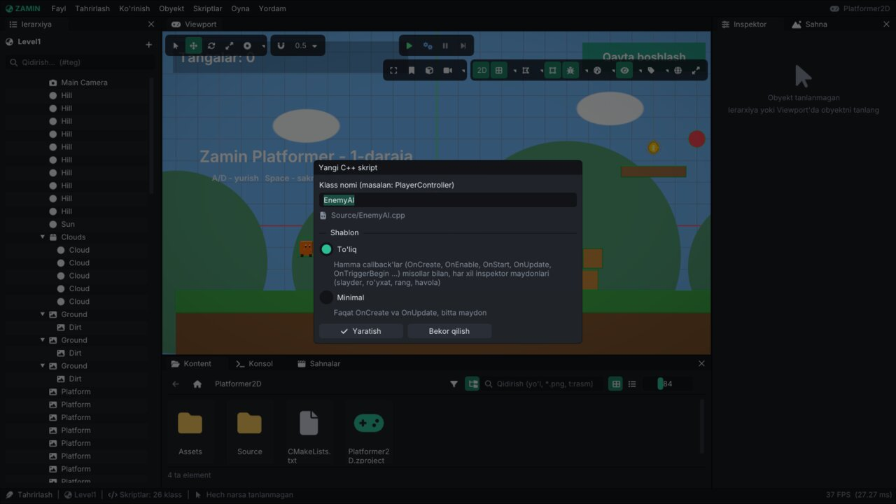
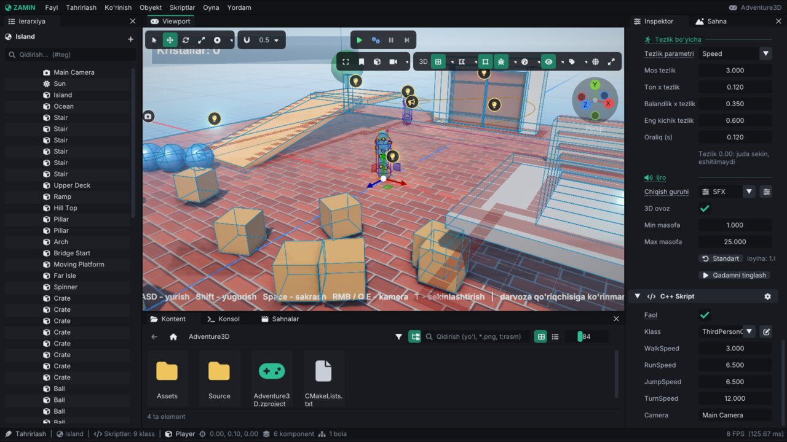

# Zamin Engine: the C++ scripting guide

For node logic without code there is [Visual Script](VisualScripting.md). This guide covers the C++ path:

Game logic can also be written in C++: every script is a class derived from `ScriptableEntity`, attached to an object
in the scene with the **C++ Script** component. This guide explains everything from creating a script to the life
cycle, inspector fields, events, physics, input, scenes, audio, hot reload and export. Every function name is the real
API in `Zamin/src/Zamin/Scripting/ScriptableEntity.h`; the examples come from the sample projects
(`Projects/Platformer2D`, `Projects/Showcase3D`, `Projects/Adventure3D`) or from the
[2D](Tutorial-2D.md) / [3D](Tutorial-3D.md) tutorials and have been compiled and tested.

For editing, building and diagnosing scripts inside the engine there is the [Code editor](CodeEditor.md) guide.

The code examples are written with `#include <Zamin/Zamin.h>` and `using namespace Zamin;`.

Contents:

1. [How a script works](#1-how-a-script-works)
2. [The first script](#2-the-first-script)
3. [The structure of a script file](#3-the-structure-of-a-script-file)
4. [Inspector fields (ZM_FIELD)](#4-inspector-fields-zm_field)
   - [Methods for Visual Script (ZM_METHOD)](#4b-methods-for-visual-script-zm_method)
5. [The life cycle](#5-the-life-cycle)
6. [Event callbacks](#6-event-callbacks)
7. [Objects, components, hierarchy](#7-objects-components-hierarchy)
8. [Input](#8-input)
9. [Physics and queries](#9-physics-and-queries)
10. [Time, timers, tweens](#10-time-timers-tweens)
11. [Messages, the event bus, global state](#11-messages-the-event-bus-global-state)
12. [Scenes](#12-scenes)
13. [Audio](#13-audio)
14. [Graphics, colour and effects](#14-graphics-colour-and-effects)
15. [UI](#15-ui)
16. [Animation](#16-animation)
17. [AI and navigation](#17-ai-and-navigation)
18. [Saving, localization, logging](#18-saving-localization-logging)
19. [Several files and communication between scripts](#19-several-files-and-communication-between-scripts)
20. [Compilation and hot reload](#20-compilation-and-hot-reload)
21. [Scripts in an exported game](#21-scripts-in-an-exported-game)
22. [Sample scripts](#22-sample-scripts)
23. [Common mistakes](#23-common-mistakes)
24. [API reference](#24-api-reference)

---

## 1. How a script works

- The project's C++ code lives in the `Source/` folder (`SourceDirectory` in the `.zproject`). When a project is
  created the editor writes a `CMakeLists.txt`: the `Source/*.cpp` and `Source/*.h` files are compiled with
  `zamin_add_game_module(<Project> ...)` into one **script module** — `Binaries/lib<Project>.so` (`ScriptModulePath`).
  Adding a new file needs no change to CMake (`file(GLOB_RECURSE ... CONFIGURE_DEPENDS)`).
- The engine, `libZamin.so`, is a shared library: the editor, the player and the game module use one copy of it, so a
  script calls `Scene`, `Input`, `Audio` and every other API directly.
- Every script class registers itself at the end of its file with `ZM_REGISTER_SCRIPT(Class, fields...)`. When the
  module is loaded (`ScriptEngine::LoadModule`) the classes are written to the `ScriptRegistry` and appear in the
  inspector's **C++ Script → Class** list; when the module is closed they remove themselves.
- The `NativeScriptComponent` on an object stores only the class name (`ClassName`), the field values set in the
  inspector (`Fields`) and the `Enabled` flag. When the game starts (**Play** in the editor, or `ZaminPlayer`) the
  scene creates an instance of the class for every such component, writes the field values into it and calls the
  callbacks.
- In the editor **Play** runs on a copy of the scene: everything a script changes while playing is gone when **Stop**
  is pressed, and the edited scene stays as it was.

## 2. The first script

1. Open a project (the launcher or **File → Open project...**). A new project already has `Source/Scripts.cpp`: it
   holds the `Rotator` and `PlayerController` classes (the `Cube` object in the template scene spins with `Rotator`).
2. **Scripts → New C++ script...** (or right-click an empty spot in the **Content** panel → **New C++ script...**).
   In the window:
   - **Class name** — for example `EnemyAI`. The name is checked at once: it must not be empty, must not start with a
     digit and may only hold Latin letters, digits and `_`; C++ keywords and engine names that clash with
     `using namespace Zamin` (`Camera`, `Entity`, `Input` ...) are not accepted — the window suggests a name such as
     `CameraController`. It also warns when a class with that name or a `Source/<Name>.cpp` file already exists.
   - **Template** — **Full** (every callback with examples, all kinds of inspector fields: a slider, a list, a colour,
     a reference) or **Minimum** (only `OnCreate` and `OnUpdate`, one field).
   - **Create** — `Source/<Name>.cpp` is written and the scripts are compiled at once.
3. Select an object → in the inspector **+ Component → Other → C++ Script** → choose the class from the **Class**
   list. The pencil button next to the class opens its code in the built-in [Code editor](CodeEditor.md) (or an
   external editor of your choice; it is found by `ZM_REGISTER_SCRIPT` in `Source`).
4. **▶ Play** (`Ctrl+P`). The script's `ZM_INFO(...)` messages appear in the **Console** panel.
5. After changing the code, **Scripts → Compile + reload** (`Ctrl+B`). Details: [section 20](#20-compilation-and-hot-reload).

The bottom of the **Scripts** menu lists every class registered in the module (with the number of fields next to it);
clicking one opens the class's code.



*Scripts → New C++ script...: the class name (the file becomes `Source/EnemyAI.cpp`) and the template — Full or Minimum.*

## 3. The structure of a script file

The simplest script, from a new project's `Source/Scripts.cpp`:

```cpp
#include <Zamin/Zamin.h>

using namespace Zamin;

// Rotates the entity all the time.
class Rotator : public ScriptableEntity
{
public:
    glm::vec3 Speed = { 0.0f, 1.0f, 0.0f }; // radians per second

    void OnUpdate(Timestep ts) override
    {
        Transform().Rotation += Speed * (float)ts;
    }
};
ZM_REGISTER_SCRIPT(Rotator, ZM_FIELD_TOOLTIP(Rotator, Speed, "Rotation speed around each axis (radians per second)"))
```

- `#include <Zamin/Zamin.h>` — the engine's whole public API (scene, components, input, audio, math ...).
- The class derives **publicly** from `ScriptableEntity`; callbacks are written with `override` (only the ones you need).
- Public member variables listed with `ZM_FIELD` are edited in the inspector (section 4); the rest (the `private`
  members starting with `m_`) are for the code itself.
- `Timestep` — the frame time in seconds; it converts to `float` by itself (`(float)ts` or `ts.GetSeconds()`).
- `Transform()` — the object's `TransformComponent` (`Translation`, `Rotation` — Euler angles in radians, `Scale`).
- A file can hold several classes; each has its own `ZM_REGISTER_SCRIPT` line.

## 4. Inspector fields (ZM_FIELD)

The members listed in `ZM_REGISTER_SCRIPT(Class, ...)` appear in the **C++ Script** section of the inspector. The
values are stored in the scene file (`"NativeScript": { "Class": ..., "Fields": {...} }`) and written into the instance
when the game starts — the initial value in the code only applies to a field not changed in the inspector.



*`Player` selected in Adventure3D: the **C++ Script** section with the `ThirdPersonController` class (with the button
that opens the code next to it) and its fields registered with `ZM_FIELD` — `WalkSpeed`, `RunSpeed`, `JumpSpeed`,
`TurnSpeed` (`float`) and `Camera` (`std::string`, the name of the camera object).*

Supported types (`ScriptFieldType`): `float`, `int`, `bool`, `glm::vec2`, `glm::vec3`, `glm::vec4`, `std::string`,
`EntityRef` (a reference to another object), `AnimationCurve` (with the curve editor) and any `enum` / `enum class`
(with any underlying type). Any other type in `ZM_FIELD` is a compile error.

| Macro | In the inspector |
|---|---|
| `ZM_FIELD(Class, Member)` | A control for its type (number, checkbox, vector, text, reference ...) |
| `ZM_FIELD_RANGE(Class, Member, Min, Max)` | A `[Min, Max]` slider (`float`, `int`, `glm::vecN`; for an `AnimationCurve` the visible range) |
| `ZM_FIELD_COLOR(Class, Member)` | A colour picker (`glm::vec3` / `glm::vec4`) |
| `ZM_FIELD_COLOR_HDR(Class, Member)` | A colour picker whose values may be above 1 |
| `ZM_FIELD_TOOLTIP(Class, Member, "text")` | A help text when the mouse hovers over it |
| `ZM_FIELD_ENUM(Class, Member, "A", "B", {"C", 10})` | A drop-down list (`enum` or `int`) |

Attributes can also be chained (`ScriptFieldInfo`): `.Range(min, max)`, `.Tooltip("...")`, `.Label("Name")`,
`.Header("Section")`, `.Color(hdr)`, `.Multiline()`, `.Options({...})`. They only change how the field looks in the
inspector. From `Projects/Platformer2D/Source/Player.cpp`:

```cpp
ZM_REGISTER_SCRIPT(PlayerController,
    ZM_FIELD_RANGE(PlayerController, MoveSpeed, 0.0f, 20.0f).Header("Movement").Tooltip("Walk speed (units/second)"),
    ZM_FIELD_RANGE(PlayerController, JumpImpulse, 0.0f, 30.0f).Tooltip("Jump force (impulse)"),
    ZM_FIELD(PlayerController, FallLimit).Tooltip("Falling below this height returns the player to the start"),
    ZM_FIELD(PlayerController, DropThrough).Label("Dropping through platforms")
        .Tooltip("Down (S) + jump: drops down through a one-way platform (a tile or a Box Collider)"))
```

A list (enum) — `MovingPlatform` in `Projects/Platformer2D/Source/Gameplay.cpp`:

```cpp
enum class Motion { Smooth, Linear };
Motion Mode = Motion::Smooth;
...
ZM_FIELD_ENUM(MovingPlatform, Mode, "Smooth (sine)", "Linear").Label("Movement type")
```

Each option's value is one more than the previous one (`{"A", "B", {"Z", 10}, "W"}` → 0, 1, 10, 11). An explicit
value (`{"Boss", 10}`) must be a real value of the enum — an enum without an underlying type can only hold the range
of its own values (give it an explicit type: `enum class Mode : int`). When the field's type changes between `int` and
`enum`, the value in the scene is kept.
A number outside such values is undefined behaviour (UBSan finds it). A `glm::vec4` field with a plain `ZM_FIELD`
appears in the inspector as 4 numbers — use `ZM_FIELD_COLOR` for a colour.

**Reference (`EntityRef`)** — points to another object. In the inspector an object is dragged from the hierarchy onto
the field or chosen from a list; in code `Resolve(ref)` gives the `Entity` (an empty `Entity` when it is not found).
When the object is duplicated or created from a prefab, internal references follow the new copy. The camera from the
[3D tutorial](Tutorial-3D.md):

```cpp
EntityRef Target;  // dragged from the hierarchy
...
Entity target = Resolve(Target);
if (!target)
    return;
```

**While playing**, changing a field in the inspector is written into the running instance at once (for
experimenting), but it is not saved to the scene — after **Stop** the previous value comes back. The class cannot be
switched while playing.

## 4b. Methods for Visual Script (ZM_METHOD)

Visual Script graphs can call a script class's methods and free functions — registered in the same
`ZM_REGISTER_SCRIPT` list as the fields (`Zamin/Scripting/ScriptMethod.h`). The node library's **C++** section shows
them; the [Visual Script guide](VisualScripting.md#native-c-methods) has how graphs use them, how a changed method is
reported after a hot reload and how the export cooks them.

```cpp
#include <Zamin/Zamin.h>
#include <cmath>
using namespace Zamin;

enum class ScoreMedal { Bronze, Silver, Gold };
ZM_SCRIPT_ENUM(ScoreMedal, "Bronze", "Silver", "Gold")

struct ScoreCard
{
    float Total = 0;
    ScoreMedal Medal = ScoreMedal::Bronze;
};
ZM_SCRIPT_STRUCT(ScoreCard, ZM_STRUCT_FIELD(ScoreCard, Total), ZM_STRUCT_FIELD(ScoreCard, Medal))

class Scoreboard : public ScriptableEntity
{
public:
    float Bonus = 1.5f;
    int Awards = 0;

    // An execution node (In/Then): changes the instance, returns a value.
    int Award(const std::string& reason)
    {
        ZM_INFO("Award: {}", reason);
        return ++Awards;
    }
    // Pure data nodes: called whenever a graph reads the result.
    ScoreCard Grade(const std::vector<float>& points) const
    {
        ScoreCard card;
        for (float p : points) card.Total += p * Bonus;
        card.Medal = card.Total >= 50 ? ScoreMedal::Gold : card.Total >= 30 ? ScoreMedal::Silver : ScoreMedal::Bronze;
        return card;
    }
    static float Clamp01(float value) { return std::clamp(value, 0.0f, 1.0f); }
};

ZM_REGISTER_SCRIPT(Scoreboard,
    ZM_FIELD(Scoreboard, Bonus),
    ZM_METHOD(Scoreboard, Award, "Reason").Returns("Awards").Tooltip("Counts an award"),
    ZM_PURE_METHOD(Scoreboard, Grade, "Points"),
    ZM_PURE_METHOD(Scoreboard, Clamp01, "Value"))

static float Hypotenuse(float x, float y) { return std::sqrt(x * x + y * y); }
ZM_REGISTER_FUNCTIONS(ScoreMath, ZM_PURE_FUNCTION(Hypotenuse, "X", "Y"))
```

| Macro | For graphs |
|---|---|
| `ZM_METHOD(Class, Method, "Param"...)` | A method (or a static member) of the class: a `Native.Call` execution node. Without names the parameters are `Arg1`, `Arg2` ... |
| `ZM_PURE_METHOD(Class, Method, "Param"...)` | A pure data node (`Native.Pure`); the method must return a value (a compile error otherwise) |
| `ZM_FUNCTION(Function, "Param"...)` / `ZM_PURE_FUNCTION` | A free function, inside `ZM_REGISTER_FUNCTIONS(Library, ...)`: the graph calls `Library.Function` without a Target |
| `ZM_SCRIPT_ENUM(Enum, "A", "B", {"C", 10})` | A C++ enum graphs use as an Enum (options as in `ZM_FIELD_ENUM`) |
| `ZM_SCRIPT_STRUCT(Struct, ZM_STRUCT_FIELD(Struct, Member)...)` | A default-constructible C++ struct graphs use as a Struct of the same fields |

The attributes chain: `.Pure()`, `.Tooltip("...")`, `.Returns("Name")` (the result pin, `Value` by default),
`.Params({"A", "B"})`. Parameter and result types: `float`, `double`, `int`, `int64_t` (Number; an integer parameter
takes whole numbers within its range only), `bool`, `std::string`, `glm::vec2/3/4`, `EntityRef` (Entity), a
`ZM_SCRIPT_ENUM` enum, a `ZM_SCRIPT_STRUCT` struct and `std::vector` of any of these, by value or `const&`; any other
type, a non-const reference or a method overload is a compile error. The names `In`, `Then`, `Method` and `Target` are
reserved. `ZM_SCRIPT_ENUM` / `ZM_SCRIPT_STRUCT` go at namespace scope in the type's own namespace (a header is fine:
they register once). An instance method runs on the live instance of its class on the graph node's **Target** entity
(play mode); a static member or a free function needs none. A `std::runtime_error` (any exception) a method throws
stops the calling graph with its message. Like classes, the methods come and go with the module: after a hot reload a
graph re-binds them and marks the ones that changed.

## 5. The life cycle

| Callback | When it is called |
|---|---|
| `OnCreate()` | Once, when the instance is created (when the game starts or the object appears). All the `OnCreate`s of a scene run before the first `OnEnable` |
| `OnEnable()` | After `OnCreate` (if the script is enabled) and every time it is enabled again |
| `OnStart()` | Once, before the first `OnUpdate` — by then every script that exists has been through `OnCreate`/`OnEnable`: a good place to look up other objects |
| `OnUpdate(ts)` | Every frame (before the physics step), if the script is enabled |
| `OnLateUpdate(ts)` | Every frame, after the physics — for camera following |
| `OnDisable()` | When it is disabled (`SetEnabled(false)`, the object becomes inactive) and before `OnDestroy` (if it was enabled) |
| `OnDestroy()` | Once: when the object is destroyed or the game stops |

Order: `OnCreate → OnEnable → OnStart → (OnUpdate → OnLateUpdate)... → OnDisable → OnDestroy`.

**An enabled / disabled script.** The **Enabled** checkbox in the inspector (`NativeScriptComponent::Enabled`), in
code `SetEnabled(bool)` / `IsEnabled()`. `SetEnabled` calls `OnEnable` / `OnDisable` at once. A disabled script gets
no `OnUpdate` / `OnLateUpdate`, its timers and tweens pause and continue when it is enabled (`OnStart` is not called
again). `HasStarted()` — whether `OnStart` has run.

**An active / inactive object.** The object's own flag (`TagComponent::Active`) and its parents' flags:
`SetActive(false)` (this object), `SetActive(entity, false)` or `entity.SetActive(false)` switch off the whole
hierarchy. The scripts get `OnDisable` before `SetActive` returns (the parent first, then the children), their physics
bodies leave the world and nothing of them is drawn; when they are enabled again `OnEnable` comes. `IsActive()` — the
own flag, `IsActiveInHierarchy()` — with the parents, `IsActiveAndEnabled()` — the script is enabled and the object is
active. The script of an object inactive at the start of the game only gets `OnCreate`; `OnEnable` / `OnStart` come
when it becomes active. When an object is switched off its sound stops after `OnDisable`, and when it is switched on
the sound starts before `OnEnable`.

Event callbacks (collision, trigger, message, `OnClick` ...) reach a disabled script too — it can enable itself in
response. Messages and the event bus reach the script of an inactive object too, but `OnClick` does not (an inactive
button cannot be pressed).

## 6. Event callbacks

All of them are `virtual` with an empty default — `override` only the ones you need.

| Callback | When |
|---|---|
| `OnCollisionBegin(Entity other)` / `OnCollisionEnd(other)` | A solid collision (neither collider is a sensor), once per pair of objects; 2D and 3D |
| `OnTriggerBegin(Entity other)` / `OnTriggerEnd(other)` | A contact where at least one is a sensor (**Trigger (sensor)** / `IsSensor`); 2D, 3D and Character Controller 3D. `OnTriggerEnd` also comes when an object inside is destroyed |
| `OnJointBreak(const JointBreak2D&)` | A 2D joint of this object broke (`Type`, `ConnectedBody`, `Force`, `Torque`) |
| `OnJointBreak3D(const JointBreak3D&)` | A 3D joint of this object broke |
| `OnClick()` | The UI Button on this object was pressed (mouse, or Enter / gamepad A while it is selected) |
| `OnPointerEnter/Exit/Down/Up/Click(const UIPointerEvent&)` | The mouse over a UI object (`e.Target`, `e.Position`, `e.ScreenPosition`, `e.Inside`) |
| `OnSelect()` / `OnDeselect()` / `OnCancel()` | Keyboard / gamepad navigation: selected / selection left / Escape or B |
| `OnValueChanged(float)` | A UI Slider was moved by the player |
| `OnToggleChanged(bool)` | A UI Toggle switched |
| `OnTextChanged / OnTextSubmit / OnTextEndEdit(const std::string&)` | UI Input Field: the text changed / Enter / editing finished |
| `OnScrollChanged(const glm::vec2&)` | A UI Scroll View's content was scrolled (x: 0 left..1 right, y: 1 top..0 bottom) |
| `OnSoundFinished(const SoundFinished&)` | A sound of this object finished by itself (`Handle`, `Clip`, `FromAudioSource`, `Stolen`) |
| `OnParticlesFinished()` | A non-looping Particle System finished its cycle |
| `OnTargetSpotted(Entity)` / `OnTargetLost(Entity)` | The Sight Sensor saw / lost the target |
| `OnPatrolPointReached(int index)` | The Patrol Path reached a point |
| `OnMessage(const ScriptMessage&)` | A message came to this object (`SendMessage`, `Broadcast` ...) |
| `OnAnimationEvent(const AnimationEventInfo&)` | An Animation Player / Animator event (`Name`, `Parameter`, `Clip`, `Time`, `Source`, `Skeletal`) |
| `OnLanguageChanged(const std::string&)` | The game's language changed — rewrite the texts built with `Localize(...)` |
| `OnSceneLoaded / OnSceneUnloaded(const SceneEventInfo&)`, `OnActiveSceneChanged(prev, current)` | SceneManager events (`Name`, `Path`, `BuildIndex`, `Mode`) |

Most of them also go out on the scene's event bus (for example `"SoundFinished"`, `"ParticlesFinished"`,
`"TargetSpotted"`, `"UISliderChanged"`, `"SceneLoaded"`) — other scripts can listen with `Subscribe`.

The coin example (`Projects/Platformer2D/Source/Gameplay.cpp`): its collider is a sensor, so a touch arrives as
`OnTriggerBegin`:

```cpp
void OnTriggerBegin(Entity other) override
{
    if (m_Collected || !other.HasTag("Player"))
        return;
    m_Collected = true;
    Emit("CoinCollected"); // the GameManager subscribed to it
    Instantiate(Effect, GetWorldPosition());
    Destroy();
}
```

## 7. Objects, components, hierarchy

**Components.** `GetComponent<T>()` (it must exist), `TryGetComponent<T>()` (`nullptr` when it does not),
`HasComponent<T>()`, `AddComponent<T>(...)`. All the components and their fields: [Components.md](Components.md).

```cpp
if (auto* sprite = TryGetComponent<SpriteRendererComponent>(); sprite && dir != 0.0f)
    sprite->FlipX = dir < 0.0f;
```

**About the object.** `GetEntity()`, `GetScene()`, `Transform()`, `GetName()`, `SetName("...")`,
`GetScriptClassName()` (which class the instance was created from).

**Finding.** `FindEntity("Name")` — the first object with that name (cached, cheap to call every frame), first in this
scene, then in the other loaded scenes; `FindEntities("Name")` — all of them. Change a name with `SetName`: writing to
`TagComponent::Tag` directly is noticed by the cache only on the next frame. Tags (the **Tags** component):
`HasTag("Enemy")`, `AddTag(...)`, `RemoveTag(...)`, `FindEntitiesWithTag("Enemy")`, `FindEntityWithTag(...)`.
By type: `FindObjectsOfType<T>()` / `FindObjectOfType<T>()` — `T` can be a component or a script class:

```cpp
for (auto* enemy : FindObjectsOfType<EnemyAI>()) enemy->Alert();
if (auto* hud = FindObjectOfType<Hud>()) hud->SetScore(m_Score);
```

**Another object's script.** `GetScript<T>(entity)` — a `T*` or `nullptr`
(`Projects/Adventure3D/Source/World.cpp`):

```cpp
if (auto* game = GetScript<AdventureGame>(FindEntity("Game"))) game->Collect();
```

**Creating and destroying.** `Instantiate(entity, position)` / `Instantiate(entity)` — a copy of an existing object
(with its own active flag); `Instantiate("Prefabs/Ball.zprefab", position)` — from a prefab asset ([Prefabs.md](Prefabs.md)).
`Destroy(entity)` / `Destroy()` — destroyed at the end of the frame.

**Hierarchy.** `GetParent()`, `SetParent(parent, keepWorldTransform = true)`, `GetWorldPosition()`, `GetChildren()`,
`GetChildCount()`, `GetChild(i)`, `FindChild("Name", recursive = true)`, `GetDescendants()`, `GetRoot()`. A child's
`Transform` is relative to its parent. A component or script from the children / parents:
`GetComponentInChildren<T>()`, `GetComponentsInChildren<T>()`, `GetComponentInParent<T>()`,
`GetComponentsInParent<T>()`, and for the object itself `FindInChildren<T>()`, `FindInParent<T>()` (all with
`includeSelf = true` by default).

**Activity.** `SetActive(bool)`, `SetActive(entity, bool)`, `IsActive()`, `IsActiveInHierarchy()`,
`IsActiveAndEnabled()` (section 5).

## 8. Input

Named actions and axes are bound to keys, mouse buttons or the gamepad in the **Project settings → Input** window and
stored in the `.zproject` ([ProjectSettings.md](ProjectSettings.md)); the window shows the live state of every action /
axis. An axis value: the negative / positive keys (-1 / +1) and the gamepad axis (rescaled to 0..1 after the deadzone)
— the larger one wins; gamepad bindings listen to every connected gamepad. The defaults in a new project:

| Name | Kind | Bindings |
|---|---|---|
| `Jump` | action | Space, gamepad A |
| `Fire` | action | left mouse button, left Ctrl, right trigger |
| `Interact` | action | E, gamepad X |
| `Sprint` | action | left Shift, left stick press |
| `Pause` | action | Escape, gamepad Start |
| `Horizontal` | axis | A/D, ←/→, D-pad, left stick X |
| `Vertical` | axis | S/W, ↓/↑, D-pad, left stick Y |
| `Move` | 2D vector | `Horizontal` + `Vertical`, length limited to 1 |

```cpp
float dir = Input::GetAxis("Horizontal");             // -1..1
glm::vec2 move = Input::GetVector("Move");            // or Input::GetAxis2D("Horizontal", "Vertical")
if (Input::IsActionJustPressed("Jump")) ...           // true for exactly one frame
if (Input::IsActionPressed("Sprint")) ...             // while it is held
if (Input::IsActionJustReleased("Fire")) ...
```

The device itself: `Input::IsKeyPressed(Key::W)`, `IsKeyJustPressed`, `IsKeyJustReleased`,
`IsMouseButtonPressed(MouseButton::Left)` (and `...JustPressed` / `...JustReleased`), `GetMousePosition()`,
`GetMouseDelta()`, `GetMouseScrollDelta()`, `IsGamepadConnected(id)`, `IsGamepadButtonPressed(GamepadButton::A)`,
`GetGamepadAxis(GamepadAxis::LeftX)`. The state is read once at the start of every frame: `JustPressed` /
`JustReleased` are `true` for exactly one frame.

The script's helpers tied to the game view (pixels, from the top-left corner): `GetMousePosition()`,
`GetViewportSize()`, `GetMouseWorldPosition()` (2D: through the main camera onto the z = 0 plane),
`ScreenToWorld(screen, z)`, `ScreenPointToRay(screen)` and `GetMouseRay()` (for picking with `Geometry::Raycast`).

The cursor: `Cursor::SetLockMode(CursorLockMode::Locked)` (mouse look — `Input::GetMouseDelta()`),
`Cursor::SetVisible(false)`, `Cursor::SetImage("Textures/crosshair.png", { 16, 16 })`.

**Control hints** — the "which button does what" text on the game screen is taken from the input map and adapts to
the device the player is using. `Input::GetActiveDevice()` — the device used last (`InputDevice::KeyboardMouse`: a
key, a mouse button, the wheel or a move of a few pixels; `InputDevice::Gamepad`: a gamepad button, or a stick /
trigger pushed more than halfway); when it changes, `Input device: gamepad` is written to the log.
`Input::GetBindingText("Jump")` — that device's bindings (`"Space / W"`, on a gamepad `"A"`; an axis:
`"A, D / Arrows"`, `"Left stick / D-pad"`; a vector: `"WASD"`), `Input::ExpandBindings("[Jump] - jump")` — in place of
every `[Name]` in the text. `[Name|text]` — `text` when that device has no binding (`[Look|Mouse]`), `[kb:text]` /
`[pad:text]` — text only for the keyboard / only for the gamepad. The **Control hints** checkbox (`InputHints`) of the
Text component does this by itself and refreshes the text when the device changes ([UI.md](UI.md)). Button names are
changed in the game's language files with `input.<id>` keys: `input.key.Arrows` → `arrows`, `input.mouse.Left` →
`LMB`, `input.stick.Left` → `left stick`, `input.pad.DPad` (the ids: `key.<Key>`, `mouse.<Button>`, `pad.<Button>`,
`stick.Left/Right`, `pad.LeftTrigger/RightTrigger`). The main menus of the sample games work this way
([Samples.md](Samples.md)).

## 9. Physics and queries

The full guide (bodies, colliders, joints, layers, settings, samples): [Physics.md](Physics.md).

**2D** (a `Rigidbody2DComponent` on the object): `GetVelocity()`, `SetVelocity(v)`, `ApplyImpulse(i)`,
`ApplyForce(f)`, `SetPosition2D(p)` (moves the body too), `DropThroughPlatforms(seconds)` (dropping through one-way
platforms), sleeping: `IsSleeping()`, `WakeUp()`, `PutToSleep()` and for another object `IsSleeping(other)`,
`WakeUp(other)`. On another object: `SetVelocity(other, v)`, `ApplyImpulse(other, i)`.

```cpp
// Projects/Platformer2D/Source/Player.cpp
glm::vec2 velocity = GetVelocity();
float target = dir * MoveSpeed;
velocity.x += (target - velocity.x) * std::min(1.0f, 12.0f * (float)ts);
SetVelocity(velocity);
if (Input::IsActionJustPressed("Jump") && m_GroundContacts > 0)
    ApplyImpulse({ 0.0f, JumpImpulse });
```

**3D** (`Rigidbody3DComponent` + a 3D collider): `GetVelocity3D()`, `SetVelocity3D(v)`, `GetAngularVelocity3D()`,
`SetAngularVelocity3D(v)`, `ApplyImpulse3D(i)`, `ApplyForce3D(f)`, `ApplyTorque3D(t)`, `SetPosition3D(p)`,
`IsSleeping3D()`, `WakeUp3D()`, `PutToSleep3D()` (and their `(other)` variants), `SetVelocity3D(other, v)`,
`ApplyImpulse3D(other, i)`.

**A character** (`CharacterController3DComponent`): `Move(velocity)` — the horizontal velocity, `Jump(speed)` (only
on the ground), `Grounded`, `Velocity` (the real velocity of the last step), `VerticalVelocity`. The component works out
gravity and stairs itself:

```cpp
auto* cc = TryGetComponent<CharacterController3DComponent>();
glm::vec2 input = Input::GetVector("Move");
cc->Move(glm::vec3(input.x * Speed, 0.0f, -input.y * Speed));
if (Input::IsActionJustPressed("Jump"))
    cc->Jump(JumpSpeed);
```

**Queries.** The result is a `RaycastHit` (`Hit`, `EntityID`, `Point`, `Normal`, `Distance`; checked with `if (hit)`;
the object: `GetScene().GetEntityByUUID(hit.EntityID)`).

| 2D | 3D |
|---|---|
| `Raycast2D(origin, dir, maxDistance, layerMask)` | `Raycast3D(origin, dir, maxDistance, layerMask)` |
| `Raycast2DAll(..., includeTriggers)` | `Raycast3DAll(...)` |
| `OverlapCircle2D(center, r, mask)` | `OverlapSphere3D(center, r, mask)` |
| `OverlapBox2D(center, halfExtents, angleDegrees, mask)` | `OverlapBox3D(center, halfExtents, rotation, mask)` |
| `OverlapPoint2D(point, mask)` | `OverlapCapsule3D(p0, p1, r, mask)` |
| | `SphereCast3D`, `BoxCast3D`, `CapsuleCast3D` (+ `...All`) — a "thick ray" |

Collision layers are named in **Project settings → Physics layers** (shared by 2D and 3D): `LayerMask({ "Ground",
"Enemy" })` — a bit mask, `LayerIndex("Player")` — the index (-1 when there is none).

```cpp
if (RaycastHit hit = Raycast3D(GetWorldPosition(), { 0, 0, 1 }, 20.0f, LayerMask({ "Enemy" })))
    Hurt(GetScene().GetEntityByUUID(hit.EntityID));
```

Joints and other physics settings go through the components (`GetComponent<RevoluteJoint2DComponent>().MotorSpeed`,
`GetComponent<HingeJoint3DComponent>().JointAngle` ...) — [Components.md](Components.md).

## 10. Time, timers, tweens

- `GetTime()` — the seconds since the script's scene started (the game clock: it follows the time scale and the
  pause). From anywhere: `Time::GetDeltaTime()`,
  `Time::GetUnscaledDeltaTime()`, `Time::GetFixedDeltaTime()`, `Time::GetFrameCount()`, `Time::GetTimeSinceStartup()`.
- The time scale: `SetTimeScale(0.5f)` (slow motion), `GetTimeScale()`; the pause: `PauseGame()`, `ResumeGame()`,
  `IsGamePaused()`. The `OnUpdate` time, timers, physics and animations follow it, the UI does not.
  `GetUnscaledDeltaTime()` — the real frame time. A script that drives the pause menu calls
  `SetUpdateWhenPaused(true)` in `OnCreate`; to run timers/tweens in real time — `SetTimersUnscaled(true)`.
- `QuitGame()` — quits the game (the player closes, in the editor Play stops).
- A fixed frame time: `Time::SetCaptureFrameRate(30)` — every frame is exactly 1/30 s whatever the real time
  (frame-by-frame video recording, tests; `0` — real time again). The `ZAMIN_CAPTURE_FPS=N` environment variable does
  the same (`Tests/samples_test.py` runs the sample games with it).

**Timers** (on the main thread, after `OnUpdate`; safe to call from inside a callback too): `Invoke(seconds, fn)`,
`InvokeRepeating(delay, interval, fn)`, `CancelInvokes()`, `IsInvoking()`.

**Tween**: `Tween(duration, [](float t) {...}, Ease::OutBack, onComplete)` — `t` 0..1 (with easing),
`TweenPosition(target, seconds, ease, onComplete)`, `TweenScale(...)`, `CancelTweens()`, `IsTweening()`.
`Ease`: `Linear`, `InQuad`, `OutQuad`, `InOutQuad`, `OutCubic`, `InOutCubic`, `OutBack`, `OutElastic`, `OutBounce`
(`ApplyEase(ease, t)`).

```cpp
// Tutorial-3D: 3 seconds after every crystal is collected the scene loads from the start
Invoke(RestartDelay, [this]() { ReloadScene(SceneTransition::Fade(0.5f)); });
```

For smooth movement `Math::Damp(current, target, sharpness, dt)` (independent of the frame rate),
`Math::SmoothDamp`, `Math::MoveTowards`, `Math::Remap` and others — [Core.md](Core.md).

## 11. Messages, the event bus, global state

**Messages** — delivered at once to a specific object's script (first the functions bound to that name with
`AddMessageHandler`, then `OnMessage`). The `payload` is any copyable value; it is read with `msg.Get<T>()` (numbers
convert to each other), `msg.Sender` — the object that sent it.

```cpp
// The enemy
AddMessageHandler("Damage", [this](const ScriptMessage& m) { Health -= m.Get<float>(); });
// The player
SendMessage(FindEntityWithTag("Enemy"), "Damage", 25.0f);
```

`SendMessage(target, name, payload)` (`true` when it has a script), `SendMessageToChildren(...)`,
`SendMessageUpwards(...)`, `Broadcast(name, payload)` (to every script in the scene), `RemoveMessageHandlers(name)`.

**The event bus** (publish / subscribe) — the sender does not know who listens. The subscriptions a script made are
cancelled by themselves when the script is destroyed.

```cpp
// GameManager (Projects/Platformer2D/Source/GameManager.cpp)
m_CoinSubscription = Subscribe("CoinCollected", [this](const ScriptMessage&) { AddCoin(); });
...
Unsubscribe(m_CoinSubscription);
// The coin
Emit("CoinCollected");            // to the subscribers, now
EmitDeferred("LevelDone", 2);     // after this frame's OnLateUpdate
```

`GetEventBus()` — the scene's bus.

**Global state and services** — outside the scenes, kept across every scene change:

```cpp
GameState::Increment("Coins");
int coins = GameState::GetInt("Coins");
WatchGameState("Coins", [this](std::string_view) { RefreshHud(); }); // ends together with the script
auto& stats = GetOrCreateService<SessionStats>();                    // GetService<T>() - nullptr when missing
```

`UnwatchGameState(id)` cancels a watch. Details: [Scenes.md](Scenes.md).

## 12. Scenes

Paths are relative to `Assets`; a scene in the build list can also be loaded by name or index (**Project settings →
Build scenes**). The switch happens at the end of the frame.

```cpp
LoadScene("Scenes/Level2.zscene");
LoadScene("Scenes/Level2.zscene", SceneTransition::Fade(0.5f));   // fades to black and back
LoadScene("Scenes/HUD.zscene", LoadSceneMode::Additive);          // added alongside
LoadScene(2);                                                      // build index
if (!LoadNextScene(SceneTransition::Fade(0.5f))) LoadScene(0);     // the last level: to the menu
ReloadScene();
```

`GetSceneBuildIndex()`, `GetActiveSceneBuildIndex()`, `GetBuildSceneCount()`, `UnloadScene("HUD")`,
`DontDestroyOnLoad()` / `DontDestroyOnLoad(entity)` (stays when the scene changes), `GetSceneManager()`.
Loading in the background (a loading screen) — `LoadSceneAsync` (`Projects/Platformer2D/Source/SceneFlow.cpp`):

```cpp
m_Load = LoadSceneAsync(Target, LoadSceneMode::Single, SceneTransition::Fade(Fade));
if (m_Load)
    m_Load->SetAllowSceneActivation(false); // the screen allows it itself when it is ready
...
// GetProgress() 0..1 (0.9 - loaded, waiting for activation), IsReady(), HasFailed()
```

Sub-scenes (the Sub-scene component): `LoadSubScene()` / `LoadSubScene(host)`, `UnloadSubScene()`, `GetSubScene()`.
Details: [Scenes.md](Scenes.md).

## 13. Audio

The full guide (mixer, music, 3D, filters, limits, zones, profiler): [Audio.md](Audio.md).

One-shot sounds (they return an `AudioEngine` handle, 0 — not played):

```cpp
PlaySound("Audio/coin.wav");                                // the SFX group
PlaySound("Audio/click.wav", 0.8f, 1.0f, "UI");             // volume, pitch, mixer group
PlaySoundAt("Audio/boom.wav", GetWorldPosition());          // with a 3D position
SoundParams step; step.PitchRandom = { 0.9f, 1.1f }; step.MaxInstances = 3;
PlaySound("Audio/step.wav", step);                          // random range, limit, priority, FadeIn ...
```

The object's **Audio Source** component: `PlayAudio()` / `PlayAudio(fadeIn)`, `StopAudio()` / `StopAudio(fadeOut)`,
`PauseAudio()`, `ResumeAudio()`, `IsAudioPlaying()`, `IsAudioPaused()`, `SetAudioVolume(v)` / `GetAudioVolume()`,
`SetAudioPitch(p)` / `GetAudioPitch()`, `GetAudioTime()` / `SetAudioTime(s)`, `GetAudioLength()`,
`FadeAudio(volume, seconds)`, `GetAudioFade()`, `SetAudioLowPass(hz)`, `SetAudioHighPass(hz)`. Most have an
`(Entity other, ...)` variant for another object.

Music and the mixer — the `Audio` class: `Audio::PlayMusic("Audio/theme.wav")`, `Audio::CrossfadeTo("Audio/boss.wav", 2.0f)`,
`Audio::StopMusic()`, `Audio::SetGroupVolume("SFX", 0.5f)`, `Audio::SetGroupMuted("Music", true)`,
`Audio::SaveSettings()` / `LoadSettings()`.

## 14. Graphics, colour and effects

The full guide (cameras, materials, lights, shadows, post-processing, particles): [Rendering.md](Rendering.md).

- **Material** (`MeshRendererComponent`): `GetMaterial()` — this object's own copy (does not affect the others),
  `GetMaterial(submesh)`, `GetSharedMaterial()` (the shared `.zmat` — affects everyone), `SetSharedMaterial(path)`,
  `ResetMaterial()`; `(Entity other, ...)` variants for another object.

  ```cpp
  GetMaterial()->SetColor({ 1.0f, 0.2f, 0.2f, 1.0f });
  GetMaterial()->SetEmission({ 1.0f, 0.5f, 0.1f }, 4.0f);
  ```
- **2D colour** (Sprite Renderer, otherwise Circle Renderer, Text, Tilemap): `GetColor()`, `SetColor(c)`,
  `TweenColor(target, seconds, ease, onComplete)`, `FadeTo(alpha, seconds, ...)`.
- **Sprite effects**: `Flash(color, duration)` (a hit flash), `SetOutline(color, thickness)`.
- **Tint animation** (the Tint Animation component): `PlayTint()`, `PlayTint(color, duration, mode, cycles, ease)`,
  `StopTint()`, `IsTintPlaying()`.
- **Sprite frames**: `GetSpriteSheet()`, `SetSprite("frame")`, `PlaySpriteSequence("run", fps, loop)`,
  `PlaySpriteClip("HeroSide")`, `GetSpriteClip()`.
- **Camera**: `ShakeCamera(intensity, duration, frequency)`, `StopCameraShake()`, `SetCameraTarget(entity, snap)`
  (the Camera 2D Follow target of the main camera).
- **Particles**: `EmitParticles(n)`.
- **Debug drawing** (for viewing only; absent from a Shipping build): `DebugDraw::Line(a, b, DebugColor::Red)`, `Ray(o, dir)`,
  `Arrow(a, b)`, `Box(center, half)` / `Box(center, half, quat)` / `Box(worldTransform)`, `Bounds(aabb)`, `Rect(c, size)`,
  `WireSphere(c, r)`, `Circle(c, normal, r)`, `Cross(p, size)`, `Point(p)`, `Axes(transform)`, `Path(points)`,
  `NavigationPath(points)`, `Text(p, "text")` — the last parameters: colour, `duration` (seconds, 0 = one frame), `depthTest`.

## 15. UI

The full guide (anchors, Canvas, layout, widgets, events, navigation, scroll view): [UI.md](UI.md).

Animations for UI objects (the **UI Transform** component) run during the game pause too; each returns a tween ID
(0 — no UI Transform):

```cpp
UIScaleTo({ 1.2f, 1.2f }, 0.2f);                                 // grows around the pivot
UIFadeTo(0.0f, 0.3f, Ease::OutQuad, [this] { SetActive(false); });
UIMoveTo({ 0.0f, 40.0f }, 0.4f);                                 // 40 UI units higher
UIPunchScale(0.15f);                                             // a short "bounce"
TweenUI(UITweenProperty::Alpha, glm::vec4(0.3f), 0.6f, { .Easing = Ease::InOutQuad, .Loop = UITweenLoop::PingPong });
```

`CancelUITweens(complete)`, `ShowUI(panel)` / `HideUI(panel, animate)` (opened / closed with the UI Animation
component). UI events — section 6 (`OnClick`, `OnPointer...`, `OnValueChanged` ...). Samples:
`Projects/Platformer2D/Source/PauseMenu.cpp`, `GameMenu.cpp`, `UIWidgetsDemo.cpp`, `UILayoutDemo.cpp`.

## 16. Animation

- **Property animation** (Animation Player, `.zanim` clips): `PlayAnimation("Clip", speed)` (`speed < 0` — backwards
  from the end), `StopAnimation()`, `IsAnimationPlaying()`.
- **Skeletal** (Animator): through the component — `GetComponent<AnimatorComponent>().SetFloat("Speed", v)`,
  `SetBool`, `SetTrigger`, `Play("Walk", ...)` (`Projects/Adventure3D/Source/Player.cpp` feeds `Speed` and `Grounded`
  to the state machine).
- **Events**: `OnAnimationEvent(e)` or by name `AddAnimationEventHandler("Footstep", fn)`,
  `RemoveAnimationEventHandlers("Footstep")`.

Details: [Animation.md](Animation.md).

## 17. AI and navigation

With a Nav Agent component: `SetDestination(point)`, `StopMoving()`, `SetNavTarget(entity)`, `IsMoving()`,
`GetRemainingDistance()`, `HasArrived()`, `GetNavTraversalLink()`, `CompleteNavTraversal(link, revision, ticket)`,
`CancelNavTraversal()`, `FindPath(from, to)`, `HasNavLineOfSight(from, to)`. Sight (Sight Sensor):
`CanSee(target)`, `CanSeeTarget()`, `GetSeenTarget()`, `GetLastSeenPosition()`, `RemembersTarget()`. Patrol (Patrol
Path): `PausePatrol()`, `ResumePatrol()`, `IsPatrolling()`, `GetPatrolPoint()`, `GetPatrolTarget()`,
`IsWaitingAtPatrolPoint()`, `SetPatrolPoint(i)`. Group (Formation): `SetFormationShape(FormationShape::Line)`,
`GetFormationShape()`, `AddFormationMember(e)`, `RemoveFormationMember(e)`, `IsFormationInPlace()`,
`GetFormationLeader()`, `GetFormationSlot(slot)`. To show a state machine and a behavior tree in the inspector:
`WatchStateMachine(machine)`, `UnwatchStateMachine(...)`, `GetWatchedStateMachines()`, `WatchBehaviorTree(tree)`,
`UnwatchBehaviorTree(...)`, `GetWatchedBehaviorTrees()`. Details and examples: [AI.md](AI.md)
(`Projects/Adventure3D/Source/Guard.cpp`, `Projects/Showcase3D/Source/AI.cpp`).

## 18. Saving, localization, logging

**SaveData** — values kept between games: `SaveData::SetInt/SetFloat/SetString/SetBool(key, value)`,
`GetInt/GetFloat/GetString/GetBool(key, default)`, `HasKey`, `DeleteKey`, `DeleteAll`, `Save()`. The file is
`~/.local/share/<Company>/<Product>/savedata.json` (the company and product name from **Project settings → Player**;
without a company — `~/.local/share/zamin/<Product>/`); it is written automatically when the game stops, when the
scene changes and when the program closes.

```cpp
SaveData::SetInt("TotalCoins", SaveData::GetInt("TotalCoins") + 1);
```

For records, `SaveData::SubmitRecord(key, result)` — writes the result and returns `true` when it is better than the
stored one (or nothing is stored yet); `RecordOrder::Lower` — smaller is better (lap time, steps).
`IsNewRecord(key, result)` — checks without writing. The next `Save()` writes it to the file:

```cpp
if (SaveData::SubmitRecord("Neon.BestScore", m_Score))
    ShowBanner(Localize("over.record"));                               // "NEW RECORD!"
SaveData::SubmitRecord("Racing.BestLap", lapSeconds, RecordOrder::Lower);
SaveData::Save();
```

The six M24 sample games store their records this way ([Samples.md](Samples.md#records-savedata)).

**Localization** — `Localize("menu.start")`, `Localize("hud.score", score)` (in place of `{0}`), `LocalizePlural(...)`;
when the language changes `OnLanguageChanged` comes. The language files: `Assets/Localization/<language>.json`
([ProjectSettings.md](ProjectSettings.md)).

**Logging** — `ZM_TRACE`, `ZM_INFO`, `ZM_WARN`, `ZM_ERROR`, `ZM_CRITICAL` (`std::format` syntax) write to the editor's
**Console** panel and to the player's log file:

```cpp
ZM_INFO("Level finished! Next: {}", NextScene);
```

**Checks** — `ZM_ASSERT(condition, "message {}", value)` is only compiled in a Debug build or with CMake
`-DZAMIN_ASSERTS=ON` (the editor builds the script module in Release — `ZM_ASSERT` in a script is usually off);
`ZM_VERIFY(condition, ...)` is always checked and returns the result:
`if (!ZM_VERIFY(texture, "no image '{}'", path)) return;`. Details: [Core.md](Core.md).

## 19. Several files and communication between scripts

Every `.cpp` and `.h` in `Source/` goes into the module. When other scripts need a class too, move its declaration
into a header (`Projects/Platformer2D/Source/GameManager.h`):

```cpp
#pragma once
#include <Zamin/Zamin.h>

class GameManager : public Zamin::ScriptableEntity
{
public:
    void OnEnable() override;
    void OnMessage(const Zamin::ScriptMessage& message) override;
    void AddCoin();
    ...
};
```

`ZM_REGISTER_SCRIPT(GameManager, ...)` stays in the `.cpp` file (in one place). The ways to communicate, from the
loosest coupling to the tightest: the event bus (`Emit` / `Subscribe` — the sender does not know the receiver),
messages (`SendMessage` — with a name and a payload), a direct call (`GetScript<GameManager>(entity)->AddCoin()`),
global state (`GameState`, `Services`).

## 20. Compilation and hot reload

- **Scripts → Compile + reload** (`Ctrl+B`) — the editor runs
  `cmake -DCMAKE_BUILD_TYPE=Release -DZamin_DIR=<engine>` (the first time) and `cmake --build Build --parallel`
  in the background, in `Build/` in the project folder. On success the module is reloaded.
- **Window → Compilation** (or **Scripts → Compiler output**) — **Problems** (the list of errors and warnings;
  clicking one opens the file at that line in the built-in code editor) and **Full output**. The status bar shows the
  result of the last compilation.
- **Scripts → Automatic hot reload** (on by default) — when the module file changes outside the editor (an IDE,
  `cmake --build` in a terminal), the editor reloads it by itself. Since the linker writes the file in place, the new
  module is loaded only once the file has stopped changing. **Scripts → Reload module** — by hand.
- Before loading, the module is copied to a temporary file, so the original `.so` can be rebuilt while the editor is
  open.
- A successful reload stops play mode (`Stop`) and destroys the script instances; since the field values from the
  inspector are stored in the scene, the new code works with them. When a field is renamed, the old value does not
  move to the new field.
- Building in a terminal: `cmake -S <project> -B <project>/Build -DZamin_DIR=<engine>/build && cmake --build <project>/Build`.
  The sample projects are built together with the engine (the root `CMakeLists.txt`). Sanitizer and coverage builds
  write the sample modules to their own `GameModules` folder; the programs load a module from another folder with
  `ZAMIN_SCRIPT_MODULE_DIR=<folder>` ([Testing.md](Testing.md)).

### Native SDK / ABI compatibility

`zamin_add_game_module` adds a `.zamin_abi` record to the module: a SHA-256 fingerprint of the SDK and its GLM/EnTT/JSON headers, the toolchain and the engine ABI definitions; the standard library/GLM sizes, alignments and some ABI flags. The check is conservative: a change in an SDK header may require a rebuild.

The loader checks the record of the temporary copy's ELF64 x86-64 file **before dlopen**. An unmarked/old, damaged or mismatched module is rejected; its constructors never run. On a `dlopen` error the running module and its class metadata are kept too. A successful candidate's registrations are held aside for the moment; the new classes are connected once the old module is fully closed. The automatic watcher does not retry an unchanged failed candidate every second.

When the **SDK headers changed** message appears, rebuild the engine first, then the project's scripts. With a different compiler/toolchain the message appears at configure time. Instead of assembling a `.so` by hand, use the SDK's `zamin_add_game_module` helper. The editor also checks the native module copied into an export; an export with a mismatched module is not marked successful. *Window → Scene statistics → Scripts* shows the engine fingerprint and whether the candidate matches.

This record gives native code no signature and no sandbox. The API is used on the main thread; there is no general rollback guarantee for external side effects of C++ constructors/destructors.

## 21. Scripts in an exported game

**File → Build game...** recompiles the script module in Release mode (`-O2 -DNDEBUG`) in a separate
`Build/ExportRelease` folder and puts it in the game folder; the player loads it together with the project.
In Release `ZM_ASSERT` is not checked and `DebugDraw` (in a Shipping build) draws nothing. Details: [Runtime.md](Runtime.md).

## 22. Sample scripts

| File | What it shows |
|---|---|
| `Projects/Platformer2D/Source/Player.cpp` | A 2D character: velocity, jumping, camera shake, flash, one-way platforms |
| `Projects/Platformer2D/Source/Gameplay.cpp` | A coin (trigger + event), camera following, a moving platform (enum field), the end of a level |
| `Projects/Platformer2D/Source/GameManager.*` | Header + `.cpp`, subscriptions, `SaveData`, localization |
| `Projects/Platformer2D/Source/SceneFlow.cpp` | A loading screen (`LoadSceneAsync`), `DontDestroyOnLoad`, services |
| `Projects/Platformer2D/Source/PauseMenu.cpp`, `GameMenu.cpp` | The pause and main menus, UI events, `SetUpdateWhenPaused` |
| `Projects/Platformer2D/Source/Joints.cpp`, `Ragdoll.cpp`, `Effectors.cpp` | 2D joints, a ragdoll, effectors |
| `Projects/Platformer2D/Source/Chase.cpp`, `TopDown.cpp` | Navigation, top-down controls |
| `Projects/Showcase3D/Source/Showcase.cpp` | 3D physics, raycasts, materials, particles, audio samples |
| `Projects/Showcase3D/Source/AI.cpp`, `Squad.cpp` | The sight sensor, the state machine, group shapes |
| `Projects/Adventure3D/Source/Player.cpp` | A third-person character: Character Controller 3D, Animator parameters |
| `Projects/Adventure3D/Source/Guard.cpp`, `World.cpp` | Guard AI, crystals, the gate animation |
| [Tutorial-2D.md](Tutorial-2D.md), [Tutorial-3D.md](Tutorial-3D.md) | A game step by step from scratch, with the full code |
| [Samples.md](Samples.md) | The six M24 sample games: shooter, Breakout, FPS, Sokoban, endless runner, racing — menus, records, gamepad |

## 23. Common mistakes

| Symptom | Cause and fix |
|---|---|
| **Class not loaded** in the inspector (red name) | The module is not compiled, or the class has no `ZM_REGISTER_SCRIPT`. `Ctrl+B`, then check **Window → Compilation** |
| The class list is empty: "No scripts. Click 'Scripts > Compile'" | There is no module yet — `Ctrl+B` |
| The `ZM_FIELD: unsupported type` compile error | The field's type is not in the list in section 4 |
| `OnCollisionBegin` does not come | If the collider is a sensor, `OnTriggerBegin` comes; check that there is a 2D/3D body (`Rigidbody`) |
| A 3D trigger does not work | A sensor collider also needs a `Rigidbody 3D` (Static, for example) — a collider without a body is not added to the physics world |
| `Transform()` misbehaves / `Destroy()` does nothing | The class name is the same as a ScriptableEntity function (`Transform`, for example) — the new script window does not accept such a name; choose another one |
| A change made while playing was lost | Play runs on a copy of the scene; change fields while stopped |
| Play stopped after a hot reload | That is how it works: play mode stops when the module changes |

## 24. API reference

All the public functions of `ScriptableEntity` (by area). Signatures and comments —
`Zamin/src/Zamin/Scripting/ScriptableEntity.h`. `Tests/docs_check.py` checks that this list matches the header.

| Area | Functions |
|---|---|
| Life cycle | `OnCreate`, `OnEnable`, `OnStart`, `OnUpdate`, `OnLateUpdate`, `OnDisable`, `OnDestroy` |
| Physics events | `OnCollisionBegin`, `OnCollisionEnd`, `OnTriggerBegin`, `OnTriggerEnd`, `OnJointBreak`, `OnJointBreak3D` |
| UI events | `OnClick`, `OnPointerEnter`, `OnPointerExit`, `OnPointerDown`, `OnPointerUp`, `OnPointerClick`, `OnSelect`, `OnDeselect`, `OnCancel`, `OnValueChanged`, `OnToggleChanged`, `OnTextChanged`, `OnTextSubmit`, `OnTextEndEdit`, `OnScrollChanged` |
| Other events | `OnSoundFinished`, `OnParticlesFinished`, `OnTargetSpotted`, `OnTargetLost`, `OnPatrolPointReached`, `OnMessage`, `OnAnimationEvent`, `OnLanguageChanged`, `OnSceneLoaded`, `OnSceneUnloaded`, `OnActiveSceneChanged` |
| Enabling and activity | `IsEnabled`, `SetEnabled`, `HasStarted`, `SetActive`, `IsActive`, `IsActiveInHierarchy`, `IsActiveAndEnabled`, `GetScriptClassName` |
| Components and the object | `GetComponent`, `TryGetComponent`, `HasComponent`, `AddComponent`, `GetEntity`, `GetScene`, `Transform`, `GetName`, `SetName` |
| Finding | `FindEntity`, `FindEntities`, `HasTag`, `AddTag`, `RemoveTag`, `FindEntitiesWithTag`, `FindEntityWithTag`, `FindObjectsOfType`, `FindObjectOfType`, `GetScript` |
| Creating | `Instantiate`, `Destroy` |
| Hierarchy | `GetParent`, `SetParent`, `GetWorldPosition`, `GetChildren`, `GetChildCount`, `GetChild`, `FindChild`, `GetDescendants`, `GetRoot`, `GetComponentInChildren`, `GetComponentsInChildren`, `GetComponentInParent`, `GetComponentsInParent`, `FindInChildren`, `FindInParent` |
| 2D physics | `GetVelocity`, `SetVelocity`, `ApplyImpulse`, `ApplyForce`, `SetPosition2D`, `DropThroughPlatforms`, `IsSleeping`, `WakeUp`, `PutToSleep` |
| 3D physics | `GetVelocity3D`, `SetVelocity3D`, `GetAngularVelocity3D`, `SetAngularVelocity3D`, `ApplyImpulse3D`, `ApplyForce3D`, `ApplyTorque3D`, `SetPosition3D`, `IsSleeping3D`, `WakeUp3D`, `PutToSleep3D` |
| Queries | `Raycast2D`, `Raycast2DAll`, `LayerMask`, `LayerIndex`, `OverlapCircle2D`, `OverlapBox2D`, `OverlapPoint2D`, `Raycast3D`, `Raycast3DAll`, `OverlapSphere3D`, `OverlapBox3D`, `OverlapCapsule3D`, `SphereCast3D`, `SphereCast3DAll`, `BoxCast3D`, `BoxCast3DAll`, `CapsuleCast3D`, `CapsuleCast3DAll` |
| Navigation | `SetDestination`, `StopMoving`, `SetNavTarget`, `IsMoving`, `GetRemainingDistance`, `HasArrived`, `GetNavTraversalLink`, `CompleteNavTraversal`, `CancelNavTraversal`, `FindPath`, `HasNavLineOfSight` |
| Sight and patrol | `CanSee`, `CanSeeTarget`, `GetSeenTarget`, `GetLastSeenPosition`, `RemembersTarget`, `PausePatrol`, `ResumePatrol`, `IsPatrolling`, `GetPatrolPoint`, `GetPatrolTarget`, `IsWaitingAtPatrolPoint`, `SetPatrolPoint` |
| Group and AI | `SetFormationShape`, `GetFormationShape`, `AddFormationMember`, `RemoveFormationMember`, `IsFormationInPlace`, `GetFormationLeader`, `GetFormationSlot`, `WatchStateMachine`, `UnwatchStateMachine`, `GetWatchedStateMachines`, `WatchBehaviorTree`, `UnwatchBehaviorTree`, `GetWatchedBehaviorTrees` |
| Screen and mouse | `GetMousePosition`, `GetViewportSize`, `GetMouseWorldPosition`, `ScreenToWorld`, `ScreenPointToRay`, `GetMouseRay` |
| Camera | `ShakeCamera`, `StopCameraShake`, `SetCameraTarget` |
| Material | `GetMaterial`, `GetSharedMaterial`, `SetSharedMaterial`, `ResetMaterial` |
| Particles and sprites | `EmitParticles`, `Flash`, `SetOutline`, `GetSpriteSheet`, `SetSprite`, `PlaySpriteSequence`, `PlaySpriteClip`, `GetSpriteClip` |
| Colour and tint | `GetColor`, `SetColor`, `TweenColor`, `FadeTo`, `PlayTint`, `StopTint`, `IsTintPlaying` |
| UI animation | `TweenUI`, `UIScaleTo`, `UIFadeTo`, `UIMoveTo`, `UIPunchScale`, `CancelUITweens`, `ShowUI`, `HideUI` |
| Scenes | `LoadScene`, `LoadNextScene`, `ReloadScene`, `GetSceneBuildIndex`, `GetActiveSceneBuildIndex`, `GetBuildSceneCount`, `LoadSceneAsync`, `UnloadScene`, `DontDestroyOnLoad`, `GetSceneManager`, `LoadSubScene`, `UnloadSubScene`, `GetSubScene` |
| Audio | `PlaySound`, `PlaySoundAt`, `PlayAudio`, `StopAudio`, `PauseAudio`, `ResumeAudio`, `IsAudioPlaying`, `IsAudioPaused`, `SetAudioVolume`, `GetAudioVolume`, `SetAudioPitch`, `GetAudioPitch`, `GetAudioTime`, `SetAudioTime`, `GetAudioLength`, `FadeAudio`, `GetAudioFade`, `SetAudioLowPass`, `SetAudioHighPass` |
| Time | `GetTime`, `SetTimeScale`, `GetTimeScale`, `PauseGame`, `ResumeGame`, `IsGamePaused`, `GetUnscaledDeltaTime`, `SetUpdateWhenPaused`, `IsUpdateWhenPaused`, `SetTimersUnscaled`, `IsTimersUnscaled`, `QuitGame` |
| Timers and tweens | `Invoke`, `InvokeRepeating`, `CancelInvokes`, `IsInvoking`, `Tween`, `TweenPosition`, `TweenScale`, `CancelTweens`, `IsTweening` |
| References | `Resolve` |
| Messages | `AddMessageHandler`, `RemoveMessageHandlers`, `SendMessage`, `SendMessageToChildren`, `SendMessageUpwards`, `Broadcast` |
| Animation | `AddAnimationEventHandler`, `RemoveAnimationEventHandlers`, `PlayAnimation`, `StopAnimation`, `IsAnimationPlaying` |
| Event bus | `Subscribe`, `Unsubscribe`, `Emit`, `EmitDeferred`, `GetEventBus` |
| Global state | `WatchGameState`, `UnwatchGameState`, `GetService`, `GetOrCreateService` |
| Internal | `TickTimers` — the scene calls it every frame (it runs the timers and tweens); not to be called from a script |

Other APIs used often: `Input` (section 8), `Time`, `Math::...` and `Random::...` ([Core.md](Core.md)),
`Audio` (section 13), `SaveData`, `GameState`, `Services`, `Localization` (section 18), `DebugDraw` (section 14),
`Scene` (`GetScene()`: `GetPrimaryCameraEntity()`, `GetEntityByUUID(id)`, `GetWorldPosition(entity)`,
`SetActive(entity, bool)` ...).
