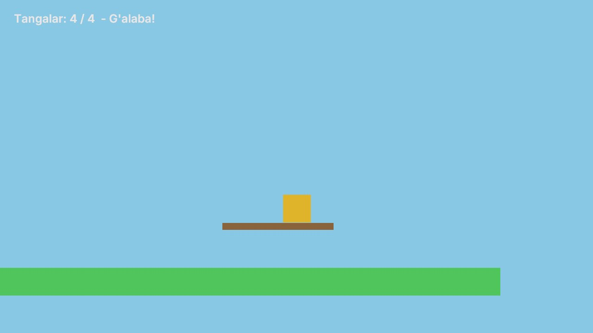
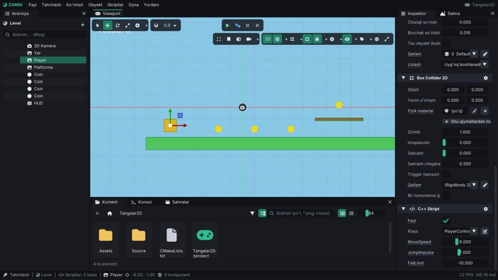

# Birinchi 2D o'yin: "Tangalar"

Bu qo'llanmada noldan kichik 2D platformer yasaymiz: qahramon (to'rtburchak) yugurib sakraydi, tangalarni yig'adi,
ekranda hisob ko'rinadi, hammasi yig'ilganda "G'alaba!" yoziladi. Yo'l-yo'lakay editorning asosiy ish usullari
o'rganiladi: loyiha va sahna yaratish, obyektlar va komponentlar, 2D fizika, teglar, C++ skriptlar, hodisalar shinasi,
UI matni, kamera kuzatishi, o'yinni sinash va eksport qilish.



Kerak bo'ladi: build qilingan Zamin ([README](../README.md#-build-qilish-linux)) va 30-40 daqiqa. Editor haqida umumiy
ma'lumot: [Editor.md](Editor.md); skriptlar: [Scripting.md](Scripting.md); komponentlar: [Components.md](Components.md).

> Bu qo'llanmadagi qadamlar va skriptlar haqiqiy loyihada bajarib tekshirilgan: loyiha editorda yaratildi, skriptlar
> kompilyatsiya qilindi, o'yin editorda va `ZaminPlayer` da ishga tushirildi (tangalar yig'ilib hisob `4 / 4 - G'alaba!`
> bo'ldi), so'ng eksport qilinib eksport qilingan o'yin ham ishga tushirildi.

## 1. Loyiha yaratish

1. `./build/bin/ZaminEditor` ni ishga tushiring — launcher ochiladi.
2. **Yangi loyiha**: **Loyiha nomi** — `Tangalar2D`, **Joylashuv** — loyihalaringiz papkasi → **Yaratish**.
3. Editor loyihani shablondan yaratadi (3D namunaviy sahna `Main`) va C++ skriptlarni kompilyatsiya qiladi —
   **Konsol** da `Skriptlar muvaffaqiyatli kompilyatsiya qilindi` chiqadi.

## 2. 2D sahna

1. **Fayl → Yangi sahna** (`Ctrl+N`) — bo'sh sahna.
2. **Fayl → Boshqacha saqlash...** (`Ctrl+Shift+S`) → `Assets/Scenes/Level.zscene`.
3. **Kontent** panelida `Assets/Scenes` ga kiring, `Level.zscene` ga o'ng tugma → **Boshlang'ich sahna qilish**
   (o'yin shu sahnadan boshlanadi).
4. O'ngdagi **Sahna** panelida **Osmon** belgisini o'chiring — 2D o'yinda fonni kameraning rangi beradi.

## 3. Kamera

1. **Obyekt → Kamera → Ortografik (2D)** — `2D Kamera` paydo bo'ladi (sahnadagi yagona kamera bo'lgani uchun
   **Asosiy (Primary)** belgisi yoqiq).
2. Inspektorda **Camera** bo'limi: **O'lcham** — `12` (ekranga sig'adigan balandlik, birlikda), **Fon rangi** —
   osmon rangi (masalan `115, 178, 242`).
3. Viewport'dagi asboblar panelida **2D** rejim yoqilganini tekshiring (2D sahnada o'zi yoqiladi).

## 4. Yer va platforma

1. **Obyekt → 2D → Fizik quti** — sprite, **Rigidbody 2D** va **Box Collider 2D** bilan quti.
2. Ierarxiyada nomini `Yer` qiling (`F2`). Inspektor: **Pozitsiya** `4, -3, 0`, **Masshtab** `24, 1, 1`,
   **Sprite Renderer → Rang** — yashil.
3. **Rigidbody 2D → Turi** — **Statik** (yer qimirlamasin).
4. Yana bitta **Fizik quti**: nomi `Platforma`, **Pozitsiya** `8, -1, 0`, **Masshtab** `4, 0.25, 1`, rangi jigarrang,
   **Turi** — **Statik**.

Box Collider 2D'ning **Yarim o'lcham** i `0.5, 0.5` — transform masshtabiga ko'paytiriladi, shuning uchun collider
sprite bilan bir xil o'lchamda qoladi.

## 5. Qahramon

1. **Obyekt → 2D → Fizik quti**, nomi `Player`, **Pozitsiya** `-6, -1.5, 0`, rangi to'q sariq.
2. **Rigidbody 2D**: **Turi** — **Dinamik** (standart), **Aylanmasin** — yoqing (qahramon ag'darilib ketmasin).
3. **Box Collider 2D**: **Ishqalanish** — `0` (devorga yopishib qolmasin).
4. **+ Komponent → Boshqa → Teglar (Tags)** → **Qo'shish** maydoniga `Player` deb yozib Enter. Tangalar qahramonni
   shu teg orqali taniydi.

## 6. Tangalar

1. **Obyekt → 2D → Doira**, nomi `Coin`, **Pozitsiya** `-2, -1.8, 0.1`, **Masshtab** `0.6, 0.6, 1`,
   **Circle Renderer → Rang** — sariq.
2. **+ Komponent → Fizika 2D → Rigidbody 2D** → **Turi**: **Statik**.
3. **+ Komponent → Fizika 2D → Circle Collider 2D** → **Trigger (sensor)** ni yoqing. Sensor to'qnashmaydi —
   qahramon tangadan o'tib ketadi, skript esa `OnTriggerBegin` oladi.
4. **+ Komponent → Boshqa → Teglar (Tags)** → `Coin`.
5. Tangani `Ctrl+D` bilan uch marta nusxalang va joylashtiring: `1, -1.8`, `4, -1.8` va platforma ustida `8, 0.2`.

## 7. Hisob matni

1. **Obyekt → UI (ekran) → Matn** — `UI Matn` (UI Transform + Text). Nomini `HUD` qiling.
2. **UI Transform**: **X | Kenglik** — `240 | 420`, **Y | Balandlik** — `-40 | 40`, **Shrift o'lchami** — `30`
   (yuqori chap burchakdan 240 piksel o'ngda va 40 pastda).

## 8. Kamera qahramonni kuzatsin

`2D Kamera` ni tanlang → **+ Komponent → Effektlar va UI → Camera 2D Follow**. Ierarxiyadan `Player` ni **Nishon**
maydoniga sudrab tashlang. Kod yozish shart emas: komponent kamerani har kadr silliq suradi (**Siljish** — nishondan
qancha yuqoriroq qarash, masalan `0, 1.5`).

## 9. Skriptlar

**Skriptlar → Yangi C++ skript...** bilan uchta skript yarating (**Shablon** — **Minimal**), har birining faylini
(`Source/<Nom>.cpp`) quyidagi kod bilan almashtiring. Faylni tashqi muharrirda ochish: **Skriptlar** menyusidagi
klass nomini bosing yoki inspektordagi klass yonidagi qalam tugmasi.

### PlayerController2D — yurish va sakrash

`Input::GetAxis("Horizontal")` (A/D, strelkalar, gamepad) va `"Jump"` harakati (Space, gamepad A) — yangi loyihada
**Loyiha sozlamalari → Input** da tayyor turadi. Yerda turganini qattiq to'qnashuvlar soni bilan bilamiz.

```cpp
#include <Zamin/Zamin.h>

using namespace Zamin;

// O'yinchi: A/D yoki strelkalar - yurish, Space - sakrash ("Horizontal" va "Jump" -
// Loyiha sozlamalari > Input oynasidagi standart nomlar).
class PlayerController2D : public ScriptableEntity
{
public:
    float MoveSpeed = 6.0f;
    float JumpImpulse = 7.0f;
    float FallLimit = -10.0f;

    void OnCreate() override
    {
        m_Start = Transform().Translation; // yiqilsa shu joyga qaytadi
    }

    void OnUpdate(Timestep) override
    {
        // Gorizontal tezlikni o'zimiz beramiz, vertikalini fizika (tortishish) boshqaradi.
        glm::vec2 velocity = GetVelocity();
        velocity.x = Input::GetAxis("Horizontal") * MoveSpeed;
        SetVelocity(velocity);

        // Faqat biror narsa ustida turganda sakraydi.
        if (Input::IsActionJustPressed("Jump") && m_Contacts > 0)
            ApplyImpulse({ 0.0f, JumpImpulse });

        if (Transform().Translation.y < FallLimit)
        {
            SetPosition2D({ m_Start.x, m_Start.y });
            SetVelocity({ 0.0f, 0.0f });
        }
    }

    // Qattiq to'qnashuvlar (yer, platformalar). Tangalar sensor - ular bu yerga kelmaydi.
    void OnCollisionBegin(Entity) override { m_Contacts++; }
    void OnCollisionEnd(Entity) override { m_Contacts = std::max(0, m_Contacts - 1); }

private:
    glm::vec3 m_Start{ 0.0f };
    int m_Contacts = 0;
};

ZM_REGISTER_SCRIPT(PlayerController2D,
    ZM_FIELD_RANGE(PlayerController2D, MoveSpeed, 0.0f, 20.0f).Tooltip("Yurish tezligi (birlik/sekund)"),
    ZM_FIELD_RANGE(PlayerController2D, JumpImpulse, 0.0f, 20.0f).Tooltip("Sakrash kuchi (impuls)"),
    ZM_FIELD(PlayerController2D, FallLimit).Tooltip("Shundan pastga tushsa, boshlang'ich joyga qaytadi"))
```

### Coin — tanga

Tanga yig'ilganini o'zi hisoblamaydi: `Emit("CoinCollected")` bilan hodisalar shinasiga e'lon qiladi.

```cpp
#include <Zamin/Zamin.h>

#include <cmath>

using namespace Zamin;

// Tanga: joyida tebranadi, "Player" tegli obyekt tegsa yig'iladi.
class Coin : public ScriptableEntity
{
public:
    float BobSpeed = 3.0f;
    float BobHeight = 0.15f;

    void OnCreate() override { m_BaseY = Transform().Translation.y; }

    void OnUpdate(Timestep) override
    {
        Transform().Translation.y = m_BaseY + std::sin(GetTime() * BobSpeed) * BobHeight;
    }

    // Tanganing collider'i sensor (Is Sensor): tegish OnTriggerBegin bo'lib keladi.
    void OnTriggerBegin(Entity other) override
    {
        if (m_Taken || !other.HasTag("Player"))
            return;
        m_Taken = true;
        Emit("CoinCollected"); // hisobni ScoreHud yuritadi - tanga uni bilishi shart emas
        Destroy();             // kadr oxirida o'chiriladi
    }

private:
    float m_BaseY = 0.0f;
    bool m_Taken = false;
};

ZM_REGISTER_SCRIPT(Coin,
    ZM_FIELD_RANGE(Coin, BobSpeed, 0.0f, 10.0f),
    ZM_FIELD_RANGE(Coin, BobHeight, 0.0f, 1.0f).Tooltip("Tebranish balandligi (birlik)"))
```

### ScoreHud — ekrandagi hisob

`OnStart` da sahnadagi `Coin` tegli obyektlarni sanaydi va `"CoinCollected"` ga obuna bo'ladi.

```cpp
#include <Zamin/Zamin.h>

using namespace Zamin;

// Ekrandagi hisob: "CoinCollected" hodisasini tinglaydi va Text komponentini yangilaydi.
class ScoreHud : public ScriptableEntity
{
public:
    std::string Title = "Tangalar";

    void OnStart() override
    {
        // OnStart'da sahnadagi hamma skriptlar yaratilgan: tangalarni sanash mumkin.
        m_Total = (int)FindEntitiesWithTag("Coin").size();
        // Obuna skript o'chirilganda o'zi bekor bo'ladi.
        Subscribe("CoinCollected", [this](const ScriptMessage&) {
            m_Count++;
            Refresh();
            if (m_Count == m_Total)
                ZM_INFO("Barcha tangalar yig'ildi!");
        });
        Refresh();
    }

private:
    void Refresh()
    {
        if (auto* text = TryGetComponent<TextComponent>())
        {
            text->Text = std::format("{}: {} / {}", Title, m_Count, m_Total);
            if (m_Total > 0 && m_Count == m_Total)
                text->Text += "  - G'alaba!";
        }
    }

    int m_Count = 0;
    int m_Total = 0;
};

ZM_REGISTER_SCRIPT(ScoreHud, ZM_FIELD_TOOLTIP(ScoreHud, Title, "Hisob oldidagi so'z"))
```

Saqlang va **Skriptlar → Kompilyatsiya + qayta yuklash** (`Ctrl+B`). Xato bo'lsa **Oyna → Kompilyatsiya** da qator
raqami bilan ko'rinadi.

## 10. Skriptlarni ulash

| Obyekt | + Komponent → Boshqa → C++ Script → **Klass** |
|---|---|
| `Player` | `PlayerController2D` |
| Har bir `Coin` (to'rttasi) | `Coin` |
| `HUD` | `ScoreHud` |

To'rtta tangaga tezroq: birinchisiga skriptni qo'shing, **C++ Skript** sarlavhasidagi tishli g'ildirak →
**Komponentni nusxalash**, qolgan uchtasini `Ctrl` + bosish bilan tanlang → **+ Komponent → Buferdan joylash**
(hamma tanlanganlarga qo'shiladi). Inspektorda maydonlar (`MoveSpeed`, `JumpImpulse`, `FallLimit` ...) slayder bilan
ko'rinadi — o'zgartirib sinab ko'ring.



## 11. O'ynash

`Ctrl+S` bilan saqlang va **▶** (`Ctrl+P`). A/D — yurish, Space — sakrash. Tangalarni yig'ing: hisob
`Tangalar: 1 / 4` ... ga o'zgaradi, oxirgisi platforma ustida. To'xtatish — yana `Ctrl+P` (yoki `Shift+Escape`):
sahna o'yin oldidagi holatiga qaytadi.

Agar biror narsa ishlamasa:

| Belgi | Sabab |
|---|---|
| Qahramon yiqilib ketadi | `Yer` ning **Rigidbody 2D → Turi** Statik emas, yoki qahramon yerdan pastda boshlanadi |
| Tanga yig'ilmaydi | Tangada Rigidbody 2D yo'q, collider **Trigger (sensor)** emas, qahramonda `Player` tegi yo'q |
| Hisob `0 / 0` | Tangalarda `Coin` tegi yo'q |
| Matn ko'rinmaydi | `HUD` UI Transform qiymatlarini tekshiring (7-bo'lim) |
| Inspektorda "Klass yuklanmagan" | Skriptlar kompilyatsiya qilinmagan — `Ctrl+B`, keyin **Oyna → Kompilyatsiya** |
| Ekran osmon rangida emas, gradient | **Sahna → Osmon** o'chirilmagan |

## 12. O'yinni eksport qilish

1. **Fayl → O'yinni build qilish...** → chiqish papkasi (masalan `~/Tangalar2D-build`) → build.
2. Editor skriptlarni Release'da qayta kompilyatsiya qiladi, ishlatilgan assetlarni yig'adi va **Eksport hisoboti** ni
   ko'rsatadi.
3. Tayyor o'yin: `~/Tangalar2D-build/Tangalar2D.sh`. Editorsiz sinash uchun ham:
   `./build/bin/ZaminPlayer <loyiha papkasi>`.

Batafsil: [Runtime.md](Runtime.md#11-eksport).

## 13. Keyingi qadamlar

- Rasm qo'shing: PNG ni **Kontent** ga tashlang va **Sprite Renderer → Tekstura** maydoniga sudrang (piksel-art uchun
  **Pixel-art**), kadrlar animatsiyasi — **Sprite Animation** ([Animation.md](Animation.md)).
- Ovoz: `PlaySound("Audio/coin.wav")` ni `Coin::OnTriggerBegin` ga qo'shing ([Scripting.md](Scripting.md#13-audio)).
- Rekord: `SaveData::SetInt(...)` bilan o'yinlar orasida saqlang.
- Keyingi daraja: `LoadScene("Scenes/Level2.zscene", SceneTransition::Fade(0.5f))`.
- To'liqroq misol: `Projects/Platformer2D` (`Source/Player.cpp`, `Source/Gameplay.cpp`, `Source/GameManager.cpp`).
- 3D: [Tutorial-3D.md](Tutorial-3D.md).
