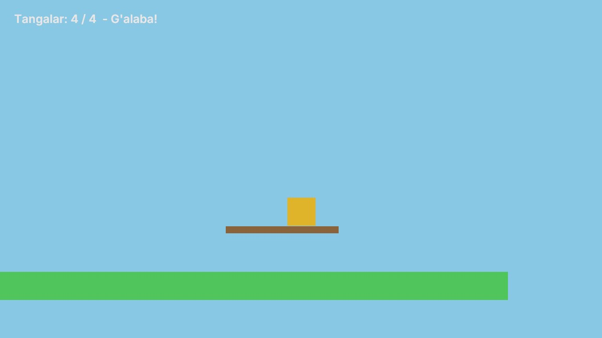
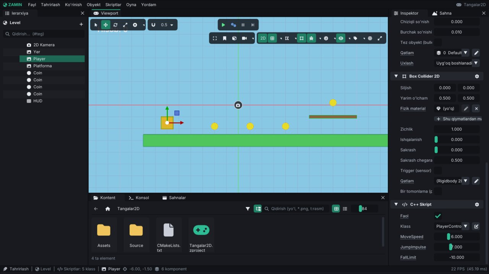

# A first 2D game: "Coins"

In this tutorial we build a small 2D platformer from scratch: a hero (a rectangle) runs and jumps, collects coins,
the score shows on the screen, and "Victory!" appears when all of them are collected. Along the way you learn the
editor's main ways of working: creating a project and a scene, entities and components, 2D physics, tags, C++
scripts, the event bus, UI text, camera follow, testing the game and exporting it.



You will need: a built Zamin ([BuildAndExport.md](BuildAndExport.md#2-building-the-engine)) and 30-40 minutes. An
overview of the editor: [Editor.md](Editor.md); scripts: [Scripting.md](Scripting.md); components: [Components.md](Components.md).

> The steps and scripts of this tutorial were checked by doing them in a real project: the project was created in the
> editor, the scripts were compiled, the game was run in the editor and in `ZaminPlayer` (the coins were collected
> and the score became `4 / 4 - Victory!`), then it was exported and the exported game was run too.

## 1. Creating a project

1. Run `./build/bin/ZaminEditor` — the launcher opens.
2. **New project**: **Project name** — `Coins2D`, the location — your projects folder → **Create**.
3. The editor creates the project from the template (a sample 3D scene `Main`) and compiles the C++ scripts —
   `Scripts compiled successfully` appears in the **Console**.

## 2. A 2D scene

1. **File → New scene** (`Ctrl+N`) — an empty scene.
2. **File → Save as...** (`Ctrl+Shift+S`) → `Assets/Scenes/Level.zscene`.
3. In the **Content** panel go into `Assets/Scenes`, right-click `Level.zscene` → **Make start scene**
   (the game starts from this scene).
4. In the **Scene** panel on the right turn off the **Sky** checkbox — in a 2D game the background comes from the
   camera's color.

## 3. The camera

1. **Object → Camera → Orthographic (2D)** — a `2D Camera` appears (since it is the only camera in the scene, its
   **Primary** checkbox is on).
2. The **Camera** section in the inspector: **Size** — `12` (the height that fits on the screen, in units),
   **Background color** — a sky color (for example `115, 178, 242`).
3. Check that the **2D** mode is on in the viewport toolbar (it turns on by itself in a 2D scene).

## 4. The ground and a platform

1. **Object → 2D → Physics box** — a box with a sprite, a **Rigidbody 2D** and a **Box Collider 2D**.
2. Rename it `Ground` in the hierarchy (`F2`). Inspector: **Position** `4, -3, 0`, **Scale** `24, 1, 1`,
   **Sprite Renderer → Color** — green.
3. **Rigidbody 2D → Type** — **Static** (the ground must not move).
4. One more **Physics box**: name `Platform`, **Position** `8, -1, 0`, **Scale** `4, 0.25, 1`, a brown color,
   **Type** — **Static**.

The Box Collider 2D's **Half extents** are `0.5, 0.5` — they are multiplied by the transform's scale, so the collider
stays the same size as the sprite.

## 5. The hero

1. **Object → 2D → Physics box**, name `Player`, **Position** `-6, -1.5, 0`, an orange color.
2. **Rigidbody 2D**: **Type** — **Dynamic** (the default), turn on **Freeze rotation** (so the hero does not tip over).
3. **Box Collider 2D**: **Friction** — `0` (so it does not stick to walls).
4. **+ Component → Other → Tags** → type `Player` in the **Add** field and press Enter. The coins recognize the hero
   by this tag.

## 6. The coins

1. **Object → 2D → Circle**, name `Coin`, **Position** `-2, -1.8, 0.1`, **Scale** `0.6, 0.6, 1`,
   **Circle Renderer → Color** — yellow.
2. **+ Component → Physics 2D → Rigidbody 2D** → **Type**: **Static**.
3. **+ Component → Physics 2D → Circle Collider 2D** → turn on **Trigger (sensor)**. A sensor does not collide —
   the hero passes through the coin, and the script gets `OnTriggerBegin`.
4. **+ Component → Other → Tags** → `Coin`.
5. Duplicate the coin three times with `Ctrl+D` and place the copies at `1, -1.8`, `4, -1.8` and on the platform at
   `8, 0.2`.

## 7. The score text

1. **Object → UI (screen) → Text** — a `UI Text` (UI Transform + Text). Rename it `HUD`.
2. **UI Transform**: **X | Width** — `240 | 420`, **Y | Height** — `-40 | 40`, **Font size** — `30`
   (240 pixels to the right of the top left corner and 40 down).

## 8. Make the camera follow the hero

Select the `2D Camera` → **+ Component → Effects and UI → Camera 2D Follow**. Drag `Player` from the hierarchy onto
the **Target** field. No code is needed: the component moves the camera smoothly every frame (**Offset** — how much
higher than the target to look, for example `0, 1.5`).

## 9. The scripts

Create three scripts with **Scripts → New C++ script...** (**Template** — **Minimum**) and replace the file of each
(`Source/<Name>.cpp`) with the code below. To open a file in an external editor: click the class name in the
**Scripts** menu, or the pencil button next to the class in the inspector.

### PlayerController2D — walking and jumping

`Input::GetAxis("Horizontal")` (A/D, arrows, gamepad) and the `"Jump"` action (Space, gamepad A) are ready in a new
project in **Project settings → Input**. We know the hero is on the ground from the number of solid collisions.

```cpp
#include <Zamin/Zamin.h>

using namespace Zamin;

// The player: A/D or the arrows - walk, Space - jump ("Horizontal" and "Jump" are
// the default names in the Project settings > Input window).
class PlayerController2D : public ScriptableEntity
{
public:
    float MoveSpeed = 6.0f;
    float JumpImpulse = 7.0f;
    float FallLimit = -10.0f;

    void OnCreate() override
    {
        m_Start = Transform().Translation; // returns here after a fall
    }

    void OnUpdate(Timestep) override
    {
        // We set the horizontal velocity ourselves; the vertical one is up to physics (gravity).
        glm::vec2 velocity = GetVelocity();
        velocity.x = Input::GetAxis("Horizontal") * MoveSpeed;
        SetVelocity(velocity);

        // Jumps only while standing on something.
        if (Input::IsActionJustPressed("Jump") && m_Contacts > 0)
            ApplyImpulse({ 0.0f, JumpImpulse });

        if (Transform().Translation.y < FallLimit)
        {
            SetPosition2D({ m_Start.x, m_Start.y });
            SetVelocity({ 0.0f, 0.0f });
        }
    }

    // Solid collisions (the ground, platforms). The coins are sensors - they do not come here.
    void OnCollisionBegin(Entity) override { m_Contacts++; }
    void OnCollisionEnd(Entity) override { m_Contacts = std::max(0, m_Contacts - 1); }

private:
    glm::vec3 m_Start{ 0.0f };
    int m_Contacts = 0;
};

ZM_REGISTER_SCRIPT(PlayerController2D,
    ZM_FIELD_RANGE(PlayerController2D, MoveSpeed, 0.0f, 20.0f).Tooltip("Walking speed (units/second)"),
    ZM_FIELD_RANGE(PlayerController2D, JumpImpulse, 0.0f, 20.0f).Tooltip("Jump strength (impulse)"),
    ZM_FIELD(PlayerController2D, FallLimit).Tooltip("Below this height it returns to the start"))
```

### Coin — a coin

A coin does not count itself as collected: it announces it on the event bus with `Emit("CoinCollected")`.

```cpp
#include <Zamin/Zamin.h>

#include <cmath>

using namespace Zamin;

// A coin: bobs in place and is collected when an entity tagged "Player" touches it.
class Coin : public ScriptableEntity
{
public:
    float BobSpeed = 3.0f;
    float BobHeight = 0.15f;

    void OnCreate() override { m_BaseY = Transform().Translation.y; }

    void OnUpdate(Timestep) override
    {
        Transform().Translation.y = m_BaseY + std::sin(GetTime() * BobSpeed) * BobHeight;
    }

    // The coin's collider is a sensor (Is Sensor): a touch arrives as OnTriggerBegin.
    void OnTriggerBegin(Entity other) override
    {
        if (m_Taken || !other.HasTag("Player"))
            return;
        m_Taken = true;
        Emit("CoinCollected"); // ScoreHud keeps the score - the coin does not need to know about it
        Destroy();             // removed at the end of the frame
    }

private:
    float m_BaseY = 0.0f;
    bool m_Taken = false;
};

ZM_REGISTER_SCRIPT(Coin,
    ZM_FIELD_RANGE(Coin, BobSpeed, 0.0f, 10.0f),
    ZM_FIELD_RANGE(Coin, BobHeight, 0.0f, 1.0f).Tooltip("Bobbing height (units)"))
```

### ScoreHud — the score on the screen

In `OnStart` it counts the entities tagged `Coin` in the scene and subscribes to `"CoinCollected"`.

```cpp
#include <Zamin/Zamin.h>

using namespace Zamin;

// The score on the screen: listens to the "CoinCollected" event and updates the Text component.
class ScoreHud : public ScriptableEntity
{
public:
    std::string Title = "Coins";

    void OnStart() override
    {
        // In OnStart every script in the scene has been created: the coins can be counted.
        m_Total = (int)FindEntitiesWithTag("Coin").size();
        // The subscription is cancelled by itself when the script is removed.
        Subscribe("CoinCollected", [this](const ScriptMessage&) {
            m_Count++;
            Refresh();
            if (m_Count == m_Total)
                ZM_INFO("All the coins are collected!");
        });
        Refresh();
    }

private:
    void Refresh()
    {
        if (auto* text = TryGetComponent<TextComponent>())
        {
            text->Text = std::format("{}: {} / {}", Title, m_Count, m_Total);
            if (m_Total > 0 && m_Count == m_Total)
                text->Text += "  - Victory!";
        }
    }

    int m_Count = 0;
    int m_Total = 0;
};

ZM_REGISTER_SCRIPT(ScoreHud, ZM_FIELD_TOOLTIP(ScoreHud, Title, "The word before the score"))
```

Save and run **Scripts → Compile + reload** (`Ctrl+B`). Errors show up with their line numbers in
**Window → Compilation**.

## 10. Attaching the scripts

| Entity | + Component → Other → Script / Visual graph → **Class** |
|---|---|
| `Player` | `PlayerController2D` |
| Every `Coin` (all four) | `Coin` |
| `HUD` | `ScoreHud` |

A faster way for the four coins: add the script to the first one, then the cog in the **C++ Script** header →
**Copy component**, select the other three with `Ctrl` + click → **+ Component → Paste from clipboard**
(it is added to every selected entity). In the inspector the fields (`MoveSpeed`, `JumpImpulse`, `FallLimit` ...)
show up with sliders — change them and try it out.



## 11. Playing

Save with `Ctrl+S` and press **▶** (`Ctrl+P`). A/D — walk, Space — jump. Collect the coins: the score changes to
`Coins: 1 / 4` ..., the last one is on the platform. To stop, press `Ctrl+P` again (or `Shift+Escape`):
the scene returns to its state before play.

If something does not work:

| Symptom | Cause |
|---|---|
| The hero falls through | The **Rigidbody 2D → Type** of `Ground` is not Static, or the hero starts below the ground |
| A coin is not collected | The coin has no Rigidbody 2D, the collider is not a **Trigger (sensor)**, the hero has no `Player` tag |
| The score is `0 / 0` | The coins have no `Coin` tag |
| The text does not show | Check the values of the `HUD` UI Transform (section 7) |
| "Class not loaded" in the inspector | The scripts are not compiled — `Ctrl+B`, then **Window → Compilation** |
| The screen is a gradient instead of the sky color | **Scene → Sky** is not turned off |

## 12. Exporting the game

1. **File → Build game...** → an output folder (for example `~/Coins2D-build`) → build.
2. The editor recompiles the scripts in Release, collects the assets in use and shows the **Export report**.
3. The finished game: `~/Coins2D-build/Coins2D.sh`. To test without the editor you can also run:
   `./build/bin/ZaminPlayer <project folder>`.

More: [Runtime.md](Runtime.md#11-eksport).

## 13. Next steps

- Add a picture: drop a PNG into **Content** and drag it onto the **Sprite Renderer → Texture** field (**Pixel art**
  for pixel art); frame animation — **Sprite Animation** ([Animation.md](Animation.md)).
- Sound: add `PlaySound("Audio/coin.wav")` to `Coin::OnTriggerBegin` ([Scripting.md](Scripting.md#13-audio)).
- A record: save it between games with `SaveData::SetInt(...)`.
- The next level: `LoadScene("Scenes/Level2.zscene", SceneTransition::Fade(0.5f))`.
- A fuller example: `Projects/Platformer2D` (`Source/Player.cpp`, `Source/Gameplay.cpp`, `Source/GameManager.cpp`).
- 3D: [Tutorial-3D.md](Tutorial-3D.md).
