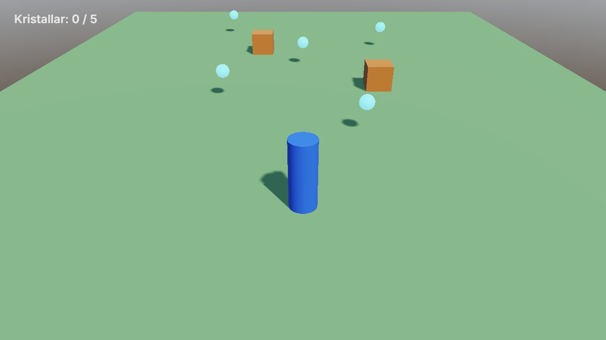
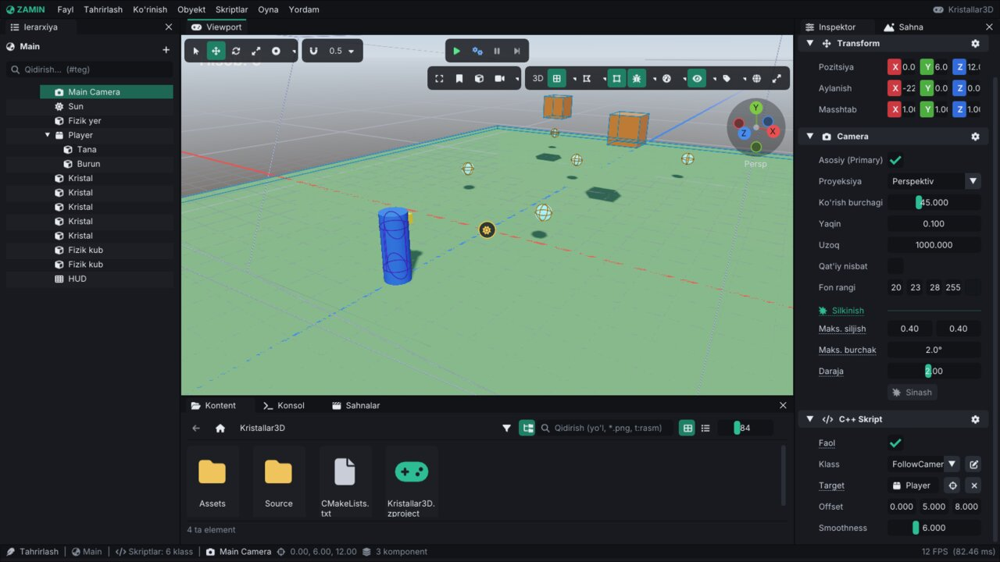

# Birinchi 3D o'yin: "Kristallar"

Bu qo'llanmada 3D o'yin yasaymiz: qahramon maydonda yuradi va sakraydi, kamera uni orqadan kuzatadi, beshta
kristallni yig'ish kerak, yo'lda itarib yuboriladigan qutilar bor. Hammasi yig'ilganda "G'alaba!" yoziladi va bir
necha soniyadan keyin daraja qayta boshlanadi. O'rganiladi: 3D primitivlar va materiallar, ierarxiya (ota-bola),
Character Controller 3D, 3D fizika va trigger'lar, obyekt havolasi (`EntityRef`), kamera skripti, taymerlar va
sahnani qayta yuklash.



Avval [2D qo'llanmani](Tutorial-2D.md) o'qib chiqish tavsiya etiladi (editor asoslari u yerda batafsilroq).
Ma'lumotnomalar: [Editor.md](Editor.md), [Scripting.md](Scripting.md), [Components.md](Components.md).

> Qadamlar va skriptlar haqiqiy loyihada tekshirilgan: loyiha editorda yaratildi, skriptlar kompilyatsiya qilindi,
> o'yin editorda va `ZaminPlayer` da ishga tushirildi (qahramon beshta kristallni yig'di, hisob `G'alaba!` ga o'zgardi,
> 3 soniyadan keyin sahna so'nib qayta yuklandi), eksport qilingan o'yin ham ishga tushirildi.

## 1. Loyiha

1. `./build/bin/ZaminEditor` → launcher → **Yangi loyiha**: nomi `Kristallar3D` → **Yaratish**.
2. Shablon sahna `Main` ochiladi: `Main Camera`, `Sun`, `Ground`, `Cube`, `Sphere`. Bu safar shu sahnada ishlaymiz:
   ierarxiyada `Ground`, `Cube` va `Sphere` ni tanlab (`Ctrl` + bosish) `Delete` bilan o'chiring. `Main Camera` va
   `Sun` qoladi.

`Ground` oddiy tekislik edi — collider'i yo'q, qahramon undan o'tib tushib ketardi. O'rniga fizik yer qo'yamiz.

## 2. Yer va qutilar

1. **Obyekt → 3D → Fizik yer (statik)** — kub mesh, **Rigidbody 3D** (Statik) va **Box Collider 3D**.
   **Pozitsiya** `0, -0.1, -4`, **Masshtab** `24, 0.2, 30`, **Mesh Renderer → Rang (albedo)** — yashil.
2. **Obyekt → 3D → Fizik kub** ikki marta — dinamik qutilar. **Pozitsiya** `3, 3, -4` va `-2, 3, -9`, rangi
   jigarrang. O'yin boshlanganda ular yerga tushadi; qahramon ularni itarib yuradi.

## 3. Qahramon

Character Controller 3D'ning nuqtasi qahramonning **oyog'i**, mesh esa markazdan chiziladi. Shuning uchun qahramon —
bo'sh ota obyekt, ko'rinadigan tanasi — bola.

1. **Obyekt → Bo'sh obyekt**, nomi `Player`, **Pozitsiya** `0, 0, 4`.
2. **+ Komponent → Fizika 3D → Character Controller 3D** (radius 0.35, balandlik 1.8 — standart).
3. **+ Komponent → Boshqa → Teglar (Tags)** → `Player`.
4. Ierarxiyada `Player` ga o'ng tugma → **Bola obyekt yaratish → 3D → Silindr**. Nomi `Tana`, **Pozitsiya**
   `0, 0.9, 0` (otaga nisbatan), **Masshtab** `0.7, 1.8, 0.7`, rangi ko'k.
5. Yana `Player` → **Bola obyekt yaratish → 3D → Kub**: nomi `Burun`, **Pozitsiya** `0, 1.5, -0.4`, **Masshtab**
   `0.25, 0.25, 0.25`, rangi sariq — qahramon qayerga qarayotganini ko'rsatadi (oldinga = -Z).

## 4. Kristallar

1. **Obyekt → 3D → Shar**, nomi `Kristal`, **Pozitsiya** `2, 1, 0`, **Masshtab** `0.5, 0.5, 0.5`. **Mesh Renderer**:
   **Rang (albedo)** — moviy, **Nurlanish** — moviy, kuchi `1` (o'zi yorishib turadi).
2. **+ Komponent → Fizika 3D → Rigidbody 3D** → **Turi**: **Statik**.
3. **+ Komponent → Fizika 3D → Sphere Collider 3D** → **Trigger (sensor)** ni yoqing. Muhim: 3D'da collider faqat
   Rigidbody 3D bor obyektda fizik dunyoga qo'shiladi — trigger uchun ham.
4. **Teglar** → `Pickup` (yangi loyihaning teg ro'yxatida bor).
5. `Ctrl+D` bilan to'rtta nusxa: `-3, 1, -3`, `0, 1, -7`, `4, 1, -10`, `-4, 1, -13`.

## 5. Hisob matni

**Obyekt → UI (ekran) → Matn**, nomi `HUD`. **UI Transform**: **X | Kenglik** `240 | 420`, **Y | Balandlik**
`-40 | 40`, **Shrift o'lchami** `30`.

## 6. Skriptlar

**Skriptlar → Yangi C++ skript...** bilan to'rtta skript (**Minimal** shablon) yarating va fayllarni quyidagi kod
bilan almashtiring.

### PlayerMovement3D — qahramon

`Input::GetVector("Move")` — `Horizontal` (A/D) va `Vertical` (W/S) bitta 2D vektor bo'lib. Character Controller'ga
faqat gorizontal tezlik beriladi (`Move`), tortishish va zinapoyalarni u o'zi hisoblaydi.

```cpp
#include <Zamin/Zamin.h>

using namespace Zamin;

// Qahramon: WASD / strelkalar / chap stik - yurish, Space - sakrash. Character Controller 3D
// komponenti bilan ishlaydi: tortishish, zinapoya va qiyaliklarni u o'zi hisoblaydi.
class PlayerMovement3D : public ScriptableEntity
{
public:
    float Speed = 5.0f;
    float JumpSpeed = 6.0f;
    float TurnSpeed = 10.0f; // radian/sekund

    void OnCreate() override
    {
        m_Start = Transform().Translation;
    }

    void OnUpdate(Timestep ts) override
    {
        auto* cc = TryGetComponent<CharacterController3DComponent>();
        if (!cc)
            return;

        // "Move" = Horizontal (A/D) + Vertical (W/S) bitta 2D qiymat bo'lib, uzunligi 1 dan oshmaydi.
        glm::vec2 input = Input::GetVector("Move");
        glm::vec3 velocity(input.x * Speed, 0.0f, -input.y * Speed); // oldinga = -Z (kamera shu tomonga qaraydi)
        cc->Move(velocity);
        if (Input::IsActionJustPressed("Jump"))
            cc->Jump(JumpSpeed); // faqat yerda turganda sakraydi

        // Yurayotgan tomonga asta buriladi.
        if (glm::length(velocity) > 0.1f)
        {
            glm::quat now = Math::FromEuler(Transform().Rotation);
            glm::quat goal = Math::LookRotation(velocity);
            Transform().Rotation = Math::ToEuler(Math::RotateTowards(now, goal, TurnSpeed * (float)ts));
        }

        if (Transform().Translation.y < -10.0f) // yiqilib tushdi
        {
            SetPosition3D(m_Start);
            cc->VerticalVelocity = 0.0f;
        }
    }

private:
    glm::vec3 m_Start{ 0.0f };
};

ZM_REGISTER_SCRIPT(PlayerMovement3D,
    ZM_FIELD_RANGE(PlayerMovement3D, Speed, 0.0f, 15.0f).Tooltip("Yurish tezligi (m/s)"),
    ZM_FIELD_RANGE(PlayerMovement3D, JumpSpeed, 0.0f, 15.0f).Tooltip("Sakrashdagi boshlang'ich tezlik (m/s)"),
    ZM_FIELD(PlayerMovement3D, TurnSpeed))
```

### FollowCamera3D — kamera

`EntityRef` maydoni inspektorda obyekt havolasi bo'lib ko'rinadi. Kamera fizikadan keyin suriladi (`OnLateUpdate`),
`Math::Damp` — kadr tezligiga bog'liq bo'lmagan silliq yaqinlashish, `Math::LookRotation` — nishonga qarash.

```cpp
#include <Zamin/Zamin.h>

using namespace Zamin;

// Kamera nishonni (inspektorda tanlanadi) orqadan va yuqoridan silliq kuzatadi.
class FollowCamera3D : public ScriptableEntity
{
public:
    EntityRef Target;                          // ierarxiyadan sudrab qo'yiladi
    glm::vec3 Offset = { 0.0f, 5.0f, 8.0f };   // nishonga nisbatan joy
    float Smoothness = 6.0f;                   // kattaroq - tezroq yetib oladi

    // Kamera fizika va boshqa skriptlardan keyin suriladi: OnLateUpdate.
    void OnLateUpdate(Timestep ts) override
    {
        Entity target = Resolve(Target);
        if (!target)
            return;
        glm::vec3 focus = GetScene().GetWorldPosition(target) + glm::vec3(0.0f, 1.0f, 0.0f);
        auto& t = Transform();
        t.Translation = Math::Damp(t.Translation, focus + Offset, Smoothness, ts); // kadr tezligiga bog'liq emas
        t.Rotation = Math::ToEuler(Math::LookRotation(focus - t.Translation));
    }
};

ZM_REGISTER_SCRIPT(FollowCamera3D,
    ZM_FIELD(FollowCamera3D, Target).Tooltip("Kuzatiladigan obyekt"),
    ZM_FIELD(FollowCamera3D, Offset),
    ZM_FIELD_RANGE(FollowCamera3D, Smoothness, 0.5f, 20.0f))
```

### Crystal — kristall

```cpp
#include <Zamin/Zamin.h>

using namespace Zamin;

// Kristal: aylanadi; "Player" tegli obyekt sensor collider'iga kirsa yig'iladi.
class Crystal : public ScriptableEntity
{
public:
    float SpinSpeed = 2.0f; // radian/sekund

    void OnUpdate(Timestep ts) override
    {
        Transform().Rotation.y += SpinSpeed * (float)ts;
    }

    void OnTriggerBegin(Entity other) override
    {
        if (m_Taken || !other.HasTag("Player"))
            return;
        m_Taken = true;
        Emit("CrystalCollected"); // CrystalCounter hisoblaydi
        Destroy();
    }

private:
    bool m_Taken = false;
};

ZM_REGISTER_SCRIPT(Crystal, ZM_FIELD(Crystal, SpinSpeed))
```

### CrystalCounter — hisob va qayta boshlash

`Invoke` — taymer; `ReloadScene(SceneTransition::Fade(0.5f))` — sahnani so'ndirib boshidan yuklaydi.

```cpp
#include <Zamin/Zamin.h>

using namespace Zamin;

// Ekrandagi hisob. Hamma kristal yig'ilgach "G'alaba!" yozadi va bir necha soniyadan keyin
// sahnani boshidan yuklaydi.
class CrystalCounter : public ScriptableEntity
{
public:
    float RestartDelay = 3.0f;

    void OnStart() override
    {
        m_Total = (int)FindEntitiesWithTag("Pickup").size();
        Subscribe("CrystalCollected", [this](const ScriptMessage&) { OnCollected(); });
        Refresh();
    }

private:
    void OnCollected()
    {
        m_Count++;
        Refresh();
        if (m_Count < m_Total)
            return;
        ZM_INFO("G'alaba! {} ta kristal yig'ildi", m_Total);
        Invoke(RestartDelay, [this]() { ReloadScene(SceneTransition::Fade(0.5f)); });
    }

    void Refresh()
    {
        if (auto* text = TryGetComponent<TextComponent>())
            text->Text = m_Count < m_Total ? std::format("Kristallar: {} / {}", m_Count, m_Total)
                                           : std::string("G'alaba!");
    }

    int m_Count = 0;
    int m_Total = 0;
};

ZM_REGISTER_SCRIPT(CrystalCounter,
    ZM_FIELD_RANGE(CrystalCounter, RestartDelay, 0.0f, 10.0f).Tooltip("G'alabadan keyin qayta boshlashgacha (sekund)"))
```

`Ctrl+B` — kompilyatsiya. Xatolar **Oyna → Kompilyatsiya** da.

## 7. Skriptlarni ulash

| Obyekt | **C++ Script → Klass** | Maydonlar |
|---|---|---|
| `Player` | `PlayerMovement3D` | `Speed` 5, `JumpSpeed` 6 |
| `Main Camera` | `FollowCamera3D` | **Target**: ierarxiyadan `Player` ni sudrab tashlang; `Offset` `0, 5, 8` |
| Har bir `Kristal` | `Crystal` | — |
| `HUD` | `CrystalCounter` | `RestartDelay` 3 |



## 8. O'ynash

`Ctrl+S`, keyin `Ctrl+P`. WASD — yurish, Space — sakrash. Kamera qahramon ortidan yuradi, qutilarni itarib ko'ring.
Kristallga tegsangiz u yo'qoladi va hisob ortadi; beshinchisidan keyin `G'alaba!` yoziladi, **Konsol** da
`G'alaba! 5 ta kristal yig'ildi` chiqadi va 3 soniyadan keyin daraja boshidan boshlanadi.

| Belgi | Sabab |
|---|---|
| Qahramon tushib ketadi | Yer **Fizik yer (statik)** emas (collider'i yo'q) |
| Kristall yig'ilmaydi | Kristallda Rigidbody 3D yo'q, collider **Trigger (sensor)** emas yoki `Player` tegi yo'q |
| Hisob `0 / 0` | Kristallarda `Pickup` tegi yo'q |
| Kamera qimirlamaydi | `FollowCamera3D` ning **Target** maydoni bo'sh |
| Qahramon yerga yarim botgan | `Tana` ning pozitsiyasi `0, 0.9, 0` emas (Character Controller nuqtasi — oyoq) |

## 9. Eksport

**Fayl → O'yinni build qilish...** → papka → build. Natija: `<papka>/Kristallar3D.sh`. Editorsiz sinash:
`./build/bin/ZaminPlayer <loyiha papkasi>`. Batafsil: [Runtime.md](Runtime.md#11-eksport).

## 10. Keyingi qadamlar

- Model: glTF faylni **Kontent** ga tashlang va `Tana` o'rniga **Obyekt → 3D → Model (glTF / OBJ)** qo'ying; animatsiya —
  **Animator** ([Animation.md](Animation.md)). To'liq misol: `Projects/Adventure3D` (`Source/Player.cpp`).
- Kamerani sichqoncha bilan aylantirish: `Input::GetMouseDelta()` va `Cursor::SetLockMode(CursorLockMode::Locked)`
  ([Scripting.md](Scripting.md#8-input)).
- Kristallga effekt: **Obyekt → Effektlar** dan particle prefab yasab, `Instantiate("Prefabs/...", GetWorldPosition())`
  ([Prefabs.md](Prefabs.md)).
- Dushman: **Nav Agent** + **Sight Sensor** ([AI.md](AI.md)).
