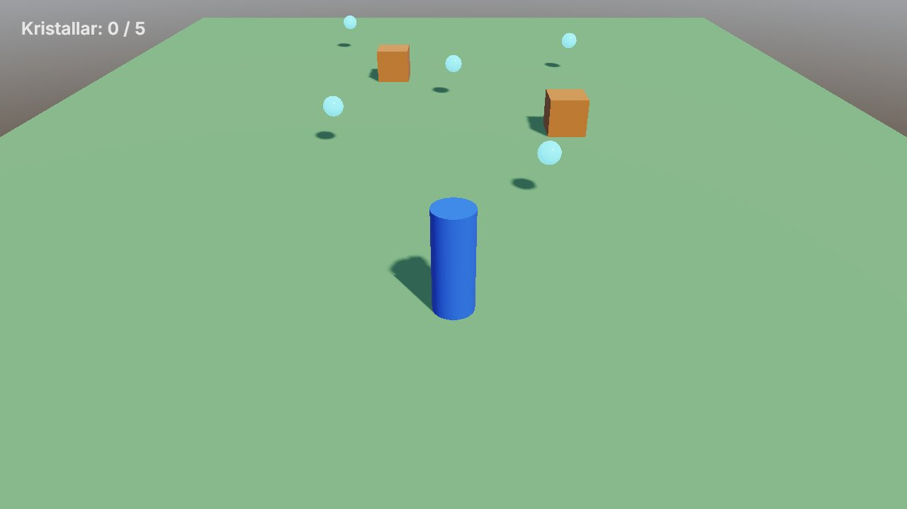
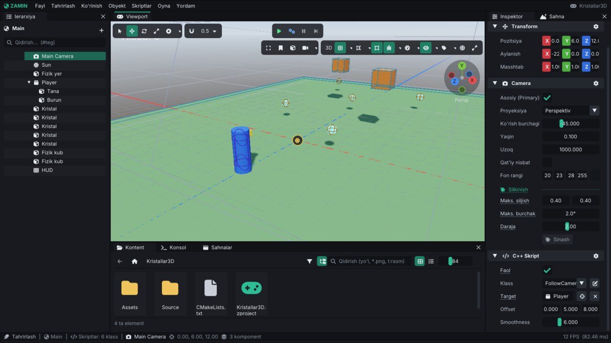

# A first 3D game: "Crystals"

In this tutorial we build a 3D game: the hero walks and jumps on a field, the camera follows from behind, five
crystals have to be collected, and there are boxes along the way that can be pushed. When all of them are collected
"Victory!" appears and the level restarts a few seconds later. You learn: 3D primitives and materials, the hierarchy
(parent-child), Character Controller 3D, 3D physics and triggers, entity references (`EntityRef`), a camera script,
timers and reloading the scene.



Reading the [2D tutorial](Tutorial-2D.md) first is recommended (the editor basics are covered there in more detail).
References: [Editor.md](Editor.md), [Scripting.md](Scripting.md), [Components.md](Components.md).

> The steps and scripts were checked in a real project: the project was created in the editor, the scripts were
> compiled, the game was run in the editor and in `ZaminPlayer` (the hero collected five crystals, the score changed
> to `Victory!`, the scene faded and reloaded 3 seconds later), and the exported game was run too.

## 1. The project

1. `./build/bin/ZaminEditor` → the launcher → **New project**: name `Crystals3D` → **Create**.
2. The template scene `Main` opens: `Main Camera`, `Sun`, `Ground`, `Cube`, `Sphere`. This time we work in this scene:
   select `Ground`, `Cube` and `Sphere` in the hierarchy (`Ctrl` + click) and delete them with `Delete`. `Main Camera`
   and `Sun` stay.

`Ground` was a plain plane — it has no collider, and the hero would fall through it. We put a physics ground in its
place.

## 2. The ground and boxes

1. **Object → 3D → Physics ground (static)** — a cube mesh, a **Rigidbody 3D** (Static) and a **Box Collider 3D**.
   **Position** `0, -0.1, -4`, **Scale** `24, 0.2, 30`, **Mesh Renderer → Color (albedo)** — green.
2. **Object → 3D → Physics cube** twice — dynamic boxes. **Position** `3, 3, -4` and `-2, 3, -9`, a brown color.
   When the game starts they fall to the ground; the hero pushes them around.

## 3. The hero

The point of a Character Controller 3D is the hero's **feet**, while a mesh is drawn from its center. That is why the
hero is an empty parent entity and its visible body is a child.

1. **Object → Empty object**, name `Player`, **Position** `0, 0, 4`.
2. **+ Component → Physics 3D → Character Controller 3D** (radius 0.35, height 1.8 — the defaults).
3. **+ Component → Other → Tags** → `Player`.
4. Right-click `Player` in the hierarchy → **Create child object → 3D → Cylinder**. Name `Body`, **Position**
   `0, 0.9, 0` (relative to the parent), **Scale** `0.7, 1.8, 0.7`, a blue color.
5. `Player` again → **Create child object → 3D → Cube**: name `Nose`, **Position** `0, 1.5, -0.4`, **Scale**
   `0.25, 0.25, 0.25`, a yellow color — it shows where the hero is facing (forward = -Z).

## 4. The crystals

1. **Object → 3D → Sphere**, name `Crystal`, **Position** `2, 1, 0`, **Scale** `0.5, 0.5, 0.5`. **Mesh Renderer**:
   **Color (albedo)** — light blue, **Emission** — light blue, intensity `1` (it glows by itself).
2. **+ Component → Physics 3D → Rigidbody 3D** → **Type**: **Static**.
3. **+ Component → Physics 3D → Sphere Collider 3D** → turn on **Trigger (sensor)**. Important: in 3D a collider is
   added to the physics world only on an entity that has a Rigidbody 3D — for a trigger too.
4. **Tags** → `Pickup` (it is in a new project's tag list).
5. Four copies with `Ctrl+D`: `-3, 1, -3`, `0, 1, -7`, `4, 1, -10`, `-4, 1, -13`.

## 5. The score text

**Object → UI (screen) → Text**, name `HUD`. **UI Transform**: **X | Width** `240 | 420`, **Y | Height**
`-40 | 40`, **Font size** `30`.

## 6. The scripts

Create four scripts with **Scripts → New C++ script...** (the **Minimum** template) and replace the files with the
code below.

### PlayerMovement3D — the hero

`Input::GetVector("Move")` — `Horizontal` (A/D) and `Vertical` (W/S) as one 2D vector. The Character Controller is
given only the horizontal velocity (`Move`); it works out gravity and stairs itself.

```cpp
#include <Zamin/Zamin.h>

using namespace Zamin;

// The hero: WASD / arrows / left stick - walk, Space - jump. Works with the Character Controller 3D
// component: it works out gravity, stairs and slopes itself.
class PlayerMovement3D : public ScriptableEntity
{
public:
    float Speed = 5.0f;
    float JumpSpeed = 6.0f;
    float TurnSpeed = 10.0f; // radians/second

    void OnCreate() override
    {
        m_Start = Transform().Translation;
    }

    void OnUpdate(Timestep ts) override
    {
        auto* cc = TryGetComponent<CharacterController3DComponent>();
        if (!cc)
            return;

        // "Move" = Horizontal (A/D) + Vertical (W/S) as one 2D value, its length at most 1.
        glm::vec2 input = Input::GetVector("Move");
        glm::vec3 velocity(input.x * Speed, 0.0f, -input.y * Speed); // forward = -Z (the camera looks that way)
        cc->Move(velocity);
        if (Input::IsActionJustPressed("Jump"))
            cc->Jump(JumpSpeed); // jumps only while on the ground

        // Turns slowly toward the walking direction.
        if (glm::length(velocity) > 0.1f)
        {
            glm::quat now = Math::FromEuler(Transform().Rotation);
            glm::quat goal = Math::LookRotation(velocity);
            Transform().Rotation = Math::ToEuler(Math::RotateTowards(now, goal, TurnSpeed * (float)ts));
        }

        if (Transform().Translation.y < -10.0f) // fell off
        {
            SetPosition3D(m_Start);
            cc->VerticalVelocity = 0.0f;
        }
    }

private:
    glm::vec3 m_Start{ 0.0f };
};

ZM_REGISTER_SCRIPT(PlayerMovement3D,
    ZM_FIELD_RANGE(PlayerMovement3D, Speed, 0.0f, 15.0f).Tooltip("Walking speed (m/s)"),
    ZM_FIELD_RANGE(PlayerMovement3D, JumpSpeed, 0.0f, 15.0f).Tooltip("The initial speed of a jump (m/s)"),
    ZM_FIELD(PlayerMovement3D, TurnSpeed))
```

### FollowCamera3D — the camera

An `EntityRef` field shows up in the inspector as an entity reference. The camera is moved after physics
(`OnLateUpdate`), `Math::Damp` is a smooth approach that does not depend on the frame rate, `Math::LookRotation`
looks at the target.

```cpp
#include <Zamin/Zamin.h>

using namespace Zamin;

// The camera follows the target (chosen in the inspector) smoothly from behind and above.
class FollowCamera3D : public ScriptableEntity
{
public:
    EntityRef Target;                          // dragged in from the hierarchy
    glm::vec3 Offset = { 0.0f, 5.0f, 8.0f };   // the place relative to the target
    float Smoothness = 6.0f;                   // larger - catches up faster

    // The camera moves after physics and the other scripts: OnLateUpdate.
    void OnLateUpdate(Timestep ts) override
    {
        Entity target = Resolve(Target);
        if (!target)
            return;
        glm::vec3 focus = GetScene().GetWorldPosition(target) + glm::vec3(0.0f, 1.0f, 0.0f);
        auto& t = Transform();
        t.Translation = Math::Damp(t.Translation, focus + Offset, Smoothness, ts); // independent of the frame rate
        t.Rotation = Math::ToEuler(Math::LookRotation(focus - t.Translation));
    }
};

ZM_REGISTER_SCRIPT(FollowCamera3D,
    ZM_FIELD(FollowCamera3D, Target).Tooltip("The entity to follow"),
    ZM_FIELD(FollowCamera3D, Offset),
    ZM_FIELD_RANGE(FollowCamera3D, Smoothness, 0.5f, 20.0f))
```

### Crystal — a crystal

```cpp
#include <Zamin/Zamin.h>

using namespace Zamin;

// A crystal: spins; it is collected when an entity tagged "Player" enters its sensor collider.
class Crystal : public ScriptableEntity
{
public:
    float SpinSpeed = 2.0f; // radians/second

    void OnUpdate(Timestep ts) override
    {
        Transform().Rotation.y += SpinSpeed * (float)ts;
    }

    void OnTriggerBegin(Entity other) override
    {
        if (m_Taken || !other.HasTag("Player"))
            return;
        m_Taken = true;
        Emit("CrystalCollected"); // CrystalCounter counts them
        Destroy();
    }

private:
    bool m_Taken = false;
};

ZM_REGISTER_SCRIPT(Crystal, ZM_FIELD(Crystal, SpinSpeed))
```

### CrystalCounter — the score and the restart

`Invoke` is a timer; `ReloadScene(SceneTransition::Fade(0.5f))` fades the scene out and loads it from the start.

```cpp
#include <Zamin/Zamin.h>

using namespace Zamin;

// The score on the screen. When every crystal is collected it writes "Victory!" and a few seconds later
// loads the scene from the start.
class CrystalCounter : public ScriptableEntity
{
public:
    float RestartDelay = 3.0f;

    void OnStart() override
    {
        m_Total = (int)FindEntitiesWithTag("Pickup").size();
        Subscribe("CrystalCollected", [this](const ScriptMessage&) { OnCollected(); });
        Refresh();
    }

private:
    void OnCollected()
    {
        m_Count++;
        Refresh();
        if (m_Count < m_Total)
            return;
        ZM_INFO("Victory! {} crystals collected", m_Total);
        Invoke(RestartDelay, [this]() { ReloadScene(SceneTransition::Fade(0.5f)); });
    }

    void Refresh()
    {
        if (auto* text = TryGetComponent<TextComponent>())
            text->Text = m_Count < m_Total ? std::format("Crystals: {} / {}", m_Count, m_Total)
                                           : std::string("Victory!");
    }

    int m_Count = 0;
    int m_Total = 0;
};

ZM_REGISTER_SCRIPT(CrystalCounter,
    ZM_FIELD_RANGE(CrystalCounter, RestartDelay, 0.0f, 10.0f).Tooltip("From the victory to the restart (seconds)"))
```

`Ctrl+B` — compile. Errors are in **Window → Compilation**.

## 7. Attaching the scripts

| Entity | **C++ Script → Class** | Fields |
|---|---|---|
| `Player` | `PlayerMovement3D` | `Speed` 5, `JumpSpeed` 6 |
| `Main Camera` | `FollowCamera3D` | **Target**: drag `Player` in from the hierarchy; `Offset` `0, 5, 8` |
| Every `Crystal` | `Crystal` | — |
| `HUD` | `CrystalCounter` | `RestartDelay` 3 |



## 8. Playing

`Ctrl+S`, then `Ctrl+P`. WASD — walk, Space — jump. The camera follows the hero; try pushing the boxes. When you touch
a crystal it disappears and the score goes up; after the fifth one `Victory!` appears, the **Console** prints
`Victory! 5 crystals collected`, and 3 seconds later the level starts over.

| Symptom | Cause |
|---|---|
| The hero falls through | The ground is not a **Physics ground (static)** (it has no collider) |
| A crystal is not collected | The crystal has no Rigidbody 3D, the collider is not a **Trigger (sensor)**, or there is no `Player` tag |
| The score is `0 / 0` | The crystals have no `Pickup` tag |
| The camera does not move | The **Target** field of `FollowCamera3D` is empty |
| The hero is half sunk into the ground | The position of `Body` is not `0, 0.9, 0` (the Character Controller's point is the feet) |

## 9. Export

**File → Build game...** → a folder → build. The result: `<folder>/Crystals3D.sh`. To test without the editor:
`./build/bin/ZaminPlayer <project folder>`. More: [Runtime.md](Runtime.md#11-eksport).

## 10. Next steps

- A model: drop a glTF file into **Content** and put an **Object → 3D → Model (glTF / OBJ)** in place of `Body`;
  animation — **Animator** ([Animation.md](Animation.md)). A full example: `Projects/Adventure3D` (`Source/Player.cpp`).
- Orbiting the camera with the mouse: `Input::GetMouseDelta()` and `Cursor::SetLockMode(CursorLockMode::Locked)`
  ([Scripting.md](Scripting.md#8-input)).
- An effect for the crystal: make a particle prefab from **Object → Effects** and use
  `Instantiate("Prefabs/...", GetWorldPosition())` ([Prefabs.md](Prefabs.md)).
- An enemy: **Nav Agent** + **Sight Sensor** ([AI.md](AI.md)).
