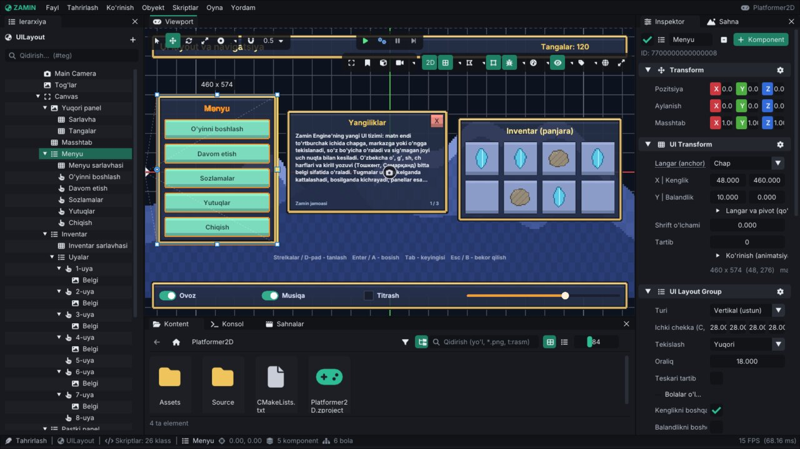

# Zamin Engine: ekran UI (interfeys)

Bu qo'llanma o'yin ichidagi ekran interfeysini tushuntiradi: UI ierarxiyasi va langarlar (RectTransform modeli), ekranga
moslashuvchi Canvas, layout guruhlari, vidjetlar (tugma, rasm, slayder, belgilash, progress bar, matn maydoni), matn
tekislash va o'rash, sichqoncha hodisalari, klaviatura / gamepad navigatsiyasi, UI animatsiyalari, maska va scroll view,
editorda UI bilan ishlash va pauza menyusi namunasi — C++ skript misollari bilan.

Komponentlarning to'liq maydonlari: [Components.md](Components.md#8-ui-ekran-interfeysi). Misollar `#include <Zamin/Zamin.h>`
va `using namespace Zamin;` bilan.



*Platformer2D `Scenes/UILayout.zscene`: tanlangan `Menyu` ning to'rtburchak gizmo'si, inspektorda UI Transform (langar) va
vertikal UI Layout Group; yuqori / pastki panellar cho'zilgan langar bilan.*

Mundarija:

1. [Asosiy tushunchalar](#1-asosiy-tushunchalar)
2. [Tez boshlash: hisob va pauza tugmasi](#2-tez-boshlash-hisob-va-pauza-tugmasi)
3. [UI Transform: langar, pivot, o'lcham](#3-ui-transform-langar-pivot-olcham)
4. [UI Canvas: ekranga moslashish](#4-ui-canvas-ekranga-moslashish)
5. [Layout guruhlari](#5-layout-guruhlari)
6. [Matn](#6-matn)
7. [Vidjetlar](#7-vidjetlar)
8. [Hodisalar: skript callback'lari va event bus](#8-hodisalar-skript-callbacklari-va-event-bus)
9. [Klaviatura va gamepad navigatsiyasi](#9-klaviatura-va-gamepad-navigatsiyasi)
10. [UI animatsiyalari](#10-ui-animatsiyalari)
11. [UI Mask va Scroll View](#11-ui-mask-va-scroll-view)
12. [Pauza va UI vaqti](#12-pauza-va-ui-vaqti)
13. [Editorda UI](#13-editorda-ui)
14. [Namuna: pauza menyusi](#14-namuna-pauza-menyusi)
15. [Namuna sahnalar](#15-namuna-sahnalar)
16. [Ko'p uchraydigan muammolar](#16-kop-uchraydigan-muammolar)
17. [Testlar](#17-testlar)
18. [Qisqa API ma'lumotnomasi](#18-qisqa-api-malumotnomasi)

---

## 1. Asosiy tushunchalar

- **UI obyekt** — `UITransformComponent` (**UI Transform**) bor obyekt. U dunyoda emas, **ekranda**, sahna ustida
  chiziladi — 2D va 3D sahnalarda bir xil. UI Transform'li obyektdagi Sprite / Circle Renderer, Text va UI vidjetlari
  ekranga chiziladi; UI Transform'siz Text — dunyodagi matn.
- **Ierarxiya** — UI obyektning UI bolasi otasining to'rtburchagiga nisbatan joylashadi (oddiy obyekt ostidagi UI —
  butun ekranga). Bolalar otasidan keyin (ustida) chiziladi, aka-ukalar orasida — `Order` bo'yicha.
- **Birliklar** — UI birligi. Canvas bo'lmasa 1 birlik = 1 piksel; Canvas ostida UI mo'ljal o'lcham (masalan
  1920 x 1080) uchun yasaladi va ekran bilan masshtablanadi ([4-bo'lim](#4-ui-canvas-ekranga-moslashish)). `Position`
  yuqoriga musbat.
- **Kamera kerak emas** — UI faol sahnaning ko'rinishi (o'yin oynasi) ustiga chiziladi.
- **UI vaqti** — UI (vidjetlar, tween'lar, navigatsiya) haqiqiy vaqtda ishlaydi: o'yin pauzada ham
  ([12-bo'lim](#12-pauza-va-ui-vaqti)). Kadrda UI birinchi yangilanadi (skriptlarning `OnUpdate` idan oldin).
- **Nofaol** UI obyekt va uning UI bolalari chizilmaydi va bosilmaydi.

Tayyor elementlar: *Obyekt > UI (ekran)* — **Matn**, **Rasm**, **Tugma**, **Slayder**, **Belgilash (toggle)**,
**Progress bar**, **Matn maydoni (input)**, **Canvas**, **Menyu (vertikal layout)**, **Scroll view (ro'yxat)**. Ierarxiyada
obyekt ustida o'ng tugma → **Bola obyekt yaratish** → *UI (ekran)* — yangi element o'sha obyektning bolasi bo'ladi.

---

## 2. Tez boshlash: hisob va pauza tugmasi

1. *Obyekt > UI (ekran) > Canvas* — butun ekranga cho'zilgan `Canvas` (UI Transform + UI Canvas, mo'ljal 1920 x 1080).
2. `Canvas` ustida o'ng tugma → *Bola obyekt yaratish > UI (ekran) > Matn*. Inspektorda: **Langar (anchor)** — chap yuqori,
   `Position` (40, -40), `Size` (400, 60), matn "Tangalar: 0". Nomini `ScoreText` qiling.
3. Yana *Bola obyekt yaratish > UI (ekran) > Tugma*: langar — o'ng yuqori, `Position` (-140, -50), matn "Pauza". UI Button'da
   **Xabar nomi** (`ClickMessage`) = `Pause`, **Qabul qiluvchi** bo'sh — xabar hamma skriptlarga (`Broadcast`) boradi.
4. Istalgan obyektga skript:

```cpp
class Hud : public ScriptableEntity
{
public:
    EntityRef ScoreText;

    void OnCreate() override
    {
        SetUpdateWhenPaused(true);                      // pauzada ham tugmani eshitsin
        AddMessageHandler("Pause", [this](const ScriptMessage&) {
            if (IsGamePaused()) ResumeGame(); else PauseGame();
        });
        Subscribe("CoinCollected", [this](const ScriptMessage&) {
            m_Coins++;
            if (Entity text = Resolve(ScoreText); text && text.HasComponent<TextComponent>())
            {
                text.GetComponent<TextComponent>().Text = std::format("Tangalar: {}", m_Coins);
                GetScene().PunchUIScale(text, 0.2f, 0.3f);   // hisob "sakraydi"
            }
        });
    }

private:
    int m_Coins = 0;
};
ZM_REGISTER_SCRIPT(Hud, ZM_FIELD(Hud, ScoreText))
```

`ScoreText` maydoniga ierarxiyadan `ScoreText` obyektini sudrang, ▶ bosing. Ekran o'lchami o'zgarsa (O'yin oynasi
o'lchami: 16:9, 4:3, 1280x720 ...) Canvas hammasini birga masshtablaydi, burchaklarga bog'langanlar burchakda qoladi.
To'liq ishlaydigan namuna: [Tutorial-2D.md](Tutorial-2D.md) (`ScoreHud`).

---

## 3. UI Transform: langar, pivot, o'lcham

UI Transform (`UITransformComponent`) — ota to'rtburchagi ichidagi joy:

| Maydon | Ma'nosi |
|---|---|
| `AnchorMin`, `AnchorMax` (0 ... 1) | ota to'rtburchagidagi langar: teng bo'lsa — bitta nuqtaga mahkam (9 ta tayyor nuqta); farqli bo'lsa — shu o'q bo'ylab ota bilan **cho'ziladi** (yuqori panel, fon) |
| `Pivot` (0 ... 1) | o'z to'rtburchagining tayanch nuqtasi (aylanish / masshtab markazi ham) |
| `Position` | langardan pivotgacha, UI birligida (yuqoriga +) |
| `Size` | kenglik / balandlik; cho'zilgan o'qda inspektor **Chap \| O'ng** (yoki **Past \| Yuqori**) chekkalarini ko'rsatadi |
| `FontSize` | shu obyektdagi matn balandligi (0 — to'rtburchak balandligi) |
| `Order` | aka-ukalar orasida chizilish tartibi |
| `Scale`, `VisualOffset`, `Alpha` | faqat **ko'rinish**: joylashuvni o'zgartirmaydi, UI bolalari ham birga kattalashadi / suriladi / so'nadi — UI tween'lari shularni o'zgartiradi |

Inspektorda langar yoki pivot o'zgartirilsa obyekt joyida qoladi (`Shift` bilan — yangi langarga joylashadi).

Skriptdan (`Scene`; to'rtburchak — `UIRect`, pikselda, ko'rinishning chap pastki burchagidan, y yuqoriga):

```cpp
UIRect rect = GetScene().GetUIRect(panel);          // UI birliklarida
UIRect screen = GetScene().GetUIScreenRect(panel);  // ekran pikselida
UIRect parent = GetScene().GetUIParentRect(panel);
GetScene().SetUIRect(panel, UIRect::FromCenter({ 960.0f, 540.0f }, { 600.0f, 400.0f }));
GetScene().SetUIAnchors(panel, { 0.0f, 1.0f }, { 1.0f, 1.0f }, true);   // yuqoridan cho'zish, joyida qolsin
GetScene().SetUIPivot(panel, { 0.5f, 1.0f });
float scale = GetScene().GetUIScale(panel);          // ekran pikseli / UI birligi
```

Sichqoncha ostidagi UI: `GetScene().GetHoveredUI()`, nuqtadagi: `GetScene().PickUI(point)`.

---

## 4. UI Canvas: ekranga moslashish

**UI Canvas** (`UICanvasComponent`) ostidagi butun UI daraxtini ekranga moslab masshtablaydi (ichma-ich canvas'lardan faqat
eng tashqisi hisoblanadi):

| `ScaleMode` | Nima bo'ladi |
|---|---|
| `ScaleWithScreenSize` (standart) | UI `ReferenceResolution` (1920 x 1080) uchun yasaladi va ekran bilan kattalashadi / kichrayadi. `MatchMode`: `MatchWidthOrHeight` — `MatchWidthOrHeight` 0 kenglikka, 1 balandlikka, 0.5 ikkalasi orasiga (logarifmik) moslaydi; `Expand` — UI doim sig'adi; `Shrink` — doim ekranni to'ldiradi |
| `ConstantPixelSize` | 1 UI birligi = `ScaleFactor` piksel |

Joriy masshtab: `GetScene().GetUIScale(entity)` yoki komponentning `CurrentScale` i. Platformer2D `Scenes/UILayout.zscene` —
ekran o'lchami va masshtabni ekranga yozib turadi (`UILayoutDemo`).

---

## 5. Layout guruhlari

**UI Layout Group** (`UILayoutGroupComponent`) UI bolalarini ierarxiya tartibida teradi:

- `Type`: `Horizontal` (qator), `Vertical` (ustun), `Grid` (panjara: `CellSize`, `GridSpacing`, `StartCorner`,
  `StartAxisVertical`, `Constraint` — `Flexible`, `FixedColumnCount`, `FixedRowCount` va `ConstraintCount`);
- `Padding` (ichki chekka), `Spacing` (oraliq), `ChildAlignment` (9 nuqta), `ReverseArrangement` (teskari tartib);
- `ControlChildWidth` / `ControlChildHeight` — bolalar o'lchamini guruh belgilaydi, `ChildForceExpandWidth` / `Height` —
  ortgan joy bo'linadi;
- **Kenglik / Balandlik mazmunga mos** (`FitWidth` / `FitHeight`) — guruh o'zi bolalariga moslashadi (elementlar qo'shilsa
  o'sadigan ro'yxat).

Ichma-ich guruhlar (ro'yxat ichida qator) afzal o'lchamni bolalaridan oladi. Nofaol bolalar tashlab ketiladi.
**UI Layout Element** (`UILayoutElementComponent`) — bola nima so'raydi: `MinSize`, `PreferredSize`, `FlexibleSize` (qolgan
joydan ulushi; -1 — berilmagan), `IgnoreLayout` — guruh uni o'z joyida qoldiradi. Guruh joylagan obyektni editorda qo'lda
surib bo'lmaydi (`GetScene().IsUILayoutDriven(e)`).

*Obyekt > UI (ekran) > Menyu (vertikal layout)* — vertikal guruhli panel va uchta tugma: tugma qo'shsangiz panel o'zi
o'sadi.

---

## 6. Matn

Text komponenti (`TextComponent`) UI obyektda to'rtburchak ichida chiziladi:

| Maydon | Ma'nosi |
|---|---|
| `Text` | UTF-8 matn (lotin, kirill, `oʻ gʻ`) |
| `AlignH` (`Left`, `Center`, `Right`), `AlignV` (`Top`, `Middle`, `Bottom`, `Baseline`) | tekislash |
| `WordWrap` | so'z bo'yicha o'rash (apostrof so'z ichida qoladi; uzun so'z sig'magan joyidan, defisdan keyin ham bo'linadi) |
| `Overflow` (`TextOverflow`): `Overflow` / `Truncate` / `Ellipsis` | sig'magani chiqib ketadi / kesiladi (butun belgi va qatorlar) / uch nuqta (…) |
| `LineSpacing`, `Kerning` | qator va harf oralig'i (em) |
| `Color`, `FontPath` | rang, shrift (bo'sh — dvigatel shrifti) |
| `LocalizationKey` | til fayllaridan olinadigan matn ([ProjectSettings.md](ProjectSettings.md#13-lokalizatsiya)) |
| `InputHints` (inspektorda **Boshqaruv ishoralari**) | matndagi `[Nom]` — loyiha input xaritasidagi harakat / o'q / vektor — o'yinchi ishlatayotgan qurilmaning tugmalari bilan ko'rinadi |

Matn balandligi — UI Transform'ning `FontSize` i (0 — to'rtburchak balandligi). Shriftlar har bir piksel o'lchami uchun
alohida atlasda yasaladi: kichik yozuv ham, katta sarlavha ham tiniq; UI matni butun piksellarga joylanadi. Yasalgan
atlaslar diskda saqlanadi (`~/.cache/zamin/FontAtlases`, `FontAtlasCache`; `ZAMIN_FONT_CACHE=0` — o'chiq): keyingi ishga
tushirishda shrift rasterlanmaydi, o'qiladi. **Kerning** — shriftning o'z harf juftliklari ("AV", "To", "Ye" yaqinroq)
odatda o'chiq (matn avvalgidek joylashadi); shrift asseti inspektorida **Kerning** belgisi yoki `.zmeta` da
`"Import": { "Kerning": true }` yoqadi (`Font::SetKerningEnabled`, `Font::GetKerning`). Dunyodagi
matn (UI Transform'siz) obyekt nuqtasi atrofida tekislanadi, o'rash `MaxWidth` bo'yicha. Joylashtirish hisobining o'zi:
`TextLayout::Layout(...)` (`Zamin/UI/TextLayout.h`, testlar uchun ham).

Til almashganda kalitli matnlar o'zi yangilanadi; skript yasagan matnlarni `OnLanguageChanged` da qayta yozing.

**Boshqaruv ishoralari.** `InputHints` yoqilgan matnda `[Jump] - sakrash` klaviatura bilan `Space - sakrash`,
gamepad bilan `A - sakrash` bo'lib ko'rinadi va o'yinchi qurilmani almashtirsa o'zi yangilanadi (`Input::GetActiveDevice`).
Bog'lanishlar Loyiha sozlamalari → Input'dan olinadi, ya'ni tugma qayta bog'lansa ishora ham o'zgaradi. `[Look|Sichqoncha]` —
qurilmada bog'lanish bo'lmasa qavs ichidagi matn, `[kb:...]` / `[pad:...]` — matn faqat klaviatura / gamepad uchun.
Lokalizatsiya kaliti bilan birga ishlaydi (shablon til faylida); tugma nomlari tilga `input.<id>` kalitlari bilan moslanadi
(`input.key.Arrows`: "strelkalar"). Batafsil: [Scripting.md](Scripting.md#8-input). Misol — namuna o'yinlarning bosh menyusi:

```json
"menu": { "controls": "[Move] - yurish   ·   [Fire] - otish   ·   [Pause] - pauza" },
"input": { "key": { "Arrows": "strelkalar" }, "mouse": { "Left": "LKM" }, "stick": { "Left": "chap stik" } }
```

---

## 7. Vidjetlar

Hammasi *Obyekt > UI (ekran)* da tayyor, *+ Komponent > Effektlar va UI* da alohida. `Interactable` yoki obyekt nofaol bo'lsa
bosilmaydi.

| Vidjet | Asosiy maydonlar | Skriptga | Koddan |
|---|---|---|---|
| **UI Button** (`UIButtonComponent`) | `NormalColor`, `HoverColor`, `PressedColor`, `Interactable`, `ClickMessage` (**Xabar nomi**), `ClickTarget` (**Qabul qiluvchi**); o'yinda `Hovered`, `Pressed`, `Clicked` (bir kadr) | `OnClick()`, `"UIClick"`, xabar `ClickMessage` | — |
| **UI Image** (`UIImageComponent`) | `TexturePath`, `SpriteName` (atlas kadri), `Color`, `Type`: `Simple` (`PreserveAspect`) / `Sliced` (9-slice, `SliceBorder`, `BorderScale`) / `Tiled` / `Filled` (`FillMethod`: `Horizontal`, `Vertical`, `Radial360`; `FillAmount` 0 ... 1), `RaycastTarget` (**Sichqonchani to'sadi**) | — | `FillAmount` ni o'zgartirish |
| **UI Slider** (`UISliderComponent`) | `MinValue`, `MaxValue`, `Value`, `WholeNumbers`, `Direction` (`UIDirection`), yo'lak / to'ldirish / tutqich ranglari | `OnValueChanged(float)`, `"UISliderChanged"` | `GetScene().SetSliderValue(e, v, notify)` |
| **UI Toggle** (`UIToggleComponent`) | `Style` (`Checkbox` / `Switch`), `IsOn`, `Group` (radio tugmalar), `AllowSwitchOff`; yorlig'i — obyektning Text'i | `OnToggleChanged(bool)`, `"UIToggleChanged"` | `GetScene().SetToggle(e, on, notify)` |
| **UI Progress Bar** (`UIProgressBarComponent`) | `Value` (0 ... 1), `Direction`, fon / to'ldirish ranglari, `UseLowColor` + `LowColor` (bo'shaganda qizaradi), `SmoothSpeed`, `ShowPercentage` | — | `Value` ni o'zgartirish |
| **UI Input Field** (`UIInputFieldComponent`) | `Text`, `Placeholder`, `ContentType` (`UIContentType`: `Standard`, `Integer`, `Decimal`, `Alphanumeric`, `Password`), `CharacterLimit`, `ReadOnly` | `OnTextChanged`, `OnTextSubmit` (Enter), `OnTextEndEdit`; `"UITextChanged"`, `"UITextSubmitted"`, `"UITextEndEdit"` | `GetScene().FocusInputField(e)`, `GetFocusedInputField()` |

**Matn maydoni**: bosilganda tahrirlanadi (kursor sichqoncha joyiga), sudrab / `Shift` + strelka / ikki marta bosib
tanlash, `Ctrl+A/C/X/V` (tizim buferi), `Home` / `End`, `Ctrl` + strelka / `Backspace` — so'z bo'yicha, `Enter` — yuborish,
`Escape` — bekor (oldingi matn); UTF-8 harflar bitta belgi; parol nuqtalar bilan va buferga nusxalanmaydi. Editorda o'yin
ko'rinishi fokusda bo'lganda yoziladi (editor yorliqlari o'sha payt ishlamaydi). Past daraja: `Input::GetTextInput()`,
`Input::GetClipboardText()` / `SetClipboardText()`.

Vidjetlar bilan ishlash (Platformer2D `UIWidgetsDemo`, `Projects/Platformer2D/Source/UIWidgetsDemo.cpp`, qisqartirilgan):

```cpp
void OnStart() override
{
    if (Entity field = Resolve(NameField))
        GetScene().FocusInputField(field);             // darhol yozish mumkin

    Subscribe("UISliderChanged", [this](const ScriptMessage& m) {
        if (m.Sender == Resolve(MusicSlider))
            Audio::SetGroupVolume("Music", m.Get<float>());
    });
    Subscribe("UIToggleChanged", [this](const ScriptMessage& m) {
        if (m.Get<bool>())
            SetStatus(std::format("Tanlandi: {}", m.Sender.GetName()));
    });
    Subscribe("UITextSubmitted", [this](const ScriptMessage& m) { Greet(m.Get<std::string>()); });
}

void OnUpdate(Timestep ts) override
{
    m_Time += ts;
    if (Entity bar = Resolve(Loading))
        if (auto* p = bar.TryGetComponent<UIProgressBarComponent>())
            p->Value = std::fmod(m_Time, LoadingSeconds + 1.0f) / LoadingSeconds;
    if (Entity icon = Resolve(Cooldown))                // radial "qayta tiklanish" belgisi
        if (auto* image = icon.TryGetComponent<UIImageComponent>())
            image->FillAmount = std::min(1.0f, std::fmod(m_Time, CooldownSeconds + 0.5f) / CooldownSeconds);
}
```

---

## 8. Hodisalar: skript callback'lari va event bus

Vidjet obyektining **o'z skripti** callback oladi; **boshqa skriptlar** sahnaning event bus'idan eshitadi (`Subscribe`,
jo'natuvchi — `m.Sender`, qiymat — `m.Get<T>()`).

| Callback (vidjet skriptida) | Event bus | Payload |
|---|---|---|
| `OnPointerEnter(const UIPointerEvent&)` / `OnPointerExit` | `"UIPointerEnter"` / `"UIPointerExit"` | `UIPointerEvent` |
| `OnPointerDown` / `OnPointerUp` (`event.Inside` — bosilgan obyekt ustida qo'yib yuborildimi) / `OnPointerClick` | `"UIPointerDown"`, `"UIPointerUp"`, `"UIPointerClick"` | `UIPointerEvent` |
| `OnClick()` | `"UIClick"` | — |
| `OnSelect()` / `OnDeselect()` / `OnCancel()` | `"UISelected"`, `"UIDeselected"`, `"UICancel"` | — |
| `OnValueChanged(float)` | `"UISliderChanged"` | `float` |
| `OnToggleChanged(bool)` | `"UIToggleChanged"` | `bool` |
| `OnTextChanged` / `OnTextSubmit` / `OnTextEndEdit(const std::string&)` | `"UITextChanged"`, `"UITextSubmitted"`, `"UITextEndEdit"` | `std::string` |
| `OnScrollChanged(const glm::vec2&)` | `"UIScrollChanged"` | `glm::vec2` |

`UIPointerEvent`: `Target` (sichqoncha ostidagi vidjet — ota uchun Enter / Exit'da uning bolasi), `Position` (UI birligida),
`ScreenPosition` (pikselda, chap pastdan), `Inside`. Bolasi ustida turgan sichqoncha uchun ota UI obyekt ham Enter / Exit
oladi.

**Tugma xabari** — kod yozmasdan ulash: UI Button'ning **Xabar nomi** (`ClickMessage`) bosilganda shu nomdagi skript
xabari **Qabul qiluvchi** obyektga (`ClickTarget`; bo'sh — `Broadcast`, hamma skriptlarga) yuboriladi. Qabul qilish:

```cpp
AddMessageHandler("Resume", [this](const ScriptMessage&) { Close(); });     // Platformer2D PauseMenu
AddMessageHandler("Quit", [this](const ScriptMessage&) { QuitGame(); });
```

Xabar `"UIClick"` dan keyin keladi. Nofaol tugma bosilmaydi va `OnClick` olmaydi.

---

## 9. Klaviatura va gamepad navigatsiyasi

Tanlangan vidjet ramka bilan ko'rinadi:

| Tugma | Amal |
|---|---|
| Strelkalar / D-pad / chap stik (ushlab turilsa takrorlanadi) | eng yaqin vidjetga o'tish; gorizontal slayderda chap / o'ng — qiymat |
| `Tab` / `Shift+Tab` | keyingi / oldingi (matn maydoniga kirsa yozish boshlanadi) |
| `Enter` / gamepad A | bosish (tugma, belgilash, matn maydonini tahrirlash) |
| `Esc` / gamepad B | `OnCancel()`, `"UICancel"` |

Hech narsa tanlanmagan bo'lsa strelkalar o'yinga tegishli; sichqoncha bosgan vidjet tanlanadi.

**UI Navigation** (`UINavigationComponent`) — vidjetdan qayerga o'tiladi: `NavigationMode` — `Automatic` (yo'nalishdagi eng
yaqini), `Horizontal`, `Vertical`, `Explicit` (`Up`, `Down`, `Left`, `Right` havolalari), `None`; `SelectOnEnable`
(**Faollashganda tanlash** — menyu ochilganda birinchi tugma tanlanadi), `ShowHighlight`, `HighlightColor`.

Skriptdan: `GetScene().SetSelectedUI(button)` (bo'sh `{}` — tanlovni olib tashlash), `GetSelectedUI()`,
`NavigateUI(UINavDirection::Down)`, `SubmitUI()`, `CancelUI()`, `SetUINavigationEnabled(false)`. To'liq yashiringan
(maska ostida) vidjetga navigatsiya o'tmaydi; scroll view ichidagi tanlangan vidjet ko'rinadigan joyga o'zi aylanadi.

Avtomatik sinov (player, headless): `ZAMIN_PLAYER_INPUT="10:Down;18:Enter;24:mouse=x,y"` — kadr raqami va amal
([Runtime.md](Runtime.md#14-avtomatlashtirish-uchun-muhit-ozgaruvchilari)).

---

## 10. UI animatsiyalari

**Tween'lar** — UI Transform'ning ko'rinishini (masshtab — pivot atrofida, siljish, shaffoflik), joylashuvini (pozitsiya,
o'lcham) yoki rasm rangini silliq o'zgartiradi. Ko'rinish tween'lari layout'ni buzmaydi, UI bolalari ham birga o'zgaradi,
sichqoncha chizilgan joyga tegadi (shaffoflik 0 — bosilmaydi). Bitta xususiyatga bitta tween (yangisi eskisini almashtiradi).

```cpp
UIScaleTo({ 1.2f, 1.2f }, 0.2f);                                   // shu obyekt; Ease::OutBack standart
UIFadeTo(0.0f, 0.3f, Ease::OutQuad, [this] { SetActive(false); });  // tugagach o'chadi
UIMoveTo({ 0.0f, 40.0f }, 0.4f);                                   // 40 UI birligi yuqoriroqda chiziladi
UIPunchScale(0.15f);                                               // qisqa "sakrash" (hisob o'zgardi)
CancelUITweens();

// To'liq: Scene::TweenUI - istalgan obyekt, xususiyat, sikl va boshlang'ich qiymat bilan.
GetScene().TweenUI(icon, UITweenProperty::Alpha, glm::vec4(0.3f), 0.6f,
                   { .Easing = Ease::InOutQuad, .Loop = UITweenLoop::PingPong, .Loops = 4 });
```

`UITweenProperty`: `Scale`, `Alpha`, `Offset`, `Position`, `Size`, `Color`. `UITweenOptions`: `Easing`, `Delay`, `Loop`
(`None`, `Loop`, `PingPong`), `Loops` (-1 — cheksiz), `From`, `OnComplete`. Har funksiya tween ID'sini qaytaradi
(`Scene::CancelUITween(id)`).

**UI Animation** komponenti (`UIAnimationComponent`) — kodsiz:

- `Show` — faollashganda (o'yin boshida ham, `ShowAtStart`) ko'rinish preseti (`UIAnimPreset`): `Fade`, `Pop`
  (kattalashib chiqish), `SlideLeft` / `SlideRight` / `SlideUp` / `SlideDown` (`SlideDistance`); `Duration`, `ShowDelay`
  (ketma-ket chiqadigan menyu tugmalari), easing;
- `Hide` — `HideUI(panel)` chaqirilganda o'ynaydi, keyin obyektni o'chiradi;
- `HoverScale`, `PressScale` — tugma / belgilash / slayder / matn maydoni ustiga kelganda kattalashadi, bosilganda kichrayadi.

```cpp
ShowUI(Resolve(News));      // yoqiladi va Show animatsiyasini o'ynaydi
HideUI(Resolve(News));      // Hide animatsiyasi, keyin o'chadi (HideUI(panel, false) - darhol)
```

---

## 11. UI Mask va Scroll View

**UI Mask** (`UIMaskComponent`) — obyektning butun UI ierarxiyasi faqat uning to'rtburchagi ichida chiziladi va sichqoncha
ham faqat shu yerda topadi (`Padding` — chekka ichkariga / tashqariga). Maska ichidagi maska — ikkalasi kesishgan joy.
**O'z rasmini ko'rsatish** (`ShowGraphic`) o'chiq bo'lsa maska faqat kesadi. `GetScene().GetUIClipRect(e, rect)`.

**UI Scroll View** (`UIScrollViewComponent`) — `Content` (masalan balandligi qatorlariga moslashuvchi vertikal layout
guruhi) ko'rinish ichida suriladi:

- sichqoncha **g'ildiragi** (`ScrollSensitivity`), **sudrash** (tugma ustidan boshlansa ham — u holda tugma bosilmaydi),
  **scrollbar'lar** (`Scrollbars`: `Permanent`, `AutoHide`, `Hidden`; tutqichni sudrash, yo'lakni bosish);
- **inersiya** (`Inertia`, `DecelerationRate`) va chekka xatti-harakati `Movement`: `Elastic` (tortilganda qarshilik qiladi
  va qaytadi, `Elasticity`), `Clamped`, `Unrestricted`; `Horizontal` / `Vertical`;
- klaviatura / gamepad bilan tanlangan vidjet ko'rinadigan joyga o'zi aylanadi.

Holat: `OnScrollChanged(pos)` va `"UIScrollChanged"` (x: 0 chap ... 1 o'ng, y: 1 tepa ... 0 past). Koddan:
`GetScene().GetScrollPosition(view)`, `SetScrollPosition(view, { 0.0f, 1.0f })` (tepaga), `ScrollBy(view, delta)`,
`ScrollIntoView(widget)`, `GetScrollContent(view)`. Tayyor: *Obyekt > UI (ekran) > Scroll view (ro'yxat bilan)*.

---

## 12. Pauza va UI vaqti

UI o'yin vaqtiga bog'liq emas: `PauseGame()` (vaqt masshtabi 0) fizika, animatsiya va skriptlarni to'xtatadi, lekin
vidjetlar, UI tween'lari va navigatsiya ishlayveradi. Pauza menyusini ochadigan / yopadigan skript `OnCreate` da
`SetUpdateWhenPaused(true)` qiladi — u pauzada ham `OnUpdate` oladi. Skript taymerlari va tween'larini haqiqiy vaqtga
o'tkazish: `SetTimersUnscaled(true)`. Haqiqiy kadr vaqti: `GetUnscaledDeltaTime()`.

UI dan pauzani olish o'yinni keyingi kadrdan davom ettiradi (menyu tugmasini bosgan gamepad A o'yinda sakrash bo'lib
o'tmaydi).

---

## 13. Editorda UI

- **Tanlash**: viewport'da UI obyektlari to'rtburchagi bo'yicha tanlanadi (shaffof joyidan ham), sichqoncha ostidagisi
  ingichka ramka bilan ko'rinadi; *Ko'rinish > UI elementlarini tanlash* bilan o'chiriladi.
- **To'rtburchak gizmo'si** (tanlangan UI obyekt): ichidan sudrash — ko'chirish (ota chetlari / markaziga yopishadi), 8 ta
  tutqich — o'lcham (`Shift` — nisbatni saqlash, `Alt` — markaz atrofida, magnit / `Ctrl` — 10 birlik qadam), pivot halqasi,
  ota to'rtburchagidagi **langarlar** (uchburchaklar, sudraladi, 0 / 0.5 / 1 ga yopishadi), o'lcham yozuvi; `Esc` — bekor,
  `Ctrl+Z` — qaytarish. Layout guruhi joylagan obyektda tutqichlar yo'q (yozuvi aytadi).
- **O'yin oynasi o'lchami** (Play paytida viewport toolbar'i): 16:9, 4:3, 1920x1080 ... — Canvas'ni turli ekranlarda sinash.
- **Animatsiya oynasi** UI xususiyatlarini (`UITransform.Position`, `Size`, `Scale`, `Alpha`, `UIImage.Color`) property klip
  bilan ham animatsiya qila oladi ([Animation.md](Animation.md#2-property-kliplar-zanim)).
- Avtomatlashtirish: `ZAMIN_EDITOR_UI_HOVER=right` — gizmo tutqichi sichqoncha ostidagidek ko'rinadi,
  `ZAMIN_EDITOR_UI_DRAG="bottom-right:60,-30"` — 20-kadrda tanlangan UI obyektning tutqichini shuncha piksel sudraydi
  (skrinshotlar uchun, [Editor.md](Editor.md#15-avtomatlashtirish-skrinshotlar-ci)).

---

## 14. Namuna: pauza menyusi

Platformer2D 1-3 darajalari (`Projects/Platformer2D/Source/PauseMenu.cpp`): `Esc` / gamepad Start — o'yin to'xtaydi, menyu
(Davom etish / Sozlamalar / Chiqish) ochiladi, musiqa bo'g'iladi. Sozlamalar scroll view ichida: ovoz guruhlari slayderlari
mixerga ulangan, to'liq ekran va VSync switch'lari, gamma / yorqinlik, til tugmasi; hammasi SaveData'da saqlanadi.
Asosiy qismi:

```cpp
class PauseMenu : public ScriptableEntity
{
public:
    EntityRef Overlay, MainPanel, SettingsPanel, ResumeButton;

    void OnCreate() override { SetUpdateWhenPaused(true); }

    void OnStart() override
    {
        if (Entity overlay = Resolve(Overlay))
            overlay.SetActive(false);
        AddMessageHandler("Resume", [this](const ScriptMessage&) { Close(); });     // tugmalarning Xabar nomi
        AddMessageHandler("Quit", [this](const ScriptMessage&) { Close(); QuitGame(); });
        Subscribe("UIToggleChanged", [this](const ScriptMessage& m) {
            if (m.Sender == Resolve(FullscreenToggle))
                Display::SetFullscreen(m.Get<bool>());
        });
    }

    void OnUpdate(Timestep) override
    {
        if (!Input::IsActionJustPressed("Pause"))   // Esc / Start (Loyiha sozlamalari > Input)
            return;
        if (IsOpen()) Close(); else Open();
    }

    void OnDisable() override { if (IsOpen()) Close(); }    // o'yin pauzada qolib ketmasin

private:
    bool IsOpen() const
    {
        Entity overlay = Resolve(Overlay);
        return overlay && overlay.IsActive();
    }
    void Open()
    {
        PauseGame();
        if (Entity overlay = Resolve(Overlay))
            overlay.SetActive(true);                          // UI Animation'ning Show'i o'ynaydi
        if (Entity button = Resolve(ResumeButton))
            GetScene().SetSelectedUI(button);                 // klaviatura / gamepad "Davom etish" dan boshlaydi
    }
    void Close()
    {
        if (Entity overlay = Resolve(Overlay))
            overlay.SetActive(false);
        GetScene().SetSelectedUI({});
        ResumeGame();
    }
    EntityRef FullscreenToggle;
};
```

Bosh menyu — xuddi shunday vidjetlardan yasalgan prefab: Platformer2D `Prefabs/GameMenu.zprefab` (`GameMenu` skripti,
`Scenes/Menu.zscene`). Ovoz slayderlari: [Audio.md](Audio.md#15-oyinchi-ovoz-sozlamalari).

---

## 15. Namuna sahnalar

| Sahna (Platformer2D) | Nima ko'rsatadi | Skript |
|---|---|---|
| `Scenes/UILayout.zscene` | Canvas masshtabi, cho'zilgan panellar, vertikal / panjara / gorizontal guruhlar, hodisalar, navigatsiya, Show / Hide animatsiyalari, `PunchUIScale`, matn o'rash va uch nuqta | `UILayoutDemo` |
| `Scenes/UIWidgets.zscene` | slayderlar, belgilashlar (guruh bilan), progress bar, radial to'ldirish, matn maydoni, tugma | `UIWidgetsDemo` |
| `Scenes/Level1.zscene` ... `Level3` | HUD, pauza menyusi (scroll view, maska, slayderlar, switch'lar) | `PauseMenu`, `GameManager` |
| `Scenes/Menu.zscene` | bosh menyu (`GameMenu` prefabi) | `GameMenu` |
| `Scenes/Loading.zscene` | yuklanish ekrani: progress bar ([Scenes.md](Scenes.md#5-fonda-yuklash-va-yuklanish-ekrani)) | `LoadingScreen` |

---

## 16. Ko'p uchraydigan muammolar

| Belgi | Sabab va yechim |
|---|---|
| UI ko'rinmaydi | Obyektda UI Transform yo'q (dunyoda chiziladi), obyekt yoki ota nofaol, `Alpha` 0, yoki to'rtburchak ekrandan tashqarida (langar / `Position`) |
| Ekran o'lchami o'zgarganda UI siljib ketadi | Canvas yo'q yoki langar noto'g'ri: burchakdagi element shu burchakka, panel — cho'zilgan langar bilan |
| Tugma bosilmaydi | Ustida `RaycastTarget` li UI Image (to'sadi), maska tashqarisida, `Interactable` o'chiq, yoki obyekt nofaol |
| `OnClick` kelmaydi, lekin `"UIClick"` keladi | Skript boshqa obyektda — `OnClick` faqat tugma obyektining o'z skriptiga; boshqalar `Subscribe("UIClick", ...)` yoki **Xabar nomi** |
| Pauzada menyu skripti ishlamaydi | `SetUpdateWhenPaused(true)` qiling (`OnCreate` da) |
| Strelkalar o'yin qahramonini ham yurgizadi | Menyu ochilganda `SetSelectedUI` bilan vidjet tanlang (navigatsiya tugmalarni oladi) yoki o'yin skriptida `IsGamePaused()` ni tekshiring |
| Layout guruhidagi obyektni surib bo'lmaydi | Guruh joylaydi — `UILayoutElement`'da `IgnoreLayout` yoki guruh sozlamalari |
| Matn xira yoki chetidan chiqadi | `FontSize` ni bering, `WordWrap` / `Overflow` ni tanlang |

---

## 17. Testlar

```bash
./build/bin/ZaminTests "UI*:TextLayout*:TextEdit*:FontAtlas*"
```

Asosiylari: `UIRectLayoutMath`, `UIHierarchyLayout`, `UICanvasScaleMath`, `UICanvasScalesTheUI`, `UILayoutGroupMath`,
`UILayoutGroupsInTheScene`, `UIPointerEventsReachScripts`, `UIKeyboardAndGamepadNavigation`, `UINavigationIntoInputFields`,
`UISliderDragging`, `UIToggleClicksAndGroups`, `UIImageBlocksTheMouse`, `UIInputFieldEditing`, `TextEditUTF8`,
`TextLayoutWordWrap`, `TextLayoutOverflowModes`, `UITweensRunOnUITime`, `UIAnimationShowHideAndFeedback`,
`UIMaskClipsDrawingAndPicking`, `UIScrollViewDragging`, `UIScrollViewScrollbarAndNavigation`, `UIWidgetsSampleScene`,
`UILayoutSampleScene`. Katalog: [Testing.md](Testing.md).

---

## 18. Qisqa API ma'lumotnomasi

| Nima | API |
|---|---|
| Komponentlar | `UITransformComponent`, `UICanvasComponent`, `UILayoutGroupComponent`, `UILayoutElementComponent`, `UINavigationComponent`, `UIAnimationComponent`, `UIButtonComponent`, `UIImageComponent`, `UISliderComponent`, `UIToggleComponent`, `UIProgressBarComponent`, `UIInputFieldComponent`, `UIMaskComponent`, `UIScrollViewComponent`, `TextComponent` |
| Joylashuv | `Scene::GetUIRect`, `GetUIScreenRect`, `GetUIParentRect`, `SetUIRect`, `SetUIAnchors`, `SetUIPivot`, `GetUIScale`, `IsUILayoutDriven`, `PickUI`, `GetHoveredUI`; `UIRect` |
| Callback'lar | `OnClick`, `OnPointerEnter`, `OnPointerExit`, `OnPointerDown`, `OnPointerUp`, `OnPointerClick` (`UIPointerEvent`), `OnSelect`, `OnDeselect`, `OnCancel`, `OnValueChanged`, `OnToggleChanged`, `OnTextChanged`, `OnTextSubmit`, `OnTextEndEdit`, `OnScrollChanged` |
| Event bus | `"UIClick"`, `"UIPointerEnter"` ... `"UIPointerClick"`, `"UISelected"`, `"UIDeselected"`, `"UICancel"`, `"UISliderChanged"`, `"UIToggleChanged"`, `"UITextChanged"`, `"UITextSubmitted"`, `"UITextEndEdit"`, `"UIScrollChanged"` |
| Vidjetlar (kod) | `Scene::SetSliderValue`, `SetToggle`, `FocusInputField`, `GetFocusedInputField` |
| Navigatsiya | `Scene::SetSelectedUI`, `GetSelectedUI`, `NavigateUI` (`UINavDirection`), `SubmitUI`, `CancelUI`, `SetUINavigationEnabled` |
| Animatsiya | `UIScaleTo`, `UIFadeTo`, `UIMoveTo`, `UIPunchScale`, `TweenUI`, `CancelUITweens`, `ShowUI`, `HideUI`; `Scene::TweenUI` (`UITweenProperty`, `UITweenOptions`, `UITweenLoop`), `PunchUIScale`, `CancelUITween`, `IsUITweening` |
| Scroll / maska | `Scene::GetScrollPosition`, `SetScrollPosition`, `ScrollBy`, `ScrollIntoView`, `GetScrollContent`, `GetUIClipRect` |
| Matn | `TextComponent` (`AlignH`, `AlignV`, `WordWrap`, `Overflow`, `LineSpacing`, `LocalizationKey`, `InputHints`), `TextLayout::Layout`, `Input::ExpandBindings` |
| Matn kiritish | `Input::GetTextInput`, `Input::GetClipboardText`, `Input::SetClipboardText` |
| Vaqt | `PauseGame`, `ResumeGame`, `IsGamePaused`, `SetUpdateWhenPaused`, `SetTimersUnscaled`, `GetUnscaledDeltaTime` |
