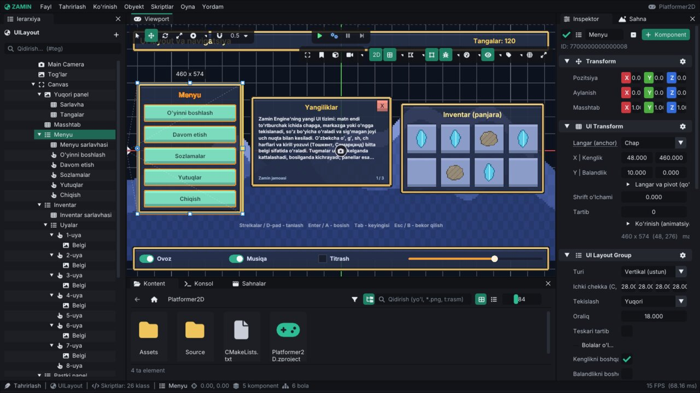

# Zamin Engine: screen UI (interface)

This guide explains the in-game screen interface: the UI hierarchy and anchors (the RectTransform model), the Canvas
that adapts to the screen, layout groups, widgets (button, image, slider, toggle, progress bar, input field), text
alignment and wrapping, mouse events, keyboard / gamepad navigation, UI animations, masks and scroll views, working
with UI in the editor and a pause menu sample — with C++ script examples.

The components' full fields: [Components.md](Components.md#8-ui-screen-interface). The examples assume
`#include <Zamin/Zamin.h>` and `using namespace Zamin;`.



*Platformer2D `Scenes/UILayout.zscene`: the rectangle gizmo of the selected `Menyu`, the UI Transform (anchor) and a
vertical UI Layout Group in the inspector; the top / bottom bars use a stretched anchor.*

Contents:

1. [Core concepts](#1-core-concepts)
2. [Quick start: a score and a pause button](#2-quick-start-a-score-and-a-pause-button)
3. [UI Transform: anchor, pivot, size](#3-ui-transform-anchor-pivot-size)
4. [UI Canvas: fitting the screen](#4-ui-canvas-fitting-the-screen)
5. [Layout groups](#5-layout-groups)
6. [Text](#6-text)
7. [Widgets](#7-widgets)
8. [Events: script callbacks and the event bus](#8-events-script-callbacks-and-the-event-bus)
9. [Keyboard and gamepad navigation](#9-keyboard-and-gamepad-navigation)
10. [UI animations](#10-ui-animations)
11. [UI Mask and Scroll View](#11-ui-mask-and-scroll-view)
12. [Pause and UI time](#12-pause-and-ui-time)
13. [UI in the editor](#13-ui-in-the-editor)
14. [Sample: a pause menu](#14-sample-a-pause-menu)
15. [Sample scenes](#15-sample-scenes)
16. [Common problems](#16-common-problems)
17. [Tests](#17-tests)
18. [Short API reference](#18-short-api-reference)

---

## 1. Core concepts

- **UI object** — an object with a `UITransformComponent` (**UI Transform**). It is drawn not in the world but **on the
  screen**, over the scene — the same in 2D and 3D scenes. A Sprite / Circle Renderer, Text and UI widgets on an object
  with a UI Transform are drawn on the screen; a Text without a UI Transform is text in the world.
- **Hierarchy** — a UI child of a UI object is placed relative to its parent's rectangle (UI under a plain object —
  relative to the whole screen). Children are drawn after (over) their parent, siblings in `Order`.
- **Units** — UI units. Without a Canvas 1 unit = 1 pixel; under a Canvas the UI is made for a reference size (for
  example 1920 x 1080) and scales with the screen ([section 4](#4-ui-canvas-fitting-the-screen)). `Position` is
  positive upward.
- **No camera needed** — the UI is drawn over the active scene's view (the game view).
- **UI time** — the UI (widgets, tweens, navigation) runs on real time: also while the game is paused
  ([section 12](#12-pause-and-ui-time)). In a frame the UI updates first (before the scripts' `OnUpdate`).
- An **inactive** UI object and its UI children are neither drawn nor clickable.

Ready-made elements: *Object > UI (screen)* — **Text**, **Image**, **Button**, **Slider**, **Toggle**,
**Progress bar**, **Input field**, **Canvas**, **Menu (vertical layout)**, **Scroll view (list)**. Right-click an
object in the hierarchy → **Create child object** → *UI (screen)* — the new element becomes that object's child.

---

## 2. Quick start: a score and a pause button

1. *Object > UI (screen) > Canvas* — a `Canvas` stretched over the whole screen (UI Transform + UI Canvas, reference
   1920 x 1080).
2. Right-click `Canvas` → *Create child object > UI (screen) > Text*. In the inspector: **Anchor** — top left,
   `Position` (40, -40), `Size` (400, 60), text "Coins: 0". Name it `ScoreText`.
3. Again *Create child object > UI (screen) > Button*: anchor — top right, `Position` (-140, -50), text "Pause". On the
   UI Button set **Message name** (`ClickMessage`) = `Pause` and leave **Receiver** empty — the message goes to every
   script (`Broadcast`).
4. A script on any object:

```cpp
class Hud : public ScriptableEntity
{
public:
    EntityRef ScoreText;

    void OnCreate() override
    {
        SetUpdateWhenPaused(true);                      // hear the button while paused too
        AddMessageHandler("Pause", [this](const ScriptMessage&) {
            if (IsGamePaused()) ResumeGame(); else PauseGame();
        });
        Subscribe("CoinCollected", [this](const ScriptMessage&) {
            m_Coins++;
            if (Entity text = Resolve(ScoreText); text && text.HasComponent<TextComponent>())
            {
                text.GetComponent<TextComponent>().Text = std::format("Coins: {}", m_Coins);
                GetScene().PunchUIScale(text, 0.2f, 0.3f);   // the score "jumps"
            }
        });
    }

private:
    int m_Coins = 0;
};
ZM_REGISTER_SCRIPT(Hud, ZM_FIELD(Hud, ScoreText))
```

Drag the `ScoreText` object from the hierarchy onto the `ScoreText` field and press ▶. When the screen size changes
(the Game view size: 16:9, 4:3, 1280x720 ...) the Canvas scales everything together and what is tied to the corners
stays in the corners. A complete working sample: [Tutorial-2D.md](Tutorial-2D.md) (`ScoreHud`).

---

## 3. UI Transform: anchor, pivot, size

The UI Transform (`UITransformComponent`) is a place inside the parent's rectangle:

| Field | Meaning |
|---|---|
| `AnchorMin`, `AnchorMax` (0 ... 1) | the anchor in the parent's rectangle: when equal — pinned to one point (9 ready-made points); when different — **stretched** with the parent along that axis (a top bar, a background) |
| `Pivot` (0 ... 1) | the reference point of its own rectangle (also the center of rotation / scale) |
| `Position` | from the anchor to the pivot, in UI units (+ upward) |
| `Size` | width / height; on a stretched axis the inspector shows the **Left \| Right** (or **Bottom \| Top**) edges |
| `FontSize` | the height of the text on this object (0 — the rectangle's height) |
| `Order` | the drawing order among siblings |
| `Scale`, `VisualOffset`, `Alpha` | **appearance** only: they do not change the layout; UI children grow / move / fade with it — the UI tweens change these |

When the anchor or pivot is changed in the inspector the object stays where it is (with `Shift` — it moves to the new
anchor).

From a script (`Scene`; the rectangle is a `UIRect`, in pixels, from the view's bottom-left corner, y upward):

```cpp
UIRect rect = GetScene().GetUIRect(panel);          // in UI units
UIRect screen = GetScene().GetUIScreenRect(panel);  // in screen pixels
UIRect parent = GetScene().GetUIParentRect(panel);
GetScene().SetUIRect(panel, UIRect::FromCenter({ 960.0f, 540.0f }, { 600.0f, 400.0f }));
GetScene().SetUIAnchors(panel, { 0.0f, 1.0f }, { 1.0f, 1.0f }, true);   // stretch along the top, stay in place
GetScene().SetUIPivot(panel, { 0.5f, 1.0f });
float scale = GetScene().GetUIScale(panel);          // screen pixels / UI unit
```

The UI under the mouse: `GetScene().GetHoveredUI()`, at a point: `GetScene().PickUI(point)`.

---

## 4. UI Canvas: fitting the screen

A **UI Canvas** (`UICanvasComponent`) scales the whole UI tree under it to fit the screen (of nested canvases only the
outermost counts):

| `ScaleMode` | What happens |
|---|---|
| `ScaleWithScreenSize` (default) | the UI is made for `ReferenceResolution` (1920 x 1080) and grows / shrinks with the screen. `MatchMode`: `MatchWidthOrHeight` — `MatchWidthOrHeight` 0 matches the width, 1 the height, 0.5 between the two (logarithmic); `Expand` — the UI always fits; `Shrink` — it always fills the screen |
| `ConstantPixelSize` | 1 UI unit = `ScaleFactor` pixels |

The current scale: `GetScene().GetUIScale(entity)` or the component's `CurrentScale`. Platformer2D
`Scenes/UILayout.zscene` keeps writing the screen size and the scale on the screen (`UILayoutDemo`).

**The player's UI size setting.** `Scene::SetUIScaleMultiplier(s)` (0.5..2, default 1) multiplies every UI Canvas
scale by `s` again (`SceneManager::SetUIScaleMultiplier` — for every scene and the ones loaded later). It is not saved
with the scene: the game stores the setting itself (for example in GameState) and applies it to each scene. Blueprint:
`Display.SetUIScale` (Scale 0.5..2 — a value outside is a graph error) and `Display.UIScale`. In the settings of both
vertical slices the *Interface size* slider (whole numbers 8..12 = 80..120 %, in steps of 10 %) works with these nodes
and the value is stored in `<Game>.Settings.UIScale`.

**UI audit (the scale gate).** `Scene::AuditUI(width, height, measureText)` lays the UI out for any view size without
drawing it (the scene's own view and layout do not change) and returns a record for every active element: the widget
type, its rectangle on the screen (px), the font size, how much room its text takes (with its font; otherwise the
default font's metrics are read without a GPU), whether it can be used, whether it is selected, where navigation leads
and which gameplay UI panel it is in (`Zamin/UI/UIAudit.h`; at most 4 096 elements). The rules of
`CheckUIAudit(report, rules)`: a usable widget is ≥ 8 px inside the view's edge (`Margin`), text does not leave the
screen (`Offscreen`), neighbouring widgets do not overlap (`Overlap`), text fits its place (`TextOverflow`;
Truncate/Ellipsis are exempt), the smallest text is 12 px at 800 x 600 and 14 px at 1024 x 768 and above (lowered in
proportion when the UI size is below 100 %; `MinFont`), with a panel open the selection is inside it (`Focus`) and every
widget of the panel can be reached with the keyboard (`Unreachable`), and only an element tied to that side enters the
outer 10 % of a 21:9 screen (`SideBand`). In the Player `ZAMIN_UI_AUDIT` ([Runtime.md](Runtime.md)) writes a `UI_AUDIT`
line whenever the panel changes.

---

## 5. Layout groups

A **UI Layout Group** (`UILayoutGroupComponent`) arranges its UI children in hierarchy order:

- `Type`: `Horizontal` (a row), `Vertical` (a column), `Grid` (a grid: `CellSize`, `GridSpacing`, `StartCorner`,
  `StartAxisVertical`, `Constraint` — `Flexible`, `FixedColumnCount`, `FixedRowCount` and `ConstraintCount`);
- `Padding` (inner margin), `Spacing` (gap), `ChildAlignment` (9 points), `ReverseArrangement` (reverse order);
- `ControlChildWidth` / `ControlChildHeight` — the group sets the children's size, `ChildForceExpandWidth` / `Height` —
  the spare room is shared out;
- **Fit width to content** / **Fit height to content** (`FitWidth` / `FitHeight`) — the group itself fits its children
  (a list that grows as elements are added).

Nested groups (a row inside a list) take their preferred size from their children. Inactive children are skipped.
A **UI Layout Element** (`UILayoutElementComponent`) says what a child asks for: `MinSize`, `PreferredSize`,
`FlexibleSize` (its share of the remaining room; -1 — not given), `IgnoreLayout` — the group leaves it where it is. An
object placed by a group cannot be moved by hand in the editor (`GetScene().IsUILayoutDriven(e)`).

*Object > UI (screen) > Menu (vertical layout)* — a panel with a vertical group and three buttons: add a button and the
panel grows by itself.

---

## 6. Text

The Text component (`TextComponent`) on a UI object is drawn inside the rectangle:

| Field | Meaning |
|---|---|
| `Text` | UTF-8 text (Latin, Cyrillic, `oʻ gʻ`) |
| `AlignH` (`Left`, `Center`, `Right`), `AlignV` (`Top`, `Middle`, `Bottom`, `Baseline`) | alignment |
| `WordWrap` | wrapping by words (an apostrophe stays inside its word; a long word is broken where it no longer fits and after a hyphen) |
| `Overflow` (`TextOverflow`): `Overflow` / `Truncate` / `Ellipsis` | what does not fit spills out / is cut off (whole characters and lines) / ends in an ellipsis (…) |
| `LineSpacing`, `Kerning` | line and letter spacing (em) |
| `Color`, `FontPath` | color, font (empty — the engine font) |
| `LocalizationKey` | text taken from the language files ([ProjectSettings.md](ProjectSettings.md#13-lokalizatsiya)) |
| `InputHints` (**Control hints** in the inspector) | `[Name]` in the text — an action / axis / vector of the project's input map — is shown with the buttons of the device the player is using |

The text height is the UI Transform's `FontSize` (0 — the rectangle's height). Fonts get a separate atlas for every
pixel size: small labels and large titles are both sharp; UI text is placed on whole pixels. The built atlases are
stored on disk (`~/.cache/zamin/FontAtlases`, `FontAtlasCache`; `ZAMIN_FONT_CACHE=0` — off): the next run reads the
font instead of rasterizing it. **Kerning** — the font's own letter pairs ("AV", "To", "Ye" closer together) — is off
by default (text is laid out as before); the **Kerning** checkbox in the font asset's inspector or
`"Import": { "Kerning": true }` in the `.zmeta` turns it on (`Font::SetKerningEnabled`, `Font::GetKerning`). Text in
the world (without a UI Transform) is aligned around the object's point and wrapped by `MaxWidth`. The layout
computation itself: `TextLayout::Layout(...)` (`Zamin/UI/TextLayout.h`, also for tests).

When the language changes, keyed texts update themselves; rewrite texts made by a script in `OnLanguageChanged`.

**Control hints.** In a text with `InputHints` on, `[Jump] - jump` shows as `Space - jump` with the keyboard and as
`A - jump` with a gamepad, and updates itself when the player switches devices (`Input::GetActiveDevice`). The bindings
come from Project settings → Input, so when a button is rebound the hint changes too. `[Look|Mouse]` — the text in the
brackets when the device has no binding, `[kb:...]` / `[pad:...]` — text only for the keyboard / gamepad. It works
together with a localization key (the template is in the language file); button names are adapted to the language with
`input.<id>` keys (`input.key.Arrows`: "arrows"). Details: [Scripting.md](Scripting.md#8-input). An example — the main
menu of the sample games:

```json
"menu": { "controls": "[Move] - move   ·   [Fire] - shoot   ·   [Pause] - pause" },
"input": { "key": { "Arrows": "arrows" }, "mouse": { "Left": "LMB" }, "stick": { "Left": "left stick" } }
```

---

## 7. Widgets

All of them are ready-made in *Object > UI (screen)* and available separately in *+ Component > Effects and UI*. A
widget is not clickable when `Interactable` is off or the object is inactive.

| Widget | Main fields | To the script | From code |
|---|---|---|---|
| **UI Button** (`UIButtonComponent`) | `NormalColor`, `HoverColor`, `PressedColor`, `Interactable`, `ClickMessage` (**Message name**), `ClickTarget` (**Receiver**); in play `Hovered`, `Pressed`, `Clicked` (one frame) | `OnClick()`, `"UIClick"`, the `ClickMessage` message | — |
| **UI Image** (`UIImageComponent`) | `TexturePath`, `SpriteName` (an atlas frame), `Color`, `Type`: `Simple` (`PreserveAspect`) / `Sliced` (9-slice, `SliceBorder`, `BorderScale`) / `Tiled` / `Filled` (`FillMethod`: `Horizontal`, `Vertical`, `Radial360`; `FillAmount` 0 ... 1), `RaycastTarget` (**Blocks the mouse**) | — | change `FillAmount` |
| **UI Slider** (`UISliderComponent`) | `MinValue`, `MaxValue`, `Value`, `WholeNumbers`, `Direction` (`UIDirection`), the track / fill / handle colors | `OnValueChanged(float)`, `"UISliderChanged"` | `GetScene().SetSliderValue(e, v, notify)` |
| **UI Toggle** (`UIToggleComponent`) | `Style` (`Checkbox` / `Switch`), `IsOn`, `Group` (radio buttons), `AllowSwitchOff`; its label is the object's Text | `OnToggleChanged(bool)`, `"UIToggleChanged"` | `GetScene().SetToggle(e, on, notify)` |
| **UI Progress Bar** (`UIProgressBarComponent`) | `Value` (0 ... 1), `Direction`, the background / fill colors, `UseLowColor` + `LowColor` (turns red when nearly empty), `SmoothSpeed`, `ShowPercentage` | — | change `Value` |
| **UI Input Field** (`UIInputFieldComponent`) | `Text`, `Placeholder`, `ContentType` (`UIContentType`: `Standard`, `Integer`, `Decimal`, `Alphanumeric`, `Password`), `CharacterLimit`, `ReadOnly` | `OnTextChanged`, `OnTextSubmit` (Enter), `OnTextEndEdit`; `"UITextChanged"`, `"UITextSubmitted"`, `"UITextEndEdit"` | `GetScene().FocusInputField(e)`, `GetFocusedInputField()` |

**Input field**: a click starts editing (the cursor goes where the mouse is); selection by dragging / `Shift` + arrow /
double-click, `Ctrl+A/C/X/V` (the system clipboard), `Home` / `End`, `Ctrl` + arrow / `Backspace` — by word, `Enter` —
submit, `Escape` — cancel (the previous text); a UTF-8 letter is one character; a password shows dots and is not copied
to the clipboard. In the editor you can type while the game view has focus (the editor shortcuts do not work then).
Lower level: `Input::GetTextInput()`, `Input::GetClipboardText()` / `SetClipboardText()`.

Working with widgets (Platformer2D `UIWidgetsDemo`, `Projects/Platformer2D/Source/UIWidgetsDemo.cpp`, shortened):

```cpp
void OnStart() override
{
    if (Entity field = Resolve(NameField))
        GetScene().FocusInputField(field);             // ready for typing at once

    Subscribe("UISliderChanged", [this](const ScriptMessage& m) {
        if (m.Sender == Resolve(MusicSlider))
            Audio::SetGroupVolume("Music", m.Get<float>());
    });
    Subscribe("UIToggleChanged", [this](const ScriptMessage& m) {
        if (m.Get<bool>())
            SetStatus(std::format("Selected: {}", m.Sender.GetName()));
    });
    Subscribe("UITextSubmitted", [this](const ScriptMessage& m) { Greet(m.Get<std::string>()); });
}

void OnUpdate(Timestep ts) override
{
    m_Time += ts;
    if (Entity bar = Resolve(Loading))
        if (auto* p = bar.TryGetComponent<UIProgressBarComponent>())
            p->Value = std::fmod(m_Time, LoadingSeconds + 1.0f) / LoadingSeconds;
    if (Entity icon = Resolve(Cooldown))                // a radial "cooldown" icon
        if (auto* image = icon.TryGetComponent<UIImageComponent>())
            image->FillAmount = std::min(1.0f, std::fmod(m_Time, CooldownSeconds + 0.5f) / CooldownSeconds);
}
```

---

## 8. Events: script callbacks and the event bus

The widget object's **own script** gets callbacks; **other scripts** listen on the scene's event bus (`Subscribe`, the
sender — `m.Sender`, the value — `m.Get<T>()`).

| Callback (in the widget's script) | Event bus | Payload |
|---|---|---|
| `OnPointerEnter(const UIPointerEvent&)` / `OnPointerExit` | `"UIPointerEnter"` / `"UIPointerExit"` | `UIPointerEvent` |
| `OnPointerDown` / `OnPointerUp` (`event.Inside` — whether it was released over the pressed object) / `OnPointerClick` | `"UIPointerDown"`, `"UIPointerUp"`, `"UIPointerClick"` | `UIPointerEvent` |
| `OnClick()` | `"UIClick"` | — |
| `OnSelect()` / `OnDeselect()` / `OnCancel()` | `"UISelected"`, `"UIDeselected"`, `"UICancel"` | — |
| `OnValueChanged(float)` | `"UISliderChanged"` | `float` |
| `OnToggleChanged(bool)` | `"UIToggleChanged"` | `bool` |
| `OnTextChanged` / `OnTextSubmit` / `OnTextEndEdit(const std::string&)` | `"UITextChanged"`, `"UITextSubmitted"`, `"UITextEndEdit"` | `std::string` |
| `OnScrollChanged(const glm::vec2&)` | `"UIScrollChanged"` | `glm::vec2` |

`UIPointerEvent`: `Target` (the widget under the mouse — for a parent's Enter / Exit, its child), `Position` (in UI
units), `ScreenPosition` (in pixels, from the bottom left), `Inside`. While the mouse is over a child, the parent UI
object gets Enter / Exit too.

**Button message** — wiring without code: when clicked, a UI Button's **Message name** (`ClickMessage`) is sent as a
script message of that name to the **Receiver** object (`ClickTarget`; empty — `Broadcast`, to every script).
Receiving it:

```cpp
AddMessageHandler("Resume", [this](const ScriptMessage&) { Close(); });     // Platformer2D PauseMenu
AddMessageHandler("Quit", [this](const ScriptMessage&) { QuitGame(); });
```

The message comes after `"UIClick"`. An inactive button cannot be clicked and gets no `OnClick`.

---

## 9. Keyboard and gamepad navigation

The selected widget is shown with a frame:

| Button | Action |
|---|---|
| Arrows / D-pad / left stick (repeats while held) | move to the nearest widget; on a horizontal slider left / right change the value |
| `Tab` / `Shift+Tab` | next / previous (entering an input field starts typing) |
| `Enter` / gamepad A | press (button, toggle, edit an input field) |
| `Esc` / gamepad B | `OnCancel()`, `"UICancel"` |

When nothing is selected the arrows belong to the game; a widget clicked with the mouse gets selected.

**UI Navigation** (`UINavigationComponent`) — where to go from a widget: `NavigationMode` — `Automatic` (the nearest
one in that direction), `Horizontal`, `Vertical`, `Explicit` (the `Up`, `Down`, `Left`, `Right` links), `None`;
`SelectOnEnable` (**Select when enabled** — the first button is selected when a menu opens), `ShowHighlight`,
`HighlightColor`.

From a script: `GetScene().SetSelectedUI(button)` (an empty `{}` clears the selection), `GetSelectedUI()`,
`NavigateUI(UINavDirection::Down)`, `SubmitUI()`, `CancelUI()`, `SetUINavigationEnabled(false)`. Navigation does not go
to a widget that is completely hidden (under a mask); a selected widget inside a scroll view scrolls into view by
itself.

Automated runs (player, headless): `ZAMIN_PLAYER_INPUT="10:Down;18:Enter;24:mouse=x,y"` — a frame number and an action
([Runtime.md](Runtime.md#14-environment-variables-for-automation)).

---

## 10. UI animations

**Tweens** smoothly change a UI Transform's appearance (scale — around the pivot, offset, opacity), its layout
(position, size) or an image's color. Appearance tweens do not disturb the layout, UI children change along with it,
and the mouse hits where the element is drawn (opacity 0 — not clickable). One tween per property (a new one replaces
the old one).

```cpp
UIScaleTo({ 1.2f, 1.2f }, 0.2f);                                   // this object; Ease::OutBack by default
UIFadeTo(0.0f, 0.3f, Ease::OutQuad, [this] { SetActive(false); });  // switched off when done
UIMoveTo({ 0.0f, 40.0f }, 0.4f);                                   // drawn 40 UI units higher
UIPunchScale(0.15f);                                               // a short "jump" (the score changed)
CancelUITweens();

// The full form: Scene::TweenUI - any object and property, with a loop and a start value.
GetScene().TweenUI(icon, UITweenProperty::Alpha, glm::vec4(0.3f), 0.6f,
                   { .Easing = Ease::InOutQuad, .Loop = UITweenLoop::PingPong, .Loops = 4 });
```

`UITweenProperty`: `Scale`, `Alpha`, `Offset`, `Position`, `Size`, `Color`. `UITweenOptions`: `Easing`, `Delay`,
`Loop` (`None`, `Loop`, `PingPong`), `Loops` (-1 — endless), `From`, `OnComplete`. Every function returns the tween's
ID (`Scene::CancelUITween(id)`).

The **UI Animation** component (`UIAnimationComponent`) — without code:

- `Show` — an appearance preset (`UIAnimPreset`) when it is enabled (also at the start of the game, `ShowAtStart`):
  `Fade`, `Pop` (growing in), `SlideLeft` / `SlideRight` / `SlideUp` / `SlideDown` (`SlideDistance`); `Duration`,
  `ShowDelay` (menu buttons that come in one after another), easing;
- `Hide` — plays when `HideUI(panel)` is called, then switches the object off;
- `HoverScale`, `PressScale` — a button / toggle / slider / input field grows when hovered and shrinks when pressed.

```cpp
ShowUI(Resolve(News));      // switched on and plays the Show animation
HideUI(Resolve(News));      // the Hide animation, then switched off (HideUI(panel, false) - at once)
```

---

## 11. UI Mask and Scroll View

**UI Mask** (`UIMaskComponent`) — the object's whole UI hierarchy is drawn only inside its rectangle, and the mouse
finds it only there (`Padding` — the edge moved inward / outward). A mask inside a mask — where the two intersect.
With **Show own image** (`ShowGraphic`) off the mask only clips. `GetScene().GetUIClipRect(e, rect)`.

**UI Scroll View** (`UIScrollViewComponent`) — the `Content` (for example a vertical layout group whose height fits
its rows) scrolls inside the view:

- the mouse **wheel** (`ScrollSensitivity`), **dragging** (even when it starts over a button — the button is then not
  clicked), **scrollbars** (`Scrollbars`: `Permanent`, `AutoHide`, `Hidden`; drag the handle, click the track);
- **inertia** (`Inertia`, `DecelerationRate`) and the edge behaviour `Movement`: `Elastic` (resists when pulled and
  springs back, `Elasticity`), `Clamped`, `Unrestricted`; `Horizontal` / `Vertical`;
- a widget selected with the keyboard / gamepad scrolls into view by itself.

State: `OnScrollChanged(pos)` and `"UIScrollChanged"` (x: 0 left ... 1 right, y: 1 top ... 0 bottom). From code:
`GetScene().GetScrollPosition(view)`, `SetScrollPosition(view, { 0.0f, 1.0f })` (to the top), `ScrollBy(view, delta)`,
`ScrollIntoView(widget)`, `GetScrollContent(view)`. Ready-made: *Object > UI (screen) > Scroll view (list)*.

---

## 12. Pause and UI time

The UI does not depend on game time: `PauseGame()` (time scale 0) stops physics, animation and scripts, but widgets, UI
tweens and navigation keep running. The script that opens / closes the pause menu calls `SetUpdateWhenPaused(true)` in
`OnCreate` — it then gets `OnUpdate` while paused too. To move a script's timers and tweens to real time:
`SetTimersUnscaled(true)`. The real frame time: `GetUnscaledDeltaTime()`.

Unpausing from the UI resumes the game from the next frame (the gamepad A that pressed the menu button does not also
become a jump in the game).

---

## 13. UI in the editor

- **Selecting**: in the viewport UI objects are picked by their rectangle (also at transparent spots), the one under the
  mouse is shown with a thin frame; *View > Pick UI elements (by their rectangle)* turns this off.
- **Rectangle gizmo** (the selected UI object): drag inside — move (snaps to the parent's edges / center), 8 handles —
  size (`Shift` — keep the ratio, `Alt` — around the center, snap / `Ctrl` — 10-unit steps), the pivot ring, the
  **anchors** in the parent's rectangle (triangles, draggable, snap to 0 / 0.5 / 1), a size label; `Esc` — cancel,
  `Ctrl+Z` — undo. An object placed by a layout group has no handles (its label says so).
- **Game view size** (the viewport toolbar during Play): 16:9, 4:3, 1920x1080 ... — try the Canvas on different
  screens.
- The **Animation window** can also animate UI properties (`UITransform.Position`, `Size`, `Scale`, `Alpha`,
  `UIImage.Color`) with a property clip ([Animation.md](Animation.md#2-property-kliplar-zanim)).
- Automation: `ZAMIN_EDITOR_UI_HOVER=right` — the gizmo handle looks as if it were under the mouse,
  `ZAMIN_EDITOR_UI_DRAG="bottom-right:60,-30"` — on frame 20 drags the selected UI object's handle by that many pixels
  (for screenshots, [Editor.md](Editor.md#15-automation-screenshots-ci)).

---

## 14. Sample: a pause menu

Platformer2D levels 1-3 (`Projects/Platformer2D/Source/PauseMenu.cpp`): `Esc` / gamepad Start — the game stops, the
menu (Resume / Settings / Quit) opens and the music is muffled. The settings are inside a scroll view: the sound group
sliders are wired to the mixer, fullscreen and VSync switches, gamma / brightness, a language button; all of it is
stored in SaveData. The main part:

```cpp
class PauseMenu : public ScriptableEntity
{
public:
    EntityRef Overlay, MainPanel, SettingsPanel, ResumeButton;

    void OnCreate() override { SetUpdateWhenPaused(true); }

    void OnStart() override
    {
        if (Entity overlay = Resolve(Overlay))
            overlay.SetActive(false);
        AddMessageHandler("Resume", [this](const ScriptMessage&) { Close(); });     // the buttons' Message name
        AddMessageHandler("Quit", [this](const ScriptMessage&) { Close(); QuitGame(); });
        Subscribe("UIToggleChanged", [this](const ScriptMessage& m) {
            if (m.Sender == Resolve(FullscreenToggle))
                Display::SetFullscreen(m.Get<bool>());
        });
    }

    void OnUpdate(Timestep) override
    {
        if (!Input::IsActionJustPressed("Pause"))   // Esc / Start (Project settings > Input)
            return;
        if (IsOpen()) Close(); else Open();
    }

    void OnDisable() override { if (IsOpen()) Close(); }    // do not leave the game paused

private:
    bool IsOpen() const
    {
        Entity overlay = Resolve(Overlay);
        return overlay && overlay.IsActive();
    }
    void Open()
    {
        PauseGame();
        if (Entity overlay = Resolve(Overlay))
            overlay.SetActive(true);                          // the UI Animation's Show plays
        if (Entity button = Resolve(ResumeButton))
            GetScene().SetSelectedUI(button);                 // the keyboard / gamepad start at "Resume"
    }
    void Close()
    {
        if (Entity overlay = Resolve(Overlay))
            overlay.SetActive(false);
        GetScene().SetSelectedUI({});
        ResumeGame();
    }
    EntityRef FullscreenToggle;
};
```

The main menu is a prefab built from the same widgets: Platformer2D `Prefabs/GameMenu.zprefab` (the `GameMenu` script,
`Scenes/Menu.zscene`). Sound sliders: [Audio.md](Audio.md#15-the-players-sound-settings).

---

## 15. Sample scenes

| Scene (Platformer2D) | What it shows | Script |
|---|---|---|
| `Scenes/UILayout.zscene` | Canvas scale, stretched panels, vertical / grid / horizontal groups, events, navigation, Show / Hide animations, `PunchUIScale`, text wrapping and ellipsis | `UILayoutDemo` |
| `Scenes/UIWidgets.zscene` | sliders, toggles (with a group), a progress bar, a radial fill, an input field, a button | `UIWidgetsDemo` |
| `Scenes/Level1.zscene` ... `Level3` | the HUD, the pause menu (scroll view, mask, sliders, switches) | `PauseMenu`, `GameManager` |
| `Scenes/Menu.zscene` | the main menu (the `GameMenu` prefab) | `GameMenu` |
| `Scenes/Loading.zscene` | the loading screen: a progress bar ([Scenes.md](Scenes.md#5-background-loading-and-the-loading-screen)) | `LoadingScreen` |

---

## 16. Common problems

| Symptom | Cause and fix |
|---|---|
| The UI does not show | The object has no UI Transform (it is drawn in the world), the object or a parent is inactive, `Alpha` is 0, or the rectangle is off the screen (anchor / `Position`) |
| The UI shifts when the screen size changes | No Canvas or a wrong anchor: a corner element to its corner, a panel with a stretched anchor |
| A button cannot be clicked | A UI Image with `RaycastTarget` above it (blocks), outside a mask, `Interactable` off, or the object is inactive |
| `OnClick` does not arrive but `"UIClick"` does | The script is on another object — `OnClick` goes only to the button object's own script; others use `Subscribe("UIClick", ...)` or the **Message name** |
| The menu script does not run while paused | Call `SetUpdateWhenPaused(true)` (in `OnCreate`) |
| The arrows also move the game's hero | Select a widget with `SetSelectedUI` when the menu opens (navigation takes the buttons) or check `IsGamePaused()` in the game script |
| An object in a layout group cannot be moved | The group places it — `IgnoreLayout` on its `UILayoutElement`, or the group's settings |
| Text is blurry or spills over the edge | Give a `FontSize`, choose `WordWrap` / `Overflow` |

---

## 17. Tests

```bash
./build/bin/ZaminTests "UI*:TextLayout*:TextEdit*:FontAtlas*"
```

The main ones: `UIRectLayoutMath`, `UIHierarchyLayout`, `UICanvasScaleMath`, `UICanvasScalesTheUI`,
`UILayoutGroupMath`, `UILayoutGroupsInTheScene`, `UIPointerEventsReachScripts`, `UIKeyboardAndGamepadNavigation`,
`UINavigationIntoInputFields`, `UISliderDragging`, `UIToggleClicksAndGroups`, `UIImageBlocksTheMouse`,
`UIInputFieldEditing`, `TextEditUTF8`, `TextLayoutWordWrap`, `TextLayoutOverflowModes`, `UITweensRunOnUITime`,
`UIAnimationShowHideAndFeedback`, `UIMaskClipsDrawingAndPicking`, `UIScrollViewDragging`,
`UIScrollViewScrollbarAndNavigation`, `UIWidgetsSampleScene`, `UILayoutSampleScene`. UI audit:
`UIAuditRulesNameEachLayoutDefect`, `UIAuditLaysOutAtAnyViewSizeAndKeepsTheScenesOwn`, `SliceMenuLayout*` (every
screen of the vertical slices at 6 sizes x 3 UI scales) and the Player gate `Tests/slice_ui_test.py`
([VerticalSlices.md](VerticalSlices.md#gates)). Catalog: [Testing.md](Testing.md).

---

## 18. Short API reference

| What | API |
|---|---|
| Components | `UITransformComponent`, `UICanvasComponent`, `UILayoutGroupComponent`, `UILayoutElementComponent`, `UINavigationComponent`, `UIAnimationComponent`, `UIButtonComponent`, `UIImageComponent`, `UISliderComponent`, `UIToggleComponent`, `UIProgressBarComponent`, `UIInputFieldComponent`, `UIMaskComponent`, `UIScrollViewComponent`, `TextComponent` |
| Layout | `Scene::GetUIRect`, `GetUIScreenRect`, `GetUIParentRect`, `SetUIRect`, `SetUIAnchors`, `SetUIPivot`, `GetUIScale`, `IsUILayoutDriven`, `PickUI`, `GetHoveredUI`; `UIRect` |
| Callbacks | `OnClick`, `OnPointerEnter`, `OnPointerExit`, `OnPointerDown`, `OnPointerUp`, `OnPointerClick` (`UIPointerEvent`), `OnSelect`, `OnDeselect`, `OnCancel`, `OnValueChanged`, `OnToggleChanged`, `OnTextChanged`, `OnTextSubmit`, `OnTextEndEdit`, `OnScrollChanged` |
| Event bus | `"UIClick"`, `"UIPointerEnter"` ... `"UIPointerClick"`, `"UISelected"`, `"UIDeselected"`, `"UICancel"`, `"UISliderChanged"`, `"UIToggleChanged"`, `"UITextChanged"`, `"UITextSubmitted"`, `"UITextEndEdit"`, `"UIScrollChanged"` |
| Widgets (code) | `Scene::SetSliderValue`, `SetToggle`, `FocusInputField`, `GetFocusedInputField` |
| Navigation | `Scene::SetSelectedUI`, `GetSelectedUI`, `NavigateUI` (`UINavDirection`), `SubmitUI`, `CancelUI`, `SetUINavigationEnabled` |
| Animation | `UIScaleTo`, `UIFadeTo`, `UIMoveTo`, `UIPunchScale`, `TweenUI`, `CancelUITweens`, `ShowUI`, `HideUI`; `Scene::TweenUI` (`UITweenProperty`, `UITweenOptions`, `UITweenLoop`), `PunchUIScale`, `CancelUITween`, `IsUITweening` |
| Scroll / mask | `Scene::GetScrollPosition`, `SetScrollPosition`, `ScrollBy`, `ScrollIntoView`, `GetScrollContent`, `GetUIClipRect` |
| Text | `TextComponent` (`AlignH`, `AlignV`, `WordWrap`, `Overflow`, `LineSpacing`, `LocalizationKey`, `InputHints`), `TextLayout::Layout`, `Input::ExpandBindings` |
| Text input | `Input::GetTextInput`, `Input::GetClipboardText`, `Input::SetClipboardText` |
| Time | `PauseGame`, `ResumeGame`, `IsGamePaused`, `SetUpdateWhenPaused`, `SetTimersUnscaled`, `GetUnscaledDeltaTime` |
